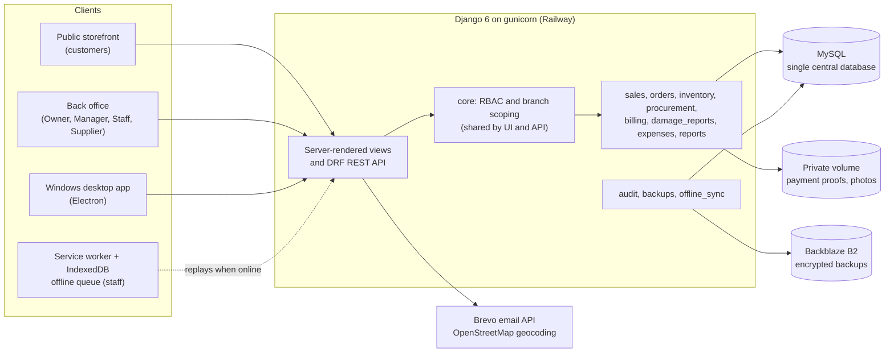
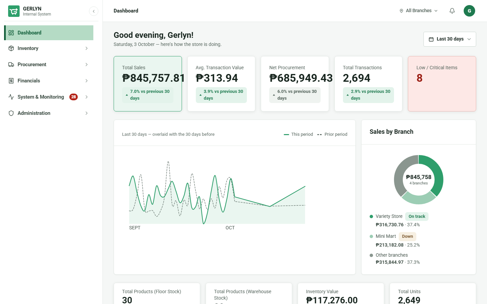
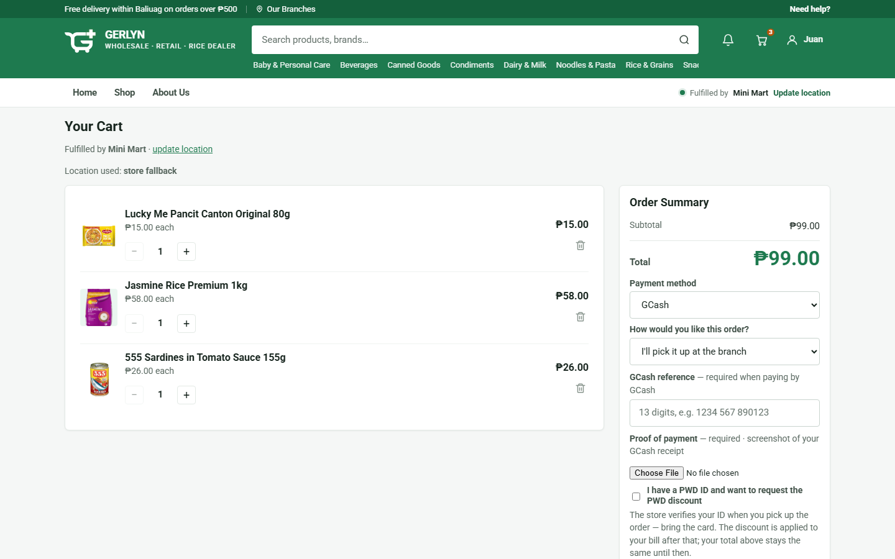
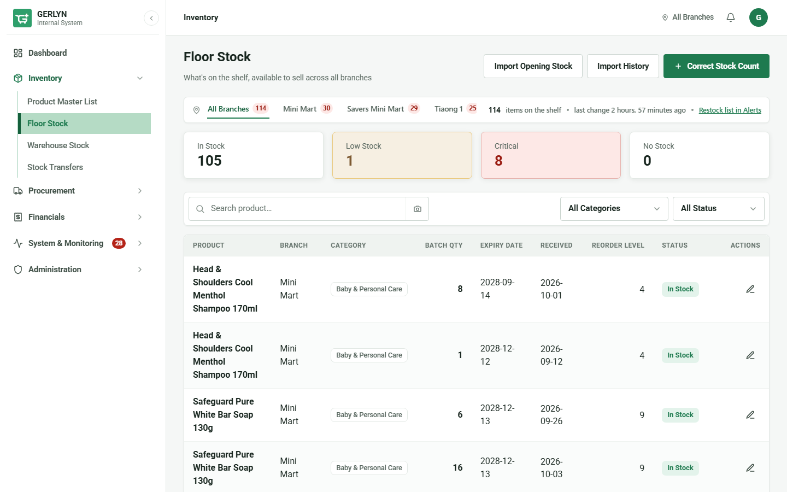
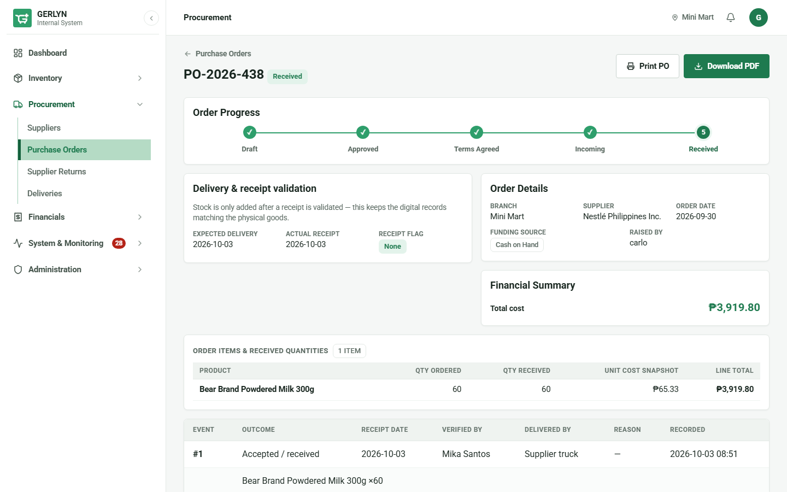
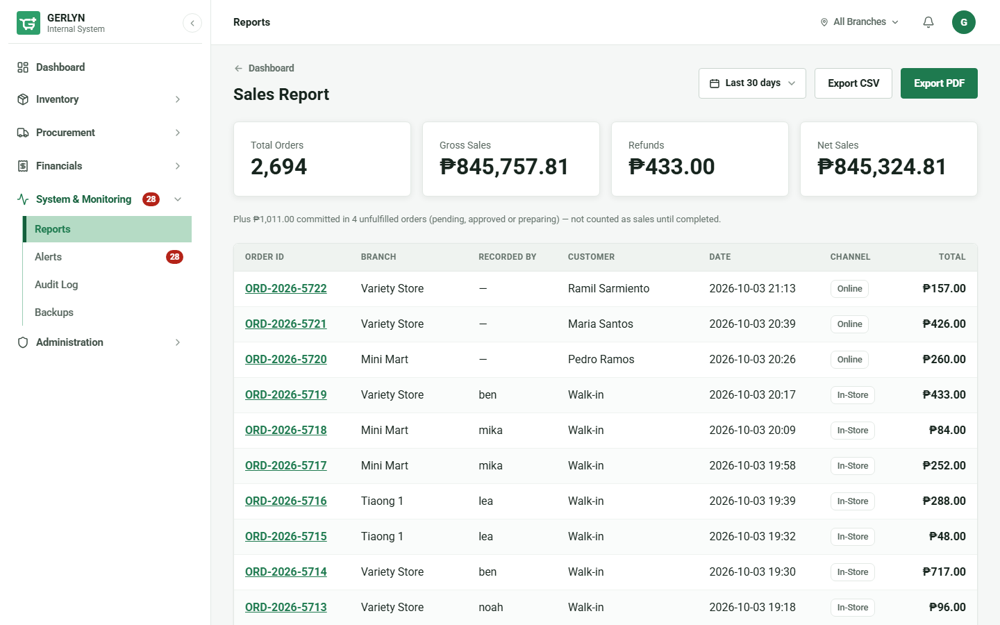
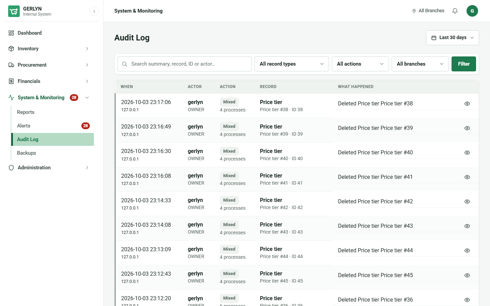

<div align="center">

# GerlynPLUS

**One system of record for a multi-branch retail business: sales, inventory, procurement, billing and reporting on a single shared database.**


<!-- When CI runs the test suite, replace the tests badge with a GitHub Actions status badge. -->

[**Live demo**](https://gerlynplus.up.railway.app) · [Screenshots](#system-preview) · [Architecture](#tech-stack--architecture) · [Quick start](#getting-started)

</div>

---

## About the project

**GerlynPLUS** (*Process-Linked Unified Systems Enterprise*) is an information system for GERLYN, a multi-branch retail enterprise in Baliuag, Bulacan. It is the capstone project of a six-member team at the Bulacan State University College of ICT (BS Information Systems).

**The problem.** Each branch kept its own records, so nobody could answer basic questions across the business: what is in stock where, what has been ordered and actually received, what sold, and whether a branch made a profit.

**The solution.** Using Business Process Reengineering, we mapped the as-is processes and rebuilt five of them (Sales & Orders, Inventory, Procurement, Billing, Reporting) as one web system. Every branch reads and writes the same data. Access is controlled by role and branch, and every stock and money movement leaves a trace.

---

## Key features & modules

| Module | What it does |
|---|---|
| **Sales & storefront** | Walk-in POS and a public online storefront (catalog, cart, checkout). Online orders move through Pending → Approved → Preparing → Completed, and are completed only by a recorded hand-over (receiver, time, photo, drawn signature, PDF receipt). Includes senior/PWD discounts, an approval-based refund workflow, and import of POS daily-sales exports (CSV/Excel). |
| **Inventory** | Product master list, per-branch floor stock and warehouse stock, **FEFO batch/expiry tracking**, warehouse-to-floor transfers, withdrawal slips, low-stock alerts, and damaged-product reports with photo evidence and manager approval. |
| **Procurement** | Suppliers, purchase orders and deliveries. **Stock is added only when a delivery receipt is validated.** Includes supplier returns, overdue-delivery escalation, and an optional supplier portal. |
| **Billing** | One billing record per sale, with payment method, GCash reference and proof upload, and payment verification. Payments are *recorded*, not processed (see [limitations](#scope--limitations)). |
| **Reports & profitability** | Dashboard plus Sales, Inventory, Procurement, Billing and Profitability reports (net sales − cost of goods − expenses), exportable as CSV, PDF or Excel, consolidated or per branch. |
| **Delivery coverage** | Per-branch delivery areas (province / municipality / barangay, most-specific entry wins) enforced at checkout *and* in the API, with a staff override that requires a reason. |

**Platform capabilities**

- **Role-based access** for five roles (Owner, Branch Manager, Staff, Supplier, Customer), plus per-user View/Add/Edit/Delete grants per module.
- **Append-only audit log** of every create, edit and delete, enforced in the app and by MySQL triggers.
- **Encrypted off-site backups** to Backblaze B2 with an automated restore check.
- **Offline mode** for staff: sales and stock entries queue in the browser and sync safely when the connection returns.
- **Windows desktop app** (Electron) that wraps the same system.

---

## Tech stack & architecture



| Layer | Choice | Why |
|---|---|---|
| Backend | Python 3.13, Django 6, Django REST Framework | The ORM, auth and migrations suit a transactional, data-heavy system. The REST API is kept and enforces the same branch scoping as the pages. |
| Database | MySQL (PyMySQL driver) | One centralized database is the point of the project, and MySQL was specified in the approved study. Connection reuse with health checks; DB-level triggers protect the audit table. |
| Frontend | Django templates, vanilla JS, a hand-built CSS design system | No JS build step. A React SPA was built in parallel and compared side by side; templates won on evidence (see below). |
| Offline | Service worker + IndexedDB | A queue, not a second copy of the system: nothing counts as saved until the server confirms it. |
| Exports | xhtml2pdf, openpyxl | PDF and Excel reports, each opening with a summary. |
| Infrastructure | Railway (Nixpacks, gunicorn, health check), WhiteNoise, Backblaze B2, Brevo | Railway blocks outbound SMTP, so email goes over Brevo's HTTPS API. Optional Redis cache, Sentry and Cloudinary are enabled by environment variables only. |
| Desktop | Electron, GitHub Actions build | Installable Windows client, with the same sign-in and permissions. |

### Engineering decisions

- **Frontend chosen on evidence, not preference.** We built a React/Vite SPA and the template UI in parallel and tested both. The SPA lacked withdrawal slips, CSV export and order filters, had no tests, and mislabelled customers on walk-in sales. It is preserved on the `frontend-react` branch.
- **Branch scoping fails closed.** One helper (`core/scoping.py`) serves both the pages and the API. An account with no branch sees nothing, not everything. Regression tests are written to fail if the fix is reverted.
- **Stock moves exactly once, and is ledgered.** Every change writes a `StockMovement` row (before/after quantity, reason, who). Deliveries add stock only at validated receipt, and refund approval runs in one locked transaction.
- **Offline sync is idempotent.** Each queued change carries an operation ID, and the server replays the *real* view as the same user, so validation, pricing and permissions are identical to online. A change shows as Synced only after its effect is read back from the database.
- **Profit is not rewritten by later price changes.** Each sale line freezes its `unit_cost` when stock leaves the shelf.
- **One definition per rule.** Input limits (`core/limits.py`) are enforced in the HTML, the view, the model and the serializer. Delivery coverage (`branches/coverage.py`) is checked by both the checkout page and the API.
- **Security basics.** Login lockout, 30-minute idle timeout, two-factor sign-in, private file serving through authorized views, `no-store` caching on authenticated responses, and the app refuses to start in production with the default secret key.
- **Tested.** 2,848 automated tests across the apps, plus Node tests for the offline sync logic.

<details>
<summary><b>Project layout (14 Django apps)</b></summary>

| App | Responsibility |
|---|---|
| `core` | Shared RBAC, module permissions, branch scoping, input limits, pagination, notifications |
| `accounts` | Custom user model, role profiles, authentication, sessions |
| `branches` | Branch management and delivery coverage |
| `inventory` | Products, stock, FEFO batches, transfers, withdrawal slips, alerts |
| `sales` · `orders` | Order console and POS · customer storefront, cart, checkout |
| `billing` · `expenses` | Billing and payment verification · operating expenses |
| `procurement` | Suppliers, purchase orders, deliveries, returns |
| `damage_reports` | Damage reports with private photo evidence and approval |
| `reports` | Dashboard, reports, CSV/PDF/Excel exports, profitability |
| `audit` · `backups` · `offline_sync` | Audit log · encrypted backups · offline queue ledger |

</details>

---

## System preview

| Owner dashboard | Storefront cart and checkout |
|---|---|
|  |  |

| Floor stock and FEFO batches | Purchase order and delivery receiving |
|---|---|
|  |  |

| Sales report with CSV and PDF export | Audit log |
|---|---|
|  |  |

---

## Getting started

**Prerequisites:** Python 3.13, MySQL 8+, Git.

```bash
# 1. Get the code and install dependencies
git clone https://github.com/agultorannahvheaangeliquebsis-oss/Gerlyn-Capstone.git
cd Gerlyn-Capstone
python -m venv .venv
source .venv/bin/activate          # Windows: .venv\Scripts\activate
pip install -r requirements.txt
```

```sql
-- 2. Create the database and an app user (run in the MySQL shell)
CREATE DATABASE gerlyn_db CHARACTER SET utf8mb4;
CREATE USER 'gerlyn_app'@'localhost' IDENTIFIED BY 'choose-a-password';
GRANT ALL PRIVILEGES ON `gerlyn_db`.*      TO 'gerlyn_app'@'localhost';
GRANT ALL PRIVILEGES ON `test_gerlyn_db`.* TO 'gerlyn_app'@'localhost';
```

```bash
# 3. Configure, build the schema, load demo data, run
cp .env.example .env               # set DJANGO_SECRET_KEY and DB_PASSWORD
python manage.py migrate
python manage.py seed_demo --reset # 3 branches, 15 products, suppliers, POs, orders
python manage.py runserver localhost:8000
```

Open <http://localhost:8000/> for the storefront, or `/login/` for the internal system. Sign in as the seeded Owner `gerlyn` with password `demo1234` (local demo data only).

**Run the tests**

```bash
python manage.py collectstatic --noinput   # the test run reads the static manifest
python manage.py test core                 # fast acceptance suite
python manage.py test                      # full suite (takes several minutes)
```

For the 104-product, four-branch trading history, email and geocoding setup, backups, offline mode and deployment, see the **[Operations & Deployment Guide](docs/OPERATIONS.md)**.

---

## Scope & limitations

GerlynPLUS is a back-office layer, not a replacement for store hardware. By design it has no online payment gateway (payments are recorded, not processed), no courier or logistics integration, no HR or payroll functions, no integration with external accounting systems, and it does not replace the existing POS hardware.

## Further reading

[Operations & Deployment Guide](docs/OPERATIONS.md) · [Project log and testing guide](PROJECT-LOG.md) · [Metric definitions](docs/METRICS.md) · [Design notes](docs/DESIGN.md) · [Backup and restore runbook](docs/backup-and-restore.md) · [Security audit](docs/security-audit-report.md)
