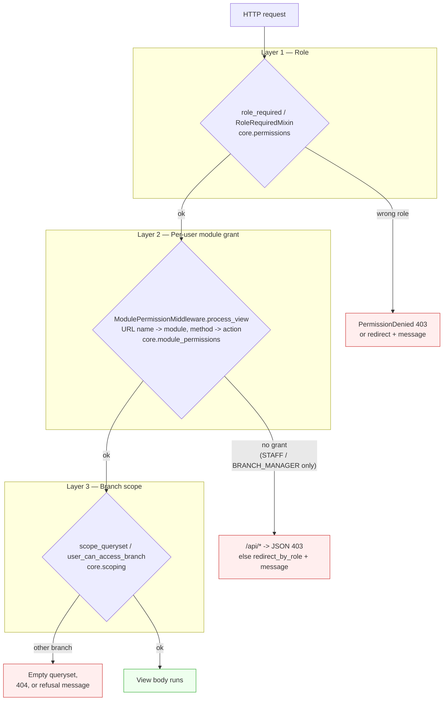
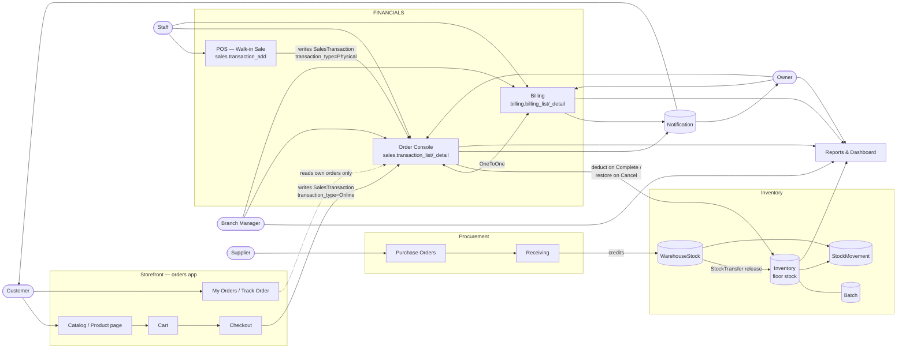
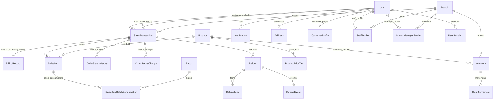

# 00 — System Overview

> **What this folder is.** A code-verified map of how data actually moves through
> GerlynPLUS, written for a live final defense. Everything here was read out of
> the source tree; nothing is assumed. Where behaviour could not be verified, it
> is marked **UNVERIFIED**. Where the code is wrong, it is in
> [`07-audit-findings.md`](07-audit-findings.md), not quietly smoothed over.

## Read these in order

| File | Covers |
|---|---|
| `00-system-overview.md` | This file — modules, roles, the three access checks, the model map |
| `01-sales-and-orders.md` | POS walk-in sales, the order lifecycle, status transitions |
| `02-billing-and-payments.md` | Billing records, payment methods, verification, refunds |
| `03-storefront-online-ordering.md` | Browsing, location, cart, checkout, My Orders |
| `04-inventory-and-cross-module-flow.md` | Stock in/out, batches, movements, reporting |
| `08-user-accounts-and-authentication.md` | Registration, login, sessions, roles, privacy |
| `09-locations-and-branch-navigation.md` | Branches, branch context, scoping, isolation |
| `10-notifications-and-customer-dashboard.md` | Every notification trigger; the customer nav audit |
| `11-integrated-system-data-flow.md` | One end-to-end flow + every exception path |
| `05-live-defense-script.md` | The presenter script and demo sequence |
| `06-panel-questions-and-answers.md` | Likely panel questions, code-verified answers |
| `07-audit-findings.md` | Verified correct / needs testing / confirmed defects |

---

## 1. What the system is

GerlynPLUS is a **Django 6 + MySQL** information system for a multi-branch
variety store. The main UI is server-rendered Django templates. A same-origin
Django REST Framework API is retained under `/api/`, and for the flows in this
audit it **mirrors** the template views rather than replacing them — the same
permission, scoping, and state-transition rules are re-applied on both paths.

One limitation shapes the whole Billing module and must be said out loud during
the defense: **there is no payment gateway.** Payments are *recorded and
verified by staff*, never processed. This is stated in the code itself
(`billing/models.py`, `BillingRecord.PaymentMethod.COD`: *"Recorded only — funds
move outside the system (Chapter 1, Limitation 1)"*).

## 2. Applications and what each owns

| App | Owns |
|---|---|
| `core` | Permissions, branch scoping, module permissions, notification fan-out, store settings, pagination |
| `accounts` | Custom `User` model, the five role profiles, auth, sessions, addresses, notifications inbox |
| `branches` | `Branch` records (Owner-only administration) |
| `inventory` | `Product`, `ProductCategory`, `ProductPriceTier`, `Inventory` (floor), `WarehouseStock`, `Batch`, `StockTransfer`, `StockMovement` |
| `sales` | `SalesTransaction`, `SalesItem`, `Refund`, order lifecycle, POS, pricing |
| `orders` | The **customer storefront** — catalog, cart, checkout, My Orders. *Has no models of its own; it writes `sales` models.* |
| `billing` | `BillingRecord`, payment verification |
| `procurement` | Suppliers, purchase orders, deliveries, receiving, supplier returns |
| `reports` | Dashboards, the four report pages, CSV export |
| `audit`, `backups` | Change capture and backup monitoring |

**The single most important structural fact for the defense:** the storefront
(`orders`) has **no order model of its own**. `orders/` contains no `models.py`.
A customer checkout writes the *same* `sales.SalesTransaction` and
`sales.SalesItem` rows that the POS writes. That is why an online order appears
in the staff Order Console with no synchronisation step — there is only ever one
record.

## 3. The five roles

From `accounts.models.User.Role`:

| Role | Branch reach | In this audit |
|---|---|---|
| `OWNER` | **All** branches | Sees everything; sole authority for voiding completed sales, refund decisions, branch and user administration |
| `BRANCH_MANAGER` | Own assigned branch only | Order console, billing verification, reports for their branch |
| `STAFF` | Own assigned branch only | POS, billing, deliveries. **No reports.** |
| `SUPPLIER` | No back-office branch access | Own purchase orders / deliveries only |
| `CUSTOMER` | No back-office branch access | Storefront, own orders, own billing read-only |

## 4. The three independent access checks

This is the part panels probe hardest. Authorization is **three separate layers**
and all three run server-side. UI visibility is never the boundary.



**Plain English.** First: *is your role allowed on this page at all?* Second:
*has the Owner granted your specific account this module, and this action
(View/Add/Edit/Delete) inside it?* Third: *does this particular record belong to
a branch you may touch?* A request has to pass all three.

Three details worth knowing precisely:

- **Layer 2 only restricts `STAFF` and `BRANCH_MANAGER`.** `ModulePermissionMiddleware`
  returns early for every other role, and `user_can_perform_module_action`
  returns `True` for Owner/Supplier/Customer. The one exception is the `reports`
  module, which is capped to `REPORT_ROLES = ('OWNER', 'BRANCH_MANAGER')`
  regardless of any grant.
- **Every write action also requires View** on the same module
  (`user_can_perform_module_action` checks `allowed_modules` before
  `module_actions`), so switching a module off closes its write URLs too.
- **Layer 3 fails closed.** `branch_ids_for_user` returns `None` for the Owner
  ("no filter") but `[]` for a Manager/Staff whose branch profile is null — so an
  unassigned account sees **nothing**, not everything. `core/scoping.py` carries
  an explicit warning against the `if user_branch:` idiom that would fail open.

## 5. Context diagram — external entities and module connections



**Plain English.** Two doors lead into Financials: a customer checking out
online, and a staff member ringing up a walk-in sale at the POS. Both write the
same kind of order record. Every order gets exactly one billing record
automatically. Stock leaves the floor at different moments depending on which
door the order came through. Reports read the finished orders, and notifications
go out to whoever needs to act.

## 6. Database model map — the records this audit traces



### The one-to-one that matters most

`BillingRecord.transaction` is a **`OneToOneField`** with
`related_name='billing_record'` (`billing/models.py`). One order, at most one
billing record, enforced at the database level by a unique constraint. This is
the structural answer to *"could you create duplicate billing for one order?"* —
no, the schema forbids it.

## 7. Three different "done" — do not conflate these

The panel will likely test whether the group understands this. The code keeps
them strictly separate:

| Concept | Field | Set by | Means |
|---|---|---|---|
| **Order completed** | `SalesTransaction.order_status = 'Completed'` | `sales.views.transaction_set_status`, or at creation for a Cash walk-in | The goods were handed over. Stock has moved. |
| **Payment paid** | `BillingRecord.status = 'Paid'` | `billing.views.billing_confirm` / `BillingConfirmAPIView` | A named person verified the money arrived. |
| **Sale recorded** | A `SalesTransaction` row exists | `transaction_add` / `checkout` | Nothing more than "this order was placed". |

The **enforced dependency runs one way**: an order cannot become `Completed`
until its billing record is already `Paid`. From `transaction_set_status`:

```
if new_status == COMPLETED:
    paying = BillingRecord.objects.select_for_update().filter(transaction=locked_txn).first()
    if not paying or paying.status != PAID:
        raise _OrderActionError('... can only be completed once its payment is verified as Paid ...')
```

The reverse is **not** true: marking a payment `Paid` does *not* complete the
order. Someone still has to press Mark Completed. And a Cash walk-in is created
`Completed` **and** `Paid` in the same atomic block (`transaction_add`), because
the money crossed the counter at the moment of sale — that is the one case where
the two coincide, and it is deliberate.

## 8. Status vocabularies (exact values)

Use these exact strings in the defense; they are `TextChoices` values, not labels.

**`SalesTransaction.order_status`** — `Pending`, `Approved`, `Preparing`,
`Completed`, `Cancelled`

**`SalesTransaction.transaction_type`** (the channel) — `Online`, `Physical`

**`SalesTransaction.fulfillment_type`** — `Delivery`, `Pickup`

**`SalesTransaction.mode_of_payment`** — `Cash`, `GCash`, `Card`, `Maya`,
`QR Ph`, `Charge Sale`, `Cash on Delivery`, `Pay at Store`

**`BillingRecord.status`** — `Pending`, `Paid`, `Rejected`, `Cancelled`,
`Partially Refunded`, `Refunded`

**`BillingRecord.payment_method`** — the eight above plus `Bank Transfer`

**`SalesTransaction.pwd_request_status`** — `None`, `Pending`, `Approved`,
`Rejected`

**`Refund.status`** — `Pending`, `Approved`, `Rejected`

## 9. Entry-point inventory (URL → view)

| URL | View | Who |
|---|---|---|
| `/` | `accounts.views.home_view` | Public (internal roles redirected to their dashboard) |
| `/shop/` | `orders.customer_views.product_catalog` | Public |
| `/shop/product/<id>/` | `product_detail` | Public |
| `/shop/branch/` | `select_branch` | Public |
| `/shop/add/<id>/` | `add_to_cart` | `@customer_required` |
| `/shop/cart/` | `view_cart` | `@customer_required` |
| `/shop/checkout/` | `checkout` | `@customer_required`, POST only |
| `/shop/orders/` | `my_orders` | `@customer_required` |
| `/shop/orders/<id>/` | `track_order` | `@customer_required`, own order only |
| `/sales/` | `transaction_list` | Internal + `sales_pos` View |
| `/sales/add/` | `transaction_add` | Owner / Manager / Staff + `sales_pos` Add |
| `/sales/<pk>/` | `transaction_detail` | Internal only + branch scope |
| `/sales/<pk>/status/<new_status>/` | `transaction_set_status` | Internal + branch, **or** the order's own customer cancelling |
| `/billing/` | `billing_list` | Owner / Manager / Staff + `billing` View |
| `/billing/<pk>/` | `billing_detail` | same |
| `/billing/create/<txn_id>/` | `billing_create` | same + `billing` Edit |
| `/billing/<pk>/confirm/` | `billing_confirm` | same + `billing` Edit |
| `/billing/<pk>/payment-proof/` | `payment_proof_download` | Authorization-checked (deliberately **not** served from `/media/`) |
| `/branches/` | `branch_list` | **Owner only** |
| `/reports/...` | `reports.views.*` | `@management_report_required` — Owner / Manager only |
| `/internal/notifications/` | `core.views.notification_center_view` | Internal roles |
| `/notifications/` | `accounts.views.notifications_view` | Any authenticated (Supplier redirected) |

## 10. Scope note

This folder covers **Financials (Sales & Orders, Billing)**, the **Storefront**,
and the account / branch / notification workflows that feed them. Procurement and
Inventory appear where they touch those flows — receiving, transfers, stock
movements — but the full procurement lifecycle (supplier offers, purchase-order
negotiation, supplier returns) is out of scope and is not documented here.
