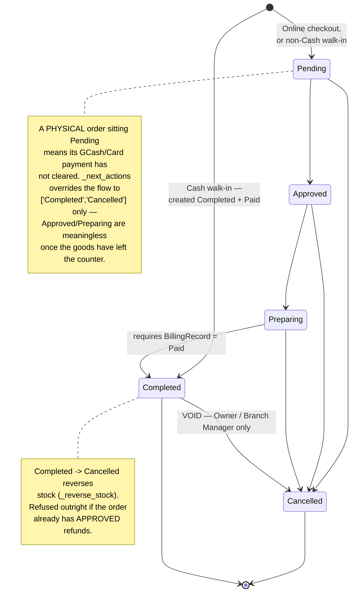
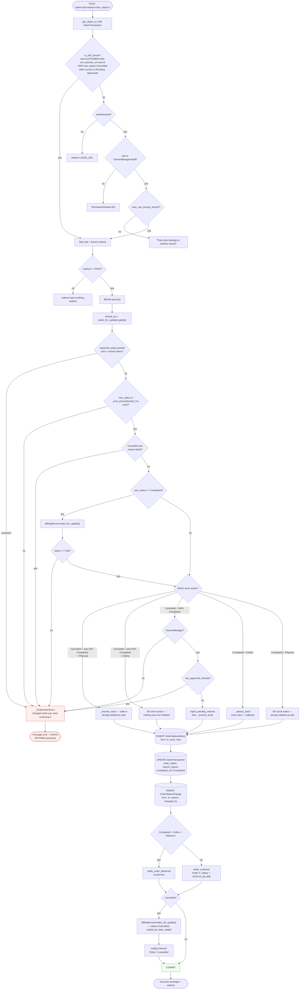
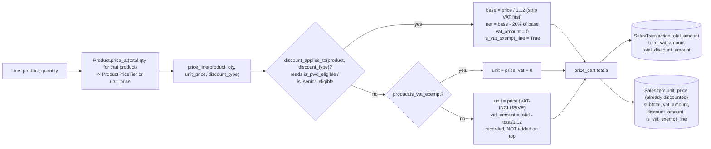
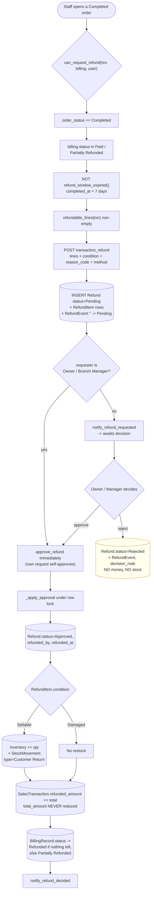

# 01 — Sales & Orders

Covers the two ways an order is born, the lifecycle it then follows, and exactly
where stock moves. Verified against `sales/views.py`, `sales/models.py`,
`sales/pricing.py`, `orders/customer_views.py`.

---

## 1. The two channels, side by side

Both write `SalesTransaction` + `SalesItem`. The differences are precise and
small, and they are the thing to have memorised.

| | **POS walk-in** (`transaction_type='Physical'`) | **Online order** (`transaction_type='Online'`) |
|---|---|---|
| Written by | `sales.views.transaction_add` | `orders.customer_views.checkout` |
| Actor | Staff / Manager / Owner at the counter | The customer themselves |
| `staff` field | The user **only if** their role is `STAFF` (the FK has `limit_choices_to={'role':'STAFF'}`) | `None` |
| `recorded_by` field | **Always** the operating user, any internal role | `None` — no staff operator |
| `customer` field | `None` (no account at the counter) | `request.user` |
| Branch | Pinned branch for Staff/Manager; Owner picks one on the form | Resolved automatically by `orders.services.resolve_nearest_branch` |
| Payment methods offered | `POS_PAYMENT_METHODS = ['Cash', 'GCash', 'Card']` | `Cash on Delivery`, `Pay at Store`, `GCash` |
| Starting `order_status` | `Completed` if Cash, else `Pending` | **Always** `Pending` |
| PWD/Senior discount | Staff may claim it at the counter | **Never applied at checkout.** Customer may only *request* it (Pickup only) |
| **Stock deducted** | **At creation**, inside the same atomic block | **Only when marked `Completed`** |
| `fulfillment_type` | Always `Pickup` (handed over at the counter) | Explicit, required: `Delivery` or `Pickup` |
| `pos_invoice_number` | Optional receipt reference, unique per branch | `None` |

**Why stock timing differs — say this exactly.** A walk-in customer carries the
goods out at the moment of sale, so the shelf must be debited immediately, even
while a GCash payment is still unverified. An online order has not been handed
to anybody yet; its stock stays on the shelf and is only debited when staff mark
it `Completed`. This is what makes stock **exactly-once**: the two paths never
both fire for the same order, because `_deduct_stock` is called from
`transaction_add` for `Physical` and from `transaction_set_status` **guarded by
`transaction_type == ONLINE`**.

---

## 2. POS walk-in sale — full flow

```mermaid
flowchart TD
    A(["Staff opens /sales/add/"]) --> B["transaction_add GET<br/>_pos_context builds the form"]
    B --> B1{"Role in<br/>Owner/Manager/Staff?"}
    B1 -- no --> BX["message + redirect<br/>transaction_list"]
    B1 -- yes --> B2{"_pos_user_branch"}
    B2 -- "POS_BRANCH_UNASSIGNED" --> BY["Refuse: account has no branch"]
    B2 -- "Branch / None(Owner)" --> C["Form: products scoped to branch<br/>_pos_products_for + _pos_stock_map"]

    C --> D(["Staff adds items, qty,<br/>payment method, tendered"])
    D --> E["POST transaction_add"]

    E --> F["COLLECT validation errors<br/>(never redirect — basket survives)"]
    F --> F1["branch exists + user_can_access_branch"]
    F1 --> F2["parse_quantity per row<br/>(1..MAX_QUANTITY)"]
    F2 --> F3["mode_of_payment in POS_PAYMENT_METHODS<br/>else fall back to Cash"]
    F3 --> F4["discount_type valid + ID no. + holder name"]
    F4 --> F5["payment evidence:<br/>missing_payment_evidence()"]
    F5 --> F6["receipt_reference unique per branch"]
    F6 --> G{"errors?"}
    G -- yes --> GX["Re-render form<br/>pos_errors + pos_restore_rows"]

    G -- no --> H["Total quantity per product<br/>-> Product.price_at(tier)"]
    H --> I["price_cart(lines, discount_type)<br/>VAT stripped, then 20% if claimed"]
    I --> I1{"total > MAX_AMOUNT?"}
    I1 -- yes --> GX
    I1 -- no --> I2{"Cash and<br/>tendered < total?"}
    I2 -- yes --> GX
    I2 -- no --> J["change_amount = tendered - total"]

    J --> K["BEGIN transaction.atomic()"]
    K --> K1["Branch.select_for_update()<br/>(serialises with POS import)"]
    K1 --> K2["Re-check receipt_reference<br/>(closes the race)"]
    K2 --> L[("INSERT SalesTransaction<br/>order_status = Completed if Cash<br/>else Pending")]
    L --> L1[("post_save -> billing.signals<br/>INSERT BillingRecord Pending")]
    L --> L2[("post_save -> sales.signals<br/>INSERT OrderStatusHistory '' -> status")]
    L --> M[("INSERT SalesItem per line")]
    M --> N["_deduct_stock(txn, user)"]
    N --> N1{"available_qty >=<br/>quantity_sold?"}
    N1 -- no --> NX["raise _OrderActionError<br/>WHOLE BLOCK ROLLS BACK"]
    N1 -- yes --> N2[("Inventory.quantity_on_hand -= qty")]
    N2 --> N3["Batch.consume_fefo<br/>nearest expiry first"]
    N3 --> N4[("INSERT SalesItemBatchConsumption")]
    N4 --> N5[("INSERT StockMovement<br/>type=Sale, before/after, actor")]
    N5 --> O["Update BillingRecord:<br/>amount_due, method, reference, proof"]
    O --> O1{"Cash?"}
    O1 -- yes --> O2[("status=Paid, confirmed_by=user")]
    O1 -- no --> O3[("stays Pending — needs<br/>separate verification<br/>maker/checker")]
    O2 --> P["COMMIT"]
    O3 --> P
    NX --> GX
    P --> Q(["redirect transaction_detail<br/>+ success message"])

    style NX fill:#fee,stroke:#c33
    style GX fill:#ffe,stroke:#c93
    style P fill:#efe,stroke:#3a3
```

**Plain English.** The cashier picks products and quantities. The server checks
every row and, crucially, **collects all the errors and redraws the form with
the basket intact** instead of redirecting — a redirect used to throw away
everything the cashier had rung up. Once it passes, prices are worked out on the
server (never trusted from the form), the order and its line items are written,
and the shelf is debited in the same database transaction. If there turns out not
to be enough stock on any single line, the *entire* sale is rolled back — you
never get half a sale. A cash sale is finished and paid on the spot; a GCash or
card sale is left waiting for a second person to verify the payment.

### Error handling and duplicate protection at the POS

| Risk | Guard | Where |
|---|---|---|
| Non-numeric / zero / huge quantity | `parse_quantity(q, 'Quantity', minimum=1)`, `MAX_QUANTITY` | `transaction_add` |
| Product deleted after page load | Resolved into `products_by_id` up front; missing → collected error, no 500 | `transaction_add` |
| Branch deleted after page load | `Branch.objects.filter(pk=...).first()` + explicit `is None` error | `transaction_add` |
| Tampered `mode_of_payment` | Must be in `POS_PAYMENT_METHODS`, else forced to `Cash` | `transaction_add` |
| Tampered `branch` (Owner's dropdown) | `user_can_access_branch` **plus** an existence check — because `branch_ids_for_user` returns `None` for the Owner, which alone would accept any id | `transaction_add` |
| Duplicate receipt reference | `UniqueConstraint(['branch','pos_invoice_number'])` + pre-check + re-check under `Branch.select_for_update()` | `SalesTransaction.Meta`, `transaction_add` |
| Oversell | `Inventory.select_for_update()` per line inside `_deduct_stock` | `_deduct_stock` |
| Duplicate order number | `OrderNumberSequence` row locked with `select_for_update`, number written **on the INSERT** | `SalesTransaction.save` |
| Over-limit total | `total > MAX_AMOUNT` → "Split it into two sales" | `transaction_add` |

**Order numbers.** `ORD-{year}-{NNN}`, allocated from `OrderNumberSequence`
(primary key = year) under a row lock, in the same transaction as the INSERT.
`NNN` restarts at `001` each January. Because the number is written on the INSERT
itself, no row ever sits under the `unique` index with `order_number=''` for two
concurrent creates to collide on.

---

## 3. The order lifecycle

### Allowed transitions (`_FLOW` in `sales/views.py`)

### `transaction_set_status` — the single gate

Every status change in the system goes through this one view. There is no second
implementation — even the **customer's own Cancel button** on Track Order posts
here, so the history, billing, and notification side effects cannot drift.

**Plain English.** Before anything changes, the order row is locked so two
people clicking at once cannot both get through. The confirmation dialog also
sends back the status it *thought* the order was in — if someone else moved it
meanwhile, the action is refused and the person is told to re-read the order.
Completing an order is blocked unless its payment is already verified. Cancelling
puts stock back **only** if stock had actually left. Every step writes two audit
rows and tells the customer.

### Why two history tables?

Both are written by `transaction_set_status`, and `_status_timeline` merges them:

- **`OrderStatusHistory`** — the complete trail *including creation* (written by
  the `record_initial_status` signal), but carries a `note` only for a
  cancellation.
- **`OrderStatusChange`** — written alongside, and the only place the *optional*
  note for a non-cancellation step is kept.

`_status_timeline` folds the change's `reason` into the matching history row and
appends any orphaned change (an order predating `OrderStatusHistory`).

---

## 4. Pricing — where totals come from

**Prices are never read from the form.** `sales/pricing.py` is the single
arithmetic authority, shared by the POS cart preview, the written sale, the
receipt, the online checkout, and the after-the-fact discount re-pricing.

Four points the panel may press on:

1. **Shelf prices are VAT-inclusive.** VAT is *extracted* for reporting, never
   added. A ₱112 item is charged ₱112; `vat_amount` records ₱12.
2. **The statutory discount strips VAT first, then takes 20%.** Under RA 10754
   (PWD) and RA 9994 (Senior) the sale becomes VAT-exempt and 20% comes off the
   VAT-*exclusive* base. ₱112 → ₱100 → ₱80. Taking 20% off ₱112 would charge
   ₱89.60 — ₱9.60 too much. The worked example is in the module docstring.
3. **Quantity is totalled per product before the tier is read.** Ringing 5 + 5
   on two rows earns the same bulk break as a single 10
   (`qty_by_product` in `transaction_add`).
4. **The discount lives in the unit price.** `SalesItem.save()` recomputes
   `subtotal = quantity * unit_price`, so `unit_price` is stored
   *already discounted* and the discount must not be subtracted again. Rounding
   is done once, per unit, half-up (`peso()`), specifically so the receipt's
   totals-agree check cannot land a centavo out.

---

## 5. PWD / Senior Citizen discount — two different paths

This is a good differentiator to explain, because it shows a deliberate security
decision.

| | Staff applies it | Customer requests it |
|---|---|---|
| Where | `transaction_apply_discount` (Order Console) | `checkout`, `request_pwd_discount=1` |
| When allowed | `can_apply_pwd_senior_discount()`: a `Physical` sale, **or** an `Online` + `Pickup` order | `can_request_pwd_discount()`: `Online` **and** `Pickup` only |
| Effect on money | Immediate — re-prices every line, updates `BillingRecord.amount_due` | **None.** Order is written at full price |
| Records | `discount_type`, `discount_id_number`, `discount_holder_name`, `discount_applied_by`, `discount_applied_at` | `pwd_request_status='Pending'`, `pwd_request_id_number`, `pwd_request_holder_name`, `pwd_requested_at` |
| Resolved by | — | `transaction_pwd_request_review` → `approve_pwd_request` / `reject_pwd_request` |

**Why a Delivery order can never get it** (`can_apply_pwd_senior_discount`):
there is no in-person verification step anywhere in a delivery — nobody at the
branch ever meets the cardholder — so the discount is refused server-side.

**Why checkout cannot grant it.** The code comment is blunt about the original
defect: checkout used to read `discount_type` from the POST and apply a full 20%,
guarded only by the ID fields being non-empty strings, so `'MADE-UP-123'` bought
a permanent discount. Now **every order checkout writes is undiscounted,
whatever the request contains**, and the only customer-facing option is a
*request*.

**The payment gate that makes the request safe.** While
`pwd_request_status == 'Pending'`, `BillingRecord.pwd_review_block_message()`
refuses to let the record be marked `Paid`. An order cannot be `Completed`
without being `Paid`. So "verify the ID before final billing" is enforced by the
payment gate, not by hoping the cashier remembers.

Requests that could not move the total are refused at checkout:
`request_can_reach_cart(products)` requires at least one PWD-eligible product.

---

## 6. Refunds (`sales/refunds.py`)

Three precise facts:

- **`total_amount` is never reduced.** It is the frozen figure the customer was
  charged and the receipt prints. What the order is worth *now* is
  `net_amount = total_amount - refunded_amount` (a property, not a column).
- **`order_status` never changes on a refund.** A refunded order is still
  `Completed`. This is why every revenue figure in Reports subtracts refunds
  separately (see `04-inventory-and-cross-module-flow.md` §6).
- **A refunded order cannot also be voided.** `transaction_set_status` refuses
  `Completed → Cancelled` when `has_approved_refunds(txn)`, because
  `_reverse_stock` credits back the *full* quantity sold and would restock
  refunded units a second time.

---

## 7. Step-by-step data trace — POS Cash walk-in

| Step | Actor | Action | Data read | Data created / updated | Result / next step |
|---|---|---|---|---|---|
| 1 | Staff | Open `/sales/add/` | `StaffProfile.branch`; `Inventory.sellable()` for that branch; `Product` + `price_tiers` | — | Form renders scoped to one branch |
| 2 | Staff | Add rows, choose Cash, enter tendered | — | — | Client-side preview only |
| 3 | Staff | Submit | `Branch`, `Product` | — | Validation errors collected, not redirected |
| 4 | Server | Price the cart | `ProductPriceTier`, `Product.is_vat_exempt`, eligibility flags | — | `total_amount`, VAT, discount computed |
| 5 | Server | Lock branch | `Branch` (`select_for_update`) | — | Serialises against POS import |
| 6 | Server | Create order | — | **`SalesTransaction`** `order_status='Completed'`, `completed_at=now`, `recorded_by=user`, `staff=user if STAFF` | `order_number` allocated from `OrderNumberSequence` |
| 7 | Signal | Auto-billing | `instance.total_amount` | **`BillingRecord`** `status='Pending'`, `amount_due=total`, `payment_method='Cash'` | Billing exists before the view touches it |
| 8 | Signal | Initial history | — | **`OrderStatusHistory`** `'' → 'Completed'`, actor `recorded_by` | Audit trail opened |
| 9 | Server | Line items | priced lines | **`SalesItem`** × N with frozen `unit_price`, `vat_amount`, `discount_amount` | Items immutable from here |
| 10 | Server | `_deduct_stock` | `Inventory.sellable()` locked | **`Inventory.quantity_on_hand` −qty**; **`Batch`** drained FEFO; **`SalesItemBatchConsumption`**; **`StockMovement`** `type='Sale'` | Shelf debited once |
| 11 | Server | Settle billing | — | **`BillingRecord`** `status='Paid'`, `confirmed_by=user` | Cash is paid at the counter |
| 12 | Server | Commit | — | — | Redirect to Order Detail |

### Step-by-step data trace — online order through to completion

| Step | Actor | Action | Data read | Data created / updated | Result / next step |
|---|---|---|---|---|---|
| 1 | Customer | Place order (see `03-...`) | session cart, `Inventory.sellable()` | **`SalesTransaction`** `Online`/`Pending`, **`SalesItem`**, **`BillingRecord`** `Pending`, **`OrderStatusHistory`** | **No stock moves** |
| 2 | Staff | Order Console → Approve | `SalesTransaction` locked | `order_status='Approved'`, `OrderStatusHistory`, `OrderStatusChange`, `Notification` to customer | Customer sees "Approved" |
| 3 | Staff | Preparing | same | `order_status='Preparing'` + 2 audit rows + `Notification` | Appears under My Orders "To receive" |
| 4 | Customer | Pays (GCash reference + screenshot at checkout, or COD/at-store) | — | — | Evidence already on the billing record |
| 5 | Staff B | Billing → Verify Payment | `BillingRecord` locked; `missing_payment_evidence`; `is_self_confirmation`; `pwd_review_block_message` | `BillingRecord.status='Paid'`, `confirmed_by`, `date_confirmed` | `Notification` "Payment verified" |
| 6 | Staff | Mark Completed | `BillingRecord` locked — **must be `Paid`** | `order_status='Completed'`, `completed_at=now` | Refund window opens |
| 7 | Server | `_deduct_stock` | `Inventory.sellable()` locked | `Inventory` −qty, `Batch` FEFO, `SalesItemBatchConsumption`, `StockMovement` `type='Sale'` | **Stock leaves here, not at checkout** |
| 8 | Server | Notify | — | `Notification` — `notify_order_delivered` for Online+Delivery, else the generic status notice | Customer informed |

---

## 8. Order Console — what staff see and how it is scoped

`transaction_list` → `_transaction_list_context`:

1. Base queryset `select_related('branch','staff','recorded_by','customer','billing_record')`.
2. **`scope_queryset(transactions, request.user)` runs first** — the hard boundary.
3. *Then* optional UI filters are applied on top: `?q=`, `?status=`, `?channel=`,
   `?branch=`, `?fulfillment=`, plus the shared date range.

The ordering matters: because `?branch=` is applied **after** scoping, a Branch
Manager who hand-edits `?branch=<other branch id>` gets the *intersection* —
an empty list — not another branch's data. `?branch=` is also rejected unless
`.isdigit()`, so a non-numeric value cannot reach the ORM.

Tab counts are taken **after** the date range but **before** the status filter,
so a reader narrowed to one week sees that week's counts.

**`_over_committed_order_ids`** is a reporting-only flag: an open order
(`Pending`/`Approved`/`Preparing`) is over-committed when the sum of all open
orders for the same branch+product exceeds current sellable floor stock. Nothing
reserves or holds stock — it is a warning, so a completed transfer can clear the
flag without any code having to release a hold.

---

## 9. Order Detail — controls and the gates behind them

Every control drawn on `sales/transaction_detail.html` is computed by the view
from the **same helper the POST handler enforces**, so the button shown and the
action allowed cannot drift:

| Control | Context flag | Enforced by |
|---|---|---|
| Status buttons | `next_actions` = `_next_actions(txn, user)` if `sales_pos` Edit | `transaction_set_status` re-checks `_next_actions` |
| Mark Completed live | `payment_is_paid` | `transaction_set_status` locks and re-reads `BillingRecord` |
| Record Payment modal | `can_record_payment` (`billing` Edit, no record or Pending) | `billing_create` re-checks status, branch, channel, evidence |
| Verify / Reject payment | `billing_missing_evidence`, `billing_self_recorded` | `billing_confirm` re-checks both |
| Apply discount form | `can_apply_discount` = `_can_offer_discount` | `apply_discount` re-checks against **locked** rows |
| Review PWD request | `can_review_pwd_request` | `transaction_pwd_request_review` re-checks |
| Refund form | `can_request_refund`, `refundable_items` | `request_refund` re-checks against locked rows |
| Approve/Reject refund | `can_decide_refunds` | `transaction_refund_approve/_reject` — Owner/Manager |

`transaction_detail` itself refuses any non-internal role with one accurate
message and sends them to `accounts:home` — a customer following a stale link
previously got refused twice with a misleading "belongs to another branch".

---

## 10. POS sales import (ZANK file)

A secondary ingestion path worth one sentence in the defense if asked. Staff
upload a daily sales file; `sales/pos_import.py` parses and previews it;
`pos_sales_import_confirm` writes `PosSalesImport` plus `SalesTransaction` rows
tagged `source` and `pos_invoice_number`. It is deduplicated against existing
rows by the `(branch, pos_invoice_number)` unique constraint — the same
constraint the manual POS form re-checks under `Branch.select_for_update()`,
which is precisely how the two paths are serialised against each other. An import
can be reversed (`pos_sales_import_undo`, `reversed_at`/`reversed_by`).
