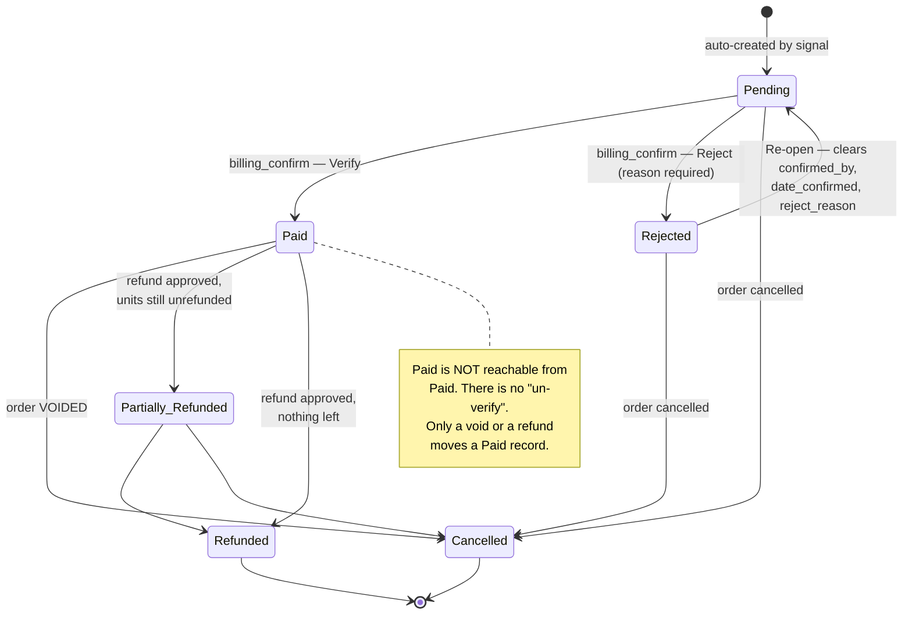
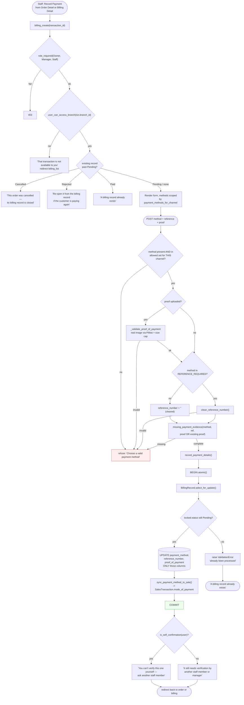
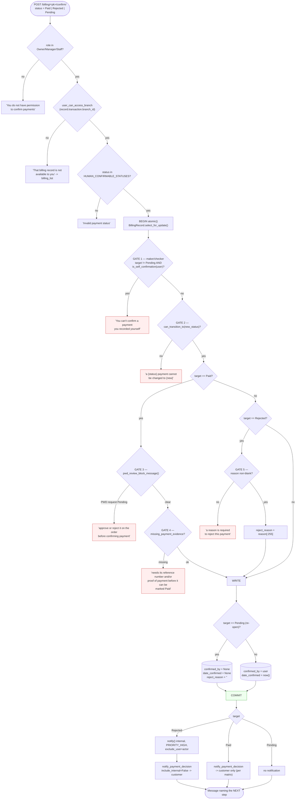
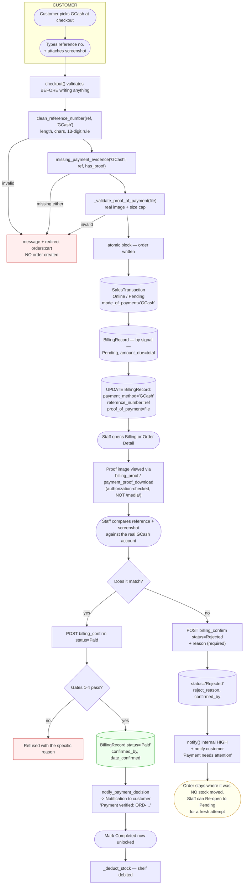

# 02 — Billing & Payments

Verified against `billing/models.py`, `billing/views.py`, `billing/signals.py`,
`billing/api_views.py`, `billing/validators.py`, `billing/notifications.py`,
`sales/refunds.py`.

---

## 1. The one sentence to open with

> **GerlynPLUS does not process payments. It records them and verifies them.**

No payment gateway is integrated. This is a stated project limitation
(Chapter 1, Limitation 1) and the code says so where it matters — e.g.
`BillingRecord.PaymentMethod.COD`: *"Recorded only — funds move outside the
system."* Consequently, for any payment that did not cross the counter, **the
reference number and the uploaded screenshot *are* the record that the payment
happened.** That is why both are mandatory for GCash, and why they are checked
twice (when saved, and again before the record can be marked `Paid`).

---

## 2. How a billing record comes into existence

**Automatically, by signal, for every order — both channels.**

`billing/signals.py`:

```
@receiver(post_save, sender=SalesTransaction)
def auto_create_billing_record(sender, instance, created, **kwargs):
    if created and not hasattr(instance, 'billing_record'):
        BillingRecord.objects.create(
            transaction=instance,
            amount_due=instance.total_amount,
            payment_method=CASH,
            status=PENDING,
        )
```

Three consequences to state precisely:

1. **There is no "create billing" step a human can forget.** The record exists
   the instant the order row is inserted, inside the same atomic block.
2. **`amount_due` is correct from the first moment.** Both `transaction_add` and
   `checkout` compute the total *before* `SalesTransaction.objects.create(...)`
   and pass `total_amount=` on the INSERT. An earlier version created at
   `total_amount=0` and patched it a beat later, which meant the signal's record
   briefly existed at `amount_due=0` — and would be left there on a crash
   between the two saves.
3. **Duplicate billing is structurally impossible.** `transaction` is a
   `OneToOneField`, so the database enforces at most one record per order. The
   `hasattr` guard plus `billing_create`'s own "already exists" branch are
   belt-and-braces on top of that.

`billing_create` keeps a fallback that creates a record from scratch "if somehow
the signal didn't fire" — it is unreachable in normal operation but harmless.

---

## 3. Payment methods, and which are legal on which channel

`billing.views.payment_methods_for_channel(transaction_type)`:

| Method | Physical (walk-in) | Online | Needs reference | Needs proof image |
|---|---|---|---|---|
| `Cash` | ✅ | ❌ | — | — |
| `Card` | ✅ | ❌ | — | ✅ |
| `GCash` | ✅ | ✅ | ✅ | ✅ |
| `Bank Transfer` | ✅ | ✅ | ✅ | ✅ |
| `Cash on Delivery` | ❌ | ✅ | — | — |
| `Pay at Store` | ❌ | ✅ | — | — |

Driven by two model constants, read by **all four** entry points (the web form,
the API serializer, `billing_confirm`, and online checkout), so they cannot
drift:

```
REFERENCE_REQUIRED_METHODS = {GCASH, BANK_TRANSFER}
PROOF_REQUIRED_METHODS     = {GCASH, BANK_TRANSFER, CARD}
```

and one shared predicate:

```
BillingRecord.missing_payment_evidence(method, reference_number, has_proof) -> [names]
```

**Why the channel split exists** (the code calls this its finding B-3). `billing_create` previously
offered and accepted all six methods regardless of channel, so a walk-in sale
could be "settled" as Cash on Delivery and an online order as a counter Cash
swipe — neither of which the counter can act on. The dropdown now only offers
the valid set, **and the POST is re-validated against the same set** so a
tampered form cannot bypass it.

**Why Card needs proof but no reference:** a card payment has no reference
number the counter can key in, so the slip or screenshot is the only record.

**`Bank Transfer` has no `SalesTransaction.ModeOfPayment` equivalent** — it is
billing-only. `sync_payment_method_to_sale()` therefore does nothing in that one
case and the sale keeps the method it had. This is deliberate, not a bug.

### Reference-number validation

`billing/validators.py` → `clean_reference_number(value, method)`, shared by
`billing_create`, the pay API, `transaction_add`, **and** `checkout`. It enforces
length (the column is `VARCHAR(100)`) and character rules, plus GCash's
13-digit rule. Before it existed, an over-long reference reached the column and
500'd mid-checkout.

Anything not required is **cleared**, not left: a reference typed before the user
switched to Cash on Delivery must not ride along onto a record that has no
reference by definition.

---

## 4. Payment status lifecycle

### The transition map (`BillingRecord.ALLOWED_STATUS_TRANSITIONS`)



### Two different sets — this is the important subtlety

```
ALLOWED_STATUS_TRANSITIONS  # what is structurally legal
HUMAN_CONFIRMABLE_STATUSES = {PENDING, PAID, REJECTED}  # what a person may pick
```

`billing_confirm` and `BillingConfirmSerializer` validate against
**`HUMAN_CONFIRMABLE_STATUSES` first**, then `can_transition_to`. So:

- `Cancelled` is reachable from every state — but **only**
  `sales.views.transaction_set_status` ever passes it, as part of cancelling the
  order itself.
- `Partially Refunded` / `Refunded` are reachable from `Paid` — but **only**
  `sales.refunds` ever passes them, as part of approving a refund.

**Why this matters (the documented defect it closed).**
`BillingConfirmSerializer.status` was once a bare `ChoiceField` over all six
`PaymentStatus` values with nothing narrowing it, so any ordinary
Billing-access API caller could `PATCH` a `Pending` record straight to
`Cancelled`, or a `Paid` one to `Refunded` — bypassing the order's whole
cancellation/refund workflow: stock reversal, the `RefundEvent` trail, and the
Owner/Manager-only refund approval. `HUMAN_CONFIRMABLE_STATUSES` is what stops
that.

Every writer routes through `can_transition_to()` rather than assigning
`.status` directly. That is why the map is a reliable description of reality.

---

## 5. Recording a payment (`billing_create`)



**Plain English.** Recording a payment is *saving what the customer handed over*,
not accepting it. The server checks the method makes sense for this kind of sale,
that the screenshot is really an image, and that whatever that method needs is
actually on file. It then locks the row and writes **only the payment columns**,
re-checking that nobody verified the record in the meantime. Finally it tells the
staff member whether they are allowed to verify this one themselves — before
they click, not after.

**The concurrency defect `record_payment_details` closed.** Both the web form and
the API used to decide "still Pending" from a read taken *before* the save, then
write *every column* of that stale copy. A confirmation that landed in between
was silently rolled back to `Pending` while the reference number was written over
an already-verified record. Now the row is locked, its status re-read inside one
transaction, and only the payment columns are touched.

---

## 6. Verifying a payment (`billing_confirm`) — the five gates



### Gate 1 — maker/checker separation (the code's own finding A-1)

`BillingRecord.is_self_confirmation(user)`:

```
return user.role == User.Role.STAFF and self.transaction.staff_id == user.id
```

**A Staff member who rang up a walk-in sale cannot verify its payment.** Someone
else has to check it. Two subtleties:

- **Owner and Branch Manager are exempt** — the role test is simply false for
  them, so they never reach the identity comparison. *The role condition **is**
  the override; there is no separate branch for it.*
- **A sale with no recorded staff actor returns `False` safely.** An
  Owner/Manager-rung walk-in, or any online order, has `SalesTransaction.staff =
  None`, which can never equal a Staff user's id — so no null check is needed
  (the code's own finding A-3).
- It is checked **before** the transition check, because *whether this user may
  act on the record at all* is logically prior to *what they are moving it to*.
- Only `Paid` and `Rejected` are gated. **Re-opening to `Pending` is not** — it
  clears `confirmed_by` and so records no confirmer to guard.

### Gates 3 and 4 — why evidence is re-checked at verification

A remote method has no counter moment where handing over money and confirming it
are the same event. `Mark as Paid` is the *only* record that a GCash, card, or
bank payment ever happened, and **once `Paid` it can never be undone** — the
transition map has no outbound edge from `Paid` back to `Pending` or `Rejected`.
A record saved before the evidence rule existed can still be short, which is
exactly why it is re-checked here and not only when the payment was saved.

### Message quality

Every outcome names the next step, rather than leaving the reader to work it out:

| Outcome | Message tail |
|---|---|
| `Paid` | "The order can now be marked Completed." |
| `Rejected` | "The customer has been notified; record a new payment attempt when they pay again." |
| `Pending` (re-open) | "It is awaiting a fresh payment attempt." |

---

## 7. GCash payment verification — the end-to-end path

This is the diagram to put on screen when the panel asks about online payment.



**Plain English.** The customer types their GCash reference and uploads a
screenshot at checkout. The system refuses to create the order at all if either
is missing or malformed — so there is no such thing as an unverifiable GCash
order sitting in the system. Staff later open the record, look at the screenshot,
and compare the reference against the real GCash account. If it matches they
verify it, which unlocks completing the order. If it does not, they reject it
with a written reason, the customer is told, and nothing about the order or the
stock has changed.

### Payment proof is deliberately not public (finding F-06)

`gerlyn_is/urls.py` excludes `payment_proofs/` from the `/media/` route:

```
re_path(r'^media/(?!payment_proofs/)(?P<path>.*)$', serve, ...)
```

`django.views.static.serve` does **no authentication**, so anyone with the path
could read a screenshot carrying a customer name, reference number and amount.
Proofs are reachable only through `billing_proof` and `payment_proof_download`,
which apply the same branch/customer scoping as the billing pages. Product
images and avatars stay public.

---

## 8. Branch scoping and customer visibility in Billing

| Surface | Who | Scoping |
|---|---|---|
| `billing_list` | Owner / Manager / Staff | `scope_queryset(records, user, 'transaction__branch')`. `?branch=` only honoured for the **Owner** — Managers/Staff are already pinned, so the selector would do nothing |
| `billing_detail` | Owner / Manager / Staff | `user_can_access_branch(record.transaction.branch_id)` |
| `billing_create` | same + `billing` Edit | same |
| `billing_confirm` | same + `billing` Edit | same |
| `GET /api/billing/` | any authenticated | Manager/Staff → `scope_queryset`; **Customer → `filter(transaction__customer=request.user)`**; Supplier → `.none()` |
| `GET /api/billing/<pk>/` | any authenticated | `user_can_access_billing_record` — 404 (not 403) outside scope |

### Finding X-1 — why customers were removed from the Billing pages

`billing_list` previously allowed `CUSTOMER` and `SUPPLIER`, which dropped a
shopper into the back-office shell with a table of billing records and, from
there, a `Pending` record's live **Mark as Paid / Reject** card. POSTing it was
already refused by `billing_confirm`'s own role check — *but the controls were
drawn and clickable, and the refusal should never have been the only guard.*
`role_required(OWNER, BRANCH_MANAGER, STAFF)` now closes the door on
`billing_list`, `billing_detail`, `billing_create` and `billing_proof`.

**Nothing was lost.** A customer already has the same information, scoped to
their own order and with no staff controls anywhere on it, on their own
**Track Order** page — and through `/api/billing/`, which scopes them to
`transaction__customer=self`.

### Finding F-02 — the API gap

`BillingConfirmAPIView` was the one confirm/reject path that skipped branch
scoping entirely: a Staff/Manager account could `PATCH` a record belonging to
another branch just by knowing its pk, while the web view already refused the
same thing. It now calls `user_can_access_billing_record` and answers **404**,
matching the convention in that file — don't confirm to an out-of-scope caller
that the record even exists.

---

## 9. Cancellation vs. rejection vs. void — three different things

| | `Rejected` | `Cancelled` | Void |
|---|---|---|---|
| Means | A submitted payment was specifically turned down | The order behind this record fell through | A **completed** sale is being reversed |
| Written by | `billing_confirm` | `transaction_set_status` | `transaction_set_status` |
| Needs | `reject_reason` | order `cancel_reason` | Owner/Manager + no approved refunds |
| Audit fields | `reject_reason`, `confirmed_by`, `date_confirmed` | `voided_by`, `date_voided` | `voided_by`, `date_voided` |
| Stock | None | Restored **only if** a `Physical` sale had already debited it | `_reverse_stock` — full reversal |
| Recoverable | ✅ Re-open to `Pending` | ❌ terminal | ❌ terminal |

**Finding F-10 — why `voided_by` / `date_voided` exist separately.** Voiding is a
different actor at a different moment from the original payment confirmation.
Writing the voider into `confirmed_by` while `date_confirmed` kept the original
timestamp made the record read *"confirmed by [voider] on [original date]"* — a
pairing that never happened — and erased the real confirmer. `confirmed_by` /
`date_confirmed` now stay pointing at whoever cleared the payment.

**Finding D-1 / B-1 — why the billing row is locked during cancellation.**
`transaction_set_status` takes its own `select_for_update()` on the billing row,
because `billing_confirm` locks the same row. Without it, a payment confirmed in
the gap between the order-status check and the save was silently overwritten back
to `Cancelled`, or the reverse — either way the order and its bill could disagree
about whether there was still money to collect. And the status is set through
`can_transition_to()`, not written onto the field, so this one caller is
*permitted* to take the `→ Cancelled` route rather than *bypassing* the rule.

---

## 10. Billing Detail — the activity trail

`_billing_activity(record, refunds)` builds "the billing events this record can
actually prove, oldest first". It is assembled from fields that exist rather
than from a separate event log, which is why it is honest about gaps: a record
created before a given field existed simply contributes no row for it.

Sources: `date_recorded`, `date_confirmed` + `confirmed_by`, `reject_reason`,
`date_voided` + `voided_by`, and the order's `Refund` rows with their
`RefundEvent` trail.

---

## 11. Step-by-step data trace — online GCash order, verified

| Step | Actor | Action | Data read | Data created / updated | Result / next step |
|---|---|---|---|---|---|
| 1 | Customer | Checkout, GCash + reference + screenshot | `Inventory.sellable()`, `ProductPriceTier`, default `Address` | — | All evidence validated **before** any write |
| 2 | Server | Create order | — | `SalesTransaction` (`Online`, `Pending`, `mode_of_payment='GCash'`) | `order_number` allocated |
| 3 | Signal | Auto-billing | `total_amount` | `BillingRecord` `Pending`, `amount_due=total`, `payment_method='Cash'` (default) | Record exists |
| 4 | Server | Attach payment details | — | `BillingRecord.payment_method='GCash'`, `reference_number`, `proof_of_payment` | Verifiable record |
| 5 | Staff A | View proof | `BillingRecord.proof_of_payment` via `payment_proof_download` | — | Authorization-checked file response |
| 6 | Staff A | Try Verify | `is_self_confirmation` → `False` (`txn.staff is None` for an online order) | — | **Allowed** — maker/checker does not block online orders |
| 7 | Server | Gates 2–4 | locked `BillingRecord`; `txn.pwd_request_status`; evidence | — | All pass |
| 8 | Server | Write | — | `status='Paid'`, `confirmed_by=StaffA`, `date_confirmed=now` | `notify_payment_decision` → customer Notification |
| 9 | Staff | Mark Completed | locked `BillingRecord` — is `Paid` ✅ | `order_status='Completed'`, `completed_at=now`, `OrderStatusHistory`, `OrderStatusChange` | Refund window opens |
| 10 | Server | `_deduct_stock` | locked `Inventory.sellable()` | `Inventory` −qty, `Batch` FEFO, `SalesItemBatchConsumption`, `StockMovement` `type='Sale'` | **Stock leaves here** |
| 11 | Server | Notify | — | `Notification` (`notify_order_delivered` if Delivery, else status notice) | Customer sees it in My Orders |

### Step-by-step — payment rejected

| Step | Actor | Action | Data created / updated | Result |
|---|---|---|---|---|
| 1 | Staff | Reject, reason "Reference does not match our GCash log" | `BillingRecord.status='Rejected'`, `reject_reason`, `confirmed_by`, `date_confirmed` | — |
| 2 | Server | Notify internal | `Notification` × Owner + branch Manager/Staff with `billing` access, `PRIORITY_HIGH`, `requires_action=True`, actor excluded | Pinned in the Notification Center |
| 3 | Server | Notify customer | `Notification` "Payment needs attention: ORD-…" with the reason, linking to Track Order | Customer can act |
| 4 | — | **Order unchanged** | *nothing* — `order_status` stays `Pending`/`Approved`/`Preparing` | **No stock moved** |
| 5 | Staff | Re-open → `Pending` | `confirmed_by=None`, `date_confirmed=None`, `reject_reason=''` | Record awaits a fresh attempt |

---

## 12. API parity summary

| Web view | API twin | Parity |
|---|---|---|
| `billing_list` | `BillingRecordListAPIView` | Same scoping via `scope_queryset`; API additionally serves Customers their own records |
| `billing_detail` | `BillingRecordDetailAPIView` | `user_can_access_billing_record`; 404 outside scope |
| `billing_create` | `BillingPaymentAPIView` + `BillingPaymentSerializer` | Both call `record_payment_details` — one locked write path |
| `billing_confirm` | `BillingConfirmAPIView` + `BillingConfirmSerializer` | Both check role, branch, `HUMAN_CONFIRMABLE_STATUSES`, `can_transition_to`, `is_self_confirmation`, `pwd_review_block_message`, `missing_payment_evidence` |

Both API views also carry `HasModuleAccess`, which re-applies the Layer-2 module
grant to the `/api/` routes using the resolved URL name and HTTP method.
