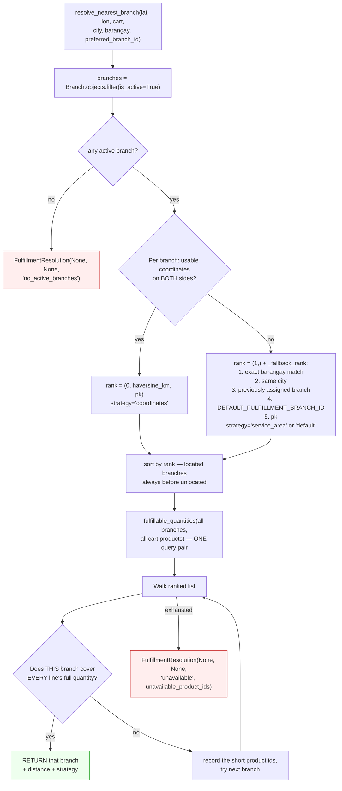
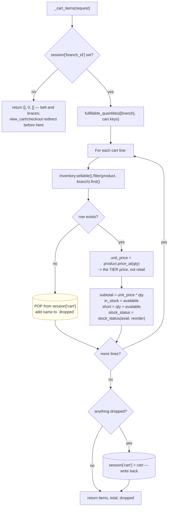

# 03 — Storefront & Online Ordering

Verified against `orders/customer_views.py`, `orders/services.py`,
`orders/urls.py`, `inventory/stats.py`, `core/context_processors.py`,
`templates/orders/*`, `templates/public_base.html`,
`templates/partials/product_card.html`, `templates/partials/_add_to_cart.html`.

---

## 1. What the storefront shares with the POS, and what it does not

**Shared — one definition, both channels:**

| Shared thing | Module |
|---|---|
| Order and line-item models | `sales.SalesTransaction`, `sales.SalesItem` |
| Billing record creation | `billing.signals.auto_create_billing_record` |
| Pricing, VAT and discount arithmetic | `sales.pricing.price_cart` / `price_line` |
| Bulk price tiers | `inventory.Product.price_at(quantity)` |
| Sellable-stock definition | `Inventory.objects.sellable()` → `available_qty` |
| Status transitions, history, notifications | `sales.views.transaction_set_status` |
| Payment-evidence rules | `BillingRecord.missing_payment_evidence`, `billing.validators.clean_reference_number` |
| Stock deduction | `sales.views._deduct_stock` |
| Order numbering | `SalesTransaction.save` + `OrderNumberSequence` |

**Separate — storefront-only logic:**

| Storefront-only | Module |
|---|---|
| Session cart (`request.session['cart']`) | `orders.customer_views` |
| Automatic branch resolution | `orders.services.resolve_nearest_branch` |
| Commitment-aware availability | `orders.services.fulfillable_quantities` |
| Double-submit token | `orders.customer_views.checkout` (cache + session) |
| Customer-facing status wording | `STATUS_STEPS`, `STATUS_BLURB`, `tab_statuses` |
| In-stock-only listing gate | `inventory.stats.in_stock_product_ids` |

**The headline:** the storefront is a *different front door to the same
records*, not a parallel system. There is no sync job, no mirror table and no
import step between the shop and Sales & Orders.

---

## 2. Browsing — what a visitor can and cannot see

### Guest vs. signed-in customer

| Page | Guest | Customer | Staff/Owner |
|---|---|---|---|
| `/` home | ✅ | ✅ | ❌ redirected to their dashboard (unless `?preview=1`) |
| `/shop/` catalog | ✅ | ✅ | ✅ (read-only; card shows "Customers only") |
| `/shop/product/<id>/` | ✅ | ✅ | ✅ |
| `/shop/branch/` set location | ✅ | ✅ | ✅ |
| `/shop/search/suggest/` | ✅ | ✅ | ✅ |
| Add to cart / cart / checkout | ❌ → login with `?next=` | ✅ | ❌ message + redirect to catalog |
| My Orders / Track Order | ❌ → login | ✅ own only | ❌ |

`@customer_required` distinguishes the two refusals deliberately — and this
closed a real bug. Sending **both** to the login page was an infinite redirect
for a signed-in staff account, because `login_view` honours `?next=` for an
already-authenticated user and handed them straight back to the view that just
refused them. The browser gave up with `ERR_TOO_MANY_REDIRECTS`; from the
shopper's side, "Add to cart" simply did nothing.

So now: **no session** → login, destination preserved. **Signed in to a
non-customer account** → told *why* ("The shop cart is for customer accounts.
Staff sales go through the POS instead.") and left on the catalog, which they
can still read. There is an AJAX branch for both (401 / 403 JSON), because
`add_to_cart` is called by `catalog-live.js` and a 302 to an HTML page would
surface as a silent failure.

### The storefront does not list what it cannot sell

This rule is enforced in several places and is worth stating as a design
principle:

- **Catalog grid** (`product_catalog`): `Inventory.objects.sellable()` filtered
  to `branch__is_active=True`, collapsed to one row per product keeping the best
  availability, then `rows = {… if row['qty'] > 0}`. The filter is applied
  **after** the collapse, because with no branch chosen a product can be empty at
  one branch and stocked at another.
- **Search suggestions**: `.filter(id__in=in_stock_product_ids(session branch))`
  — "otherwise the one place a shopper can still reach an unavailable product is
  the search box."
- **Related / recently-viewed rails** on the product page: same
  `in_stock_product_ids` gate.
- **Best sellers** (`inventory.stats.best_sellers`): `units_sold__gt=0` **and**
  `id__in=in_stock_product_ids()` — a product that sold well then ran out belongs
  off a buy-this rail.
- **Category rail** (`_category_rail`): rows with a zero count are dropped
  entirely — "an empty row in a filter rail is a promise the grid then breaks."
- **Category menus everywhere** (`storefront_categories`): hidden below two
  categories, and a category with no products is never drawn.

> ⚠️ **One page breaks this rule.** `accounts.views.customer_dashboard`
> (`/dashboard/customer/`) renders the same `partials/home_content.html` and
> `product_card.html`, but passes `Product.objects.prefetch_related('images')[:8]`
> with **no in-stock filter**. See finding **C-2** in
> [`07-audit-findings.md`](07-audit-findings.md).

### What the product card deliberately does *not* claim

`templates/partials/product_card.html` documents its own omissions, and this is
a good honesty point for the defense — each absent element is absent because no
field backs it:

| Not drawn | Why |
|---|---|
| Wishlist heart | No wishlist model — "a button that does nothing is worse than no button" |
| ★★★★☆ rating | No review model. The **"N sold"** line takes that slot and is a real `SalesItem` sum |
| Struck-through "was" price | `Product` has one retail price. A fake "was" price is a false discount claim |
| BULK RATE corner flag | The tiers are real, but a flag says one exists without saying what it is. The product page states the whole ladder |
| Brand line | `Product` has no brand column |
| Stock badge | Both grid callers already filter to in-stock, so every card rendered is buyable |

Likewise `SORT_OPTIONS` has no "Featured" — there is no featured/pinned column
on `Product`, so the slot is filled with **Popular**, ordered by units actually
sold.

---

## 3. Location selection — what it actually is

**This is the single most-likely-to-be-misunderstood part of the system, so get
it exactly right.**

> The storefront "location" is **not** a branch the customer picks, and **not** a
> delivery address. It is a *geographic hint* the server uses to choose, on its
> own, the one branch that can fulfil the entire cart.

`select_branch`'s docstring is explicit:

> *"Consent screen for location-assisted automatic branch assignment. A posted
> `branch_id` is intentionally ignored. The server always resolves one branch for
> the complete cart."*

### The three location sources, in priority order

`orders.services.customer_fulfillment_location(user, session)`:

| Priority | Source | Stored where | Lifetime |
|---|---|---|---|
| 1 | Browser geolocation | `session['fulfillment_location']` — lat/lon, `captured_at`, optional `accuracy_m`, optional reverse-geocoded `label` | **30 minutes** (`FULFILLMENT_LOCATION_TTL_SECONDS`), then popped |
| 2 | Saved default `Address` | `accounts.Address` where `is_default=True` — its `latitude`/`longitude`, else `city`/`barangay` PSGC codes | Permanent, account-scoped |
| 3 | Configured fallback | `settings.DEFAULT_FULFILLMENT_BRANCH_ID` | Deployment config |

`source` comes back as `'browser'`, `'address'` or `'fallback'`, which is what
the page uses to tell the shopper which was used.

### Privacy properties worth stating

- **Coordinates are never persisted to the database by this flow.**
  `remember_assignment` writes only `session['branch_id']` and
  `session['fulfillment_assignment'] = {branch_id, distance_km (rounded to 1dp),
  strategy}`. Its docstring: *"Persist no customer coordinates — only branch and
  rounded display data."*
- Browser coordinates **expire in 30 minutes** and are also popped from the
  session on successful checkout.
- `label` and `accuracy_m` are display metadata only and *never* influence branch
  ranking.
- Reverse geocoding only happens if `settings.GEOCODING_REVERSE_URL` is set, and
  failures are swallowed.

### How the branch is chosen



**Plain English.** The system lists every open branch, puts the nearest ones
first (or, with no coordinates, the ones in the shopper's own barangay or city),
then walks down that list asking one question: *can this single branch supply
every item in the cart, in full?* The first one that can gets the order.

**No partial result is ever returned.** If no single branch can cover the whole
cart, `branch` is `None` and the shopper is told:

> *"No single branch can fulfill every item in your cart right now. We will not
> split one order across branches; reduce a quantity or remove an item and try
> again."*

`_no_single_branch_message(resolution)` improves on that by **naming the
blocking products**, from `resolution.unavailable_product_ids`. The code is
honest that this is the union of what fell short at *every* branch tried, so it
may name more products than the shopper strictly needs to act on — "still a
better hint than the flat message."

### Availability nets out existing commitments

`orders.services.fulfillable_quantities(branch_ids, product_ids)`:

```
available = max(0, sellable_floor_stock - open_online_commitments)
```

where commitments are `SalesItem.quantity_sold` summed over `Online`
transactions whose `order_status` is in `OPEN_ORDER_STATUSES`
(`Pending`, `Approved`, `Preparing`).

This matters because an online order **does not deduct stock until completion**.
Without this subtraction, ten shoppers could all be promised the same last unit.
It is a *soft* reservation computed on read — nothing writes a hold row — which
is why it can clear on its own when another order is cancelled.

### The one hard boundary at this layer

The browse-filter **Branch checklist** in the catalog's Filters rail and the
**shopping branch** in the session are two different things:

- Ticking branches in the rail is a *browse filter* — multi-select, like the
  Category checklist. It does **not** touch `session['branch_id']` or the cart.
- The shopping branch is set only by `_resolve_cart_branch` / `remember_assignment`.

They used to be fused: a single tick called `_start_shopping_at()`, so *glancing
at another branch's shelves silently emptied the cart* — and on the live-filter
XHR path the explanatory message was never even rendered.

> **UNVERIFIED:** `view_cart`'s comment references `_start_shopping_at()`
> clearing stale lines, but no function of that name exists in the current
> `orders/customer_views.py`. The behaviour described is historical; the comment
> is stale. See finding **C-6**.

---

## 4. Cart — session-based, re-priced on every read

### Shape

`request.session['cart']` is `{"<product_id as str>": quantity}` — **one entry
per product**, so the quantity read is already the shopper's whole commitment to
that item. Plus:

- `session['branch_id']` — the resolved shopping branch
- `session['fulfillment_assignment']` — `{branch_id, distance_km, strategy}`
- `session['last_added']` — `{id, qty}`, backing the toast's Undo
- `session['checkout_token']` — the one-time double-submit token
- `session['recently_viewed']` — up to 12 product ids, newest first

Nothing about the cart is persisted to the database until checkout. There is no
`Cart` model.

### `_cart_items(request)` — the one resolver every surface shares



**Two details that are the fix for a real class of bug (finding S-1):**

1. A line that can no longer be priced *at all* — product delisted, the branch
   stopped carrying it, its last lot expired — is **popped out of the session
   here**, in the one place every caller shares. Previously it just vanished from
   the displayed list while staying in `session['cart']`: the cart page's total
   quietly shrank, the header badge (which counts the raw session cart) kept the
   old number, and **checkout met the same line for the first time and rejected
   a product the shopper could no longer even see to remove.**
2. A line that still exists but is merely **short** is *not* dropped — that is a
   normal, visible state the cart page shows a warning for.

**The PWD/Senior discount is deliberately not previewed in the cart.** Since
finding F-04 it cannot be claimed there at all: it is granted by staff against a
sighted ID, after the order exists. "Showing it on the cart would promise a price
the order is not entitled to and may never get."

### Cart operations and their guards

| Op | URL | Guards | Stock check |
|---|---|---|---|
| Add | `POST /shop/add/<id>/` | `int()` cast in try/except (non-numeric → 1); `qty < 1` or `> MAX_QUANTITY` refused; `_resolve_cart_branch` on the **proposed** cart | `already + qty > available` → refused with the exact remaining count |
| Undo | `POST /shop/undo/` | Pops `session['last_added']`; validated Referer (not raw) | — |
| Increase | `POST /shop/cart/update/<id>/` `action=increase` | `_resolve_cart_branch` on the proposed cart | If no branch can cover it, reports the per-branch remaining **and** the no-single-branch message |
| Decrease | same, `action=decrease` | Floors at **1** — and *says so*: "X is down to one. Use Remove to take it out of your cart." | — |
| Remove | `POST /shop/cart/remove/<id>/` | — | — |
| Neither button | same, bad `action` | "That cart change was not understood." | — |

**Every exit says what it did.** This is an explicit project rule: a silent
`return redirect()` is treated as a defect, because a `+` that changes a number
without a word reads exactly like one that failed to register. Examples:

- Item already removed in another tab → "That item was already removed from your
  cart." (finding S-9 — this used to reload the cart in silence, which reads
  exactly like the Remove button not working)
- Product deleted → "That item is no longer available, so it came out of your
  cart."
- Dropped lines → "`X`, `Y` — no longer available at this branch, so removed
  from your cart."

### Free-delivery meter

`FREE_DELIVERY_OVER = Decimal('500')`. The cart shows `remaining_for_free`,
`qualifies`, and `progress_pct`. This is a **display threshold only** — no
delivery fee is charged, computed or stored anywhere in the order models.

> **UNVERIFIED / out of scope:** there is no delivery-fee field on
> `SalesTransaction`, so what "free delivery" costs the business, and what a
> non-qualifying order would be charged, is not modelled. Do not claim the system
> charges or waives a delivery fee.

---

## 5. Checkout — the full validation chain

`checkout` is **POST-only** by design: *there is no checkout page.* The form
lives on the cart. A `GET` is a bookmark, refresh or back button, so it
redirects with "Review your order below, then press Place Order" rather than
bouncing silently.

```mermaid
flowchart TD
    A(["POST /shop/checkout/"]) --> B{"cart empty?"}
    B -- yes --> BX["'Your cart is empty' -> catalog"]
    B -- no --> C{"branch_id in session?"}
    C -- no --> CX["PICK_BRANCH_TO_CHECK_OUT -> select_branch"]
    C -- yes --> D{"method == POST?"}
    D -- no --> DX["'Review your order below' -> cart"]

    D -- yes --> E["DOUBLE-SUBMIT GUARD"]
    E --> E1["cache.add('checkout_token_used:&lt;tok&gt;', True, 300)<br/>atomic set-if-absent; cache error -> FAIL OPEN"]
    E1 --> E2{"token missing, mismatched,<br/>or already used?"}
    E2 -- yes --> E3["'This order may already be on its<br/>way — check My Orders'<br/>-> my_orders"]
    E2 -- no --> E4["ROTATE session['checkout_token'] NOW<br/>(stops a 3rd slower copy)"]

    E4 --> F["_resolve_cart_branch(cart)"]
    F --> F1{"resolution.branch?"}
    F1 -- no --> FX["_no_single_branch_message -> cart"]
    F1 -- yes --> F2{"branch != displayed branch?"}
    F2 -- yes --> F3["'Your fulfillment branch changed...<br/>Review the revalidated cart' -> cart"]
    F2 -- no --> G["_cart_items() — prunes unpriceable lines"]
    G --> G1{"anything dropped?"}
    G1 -- yes --> GX["name them -> cart"]
    G1 -- no --> H["PAYMENT METHOD"]

    H --> H1{"in ModeOfPayment.values?"}
    H1 -- no --> H2["fall back to Cash on Delivery<br/>(safe: every method is recorded-only)"]
    H1 -- yes --> H3
    H2 --> H3{"method == GCash?"}
    H3 -- yes --> H4["clean_reference_number<br/>+ missing_payment_evidence<br/>+ _validate_proof_of_payment"]
    H4 -- "any fail" --> HX["specific message -> cart<br/>NO ORDER CREATED"]
    H4 -- ok --> I
    H3 -- no --> H5["reference_number = '' (cleared)"]
    H5 --> I

    I{"fulfillment_type in<br/>FulfillmentType.values?"}
    I -- no --> IX["'Choose whether this order is for<br/>delivery or for pickup' — REFUSES,<br/>does NOT default"]
    I -- yes --> J{"Delivery + Pay at Store?"}
    J -- yes --> JX["'Pay at Store isn't available<br/>for delivery orders'"]
    J -- no --> K{"Delivery?"}
    K -- yes --> K1["Read user's DEFAULT Address<br/>NOT from the form"]
    K1 --> K2{"address exists?"}
    K2 -- no --> KX["'Add a delivery address to your<br/>account... open Settings then<br/>Addresses' — REFUSES"]
    K2 -- yes --> L
    K -- "Pickup" --> K3["delivery_address = '' always"]
    K3 --> L

    L{"request_pwd_discount posted?"}
    L -- yes --> L1{"fulfillment == Pickup?"}
    L1 -- no --> LX["'only for orders you pick up<br/>at the branch'"]
    L1 -- yes --> L2["validate_pwd_details(id, name)"]
    L2 -- errors --> LX
    L2 -- ok --> M
    L -- no --> M

    M["BEGIN transaction.atomic()"]
    M --> M1["Lock ALL active-branch Inventory rows<br/>for the cart's products,<br/>ORDER BY branch_id, product_id"]
    M1 --> M2["locked_resolution = _resolve_cart_branch(cart)"]
    M2 --> M3{"branch resolved AND unchanged?"}
    M3 -- no --> M4["set_rollback(True)<br/>'Availability changed while you were<br/>checking out' -> cart"]
    M3 -- yes --> N["Per line: Inventory.select_for_update()<br/>.sellable()"]
    N --> N1{"row missing?"}
    N1 -- yes --> N2["collect as stale_id"]
    N1 -- no --> N3{"available_qty < qty?"}
    N3 -- yes --> N4["set_rollback(True)<br/>'only N of X left' -> cart"]
    N3 -- no --> N5["planned.append"]
    N2 --> O
    N5 --> O
    O{"stale_ids?"} -- yes --> O1["pop them, set_rollback(True),<br/>'Some items... were removed'"]
    O -- no --> P{"PWD request reaches<br/>any eligible product?"}
    P -- no --> PX["set_rollback(True)<br/>'nothing to request'"]
    P -- yes --> Q

    Q["price_cart(lines, discount_type=None)<br/>-- None ON PURPOSE (F-04)"]
    Q --> R[("INSERT SalesTransaction<br/>Online / Pending / staff=None<br/>customer=request.user<br/>total_amount, VAT, discount<br/>written ON the INSERT")]
    R --> R1[("signal: INSERT BillingRecord Pending")]
    R --> R2[("signal: INSERT OrderStatusHistory")]
    R --> S[("INSERT SalesItem per priced line")]
    S --> T[("UPDATE BillingRecord:<br/>payment_method, reference_number,<br/>proof_of_payment")]
    T --> U["COMMIT"]

    U --> V["notify_pwd_request_submitted (if requested)"]
    V --> W[("session['cart'] = {}<br/>pop fulfillment_location<br/>pop fulfillment_assignment")]
    W --> X(["'Order ORD-YYYY-NNN placed!'<br/>-> orders:confirmation"])

    style BX fill:#fee,stroke:#c33
    style HX fill:#fee,stroke:#c33
    style IX fill:#fee,stroke:#c33
    style KX fill:#fee,stroke:#c33
    style M4 fill:#fee,stroke:#c33
    style N4 fill:#fee,stroke:#c33
    style U fill:#efe,stroke:#3a3
```



### The five checkout decisions worth explaining

**1. Why the double-submit guard uses the cache, not just the session.**
`cache.add()` is one *atomic* "set only if absent" operation, so of two requests
racing on the same token only one can ever win it, however close together they
arrive. A session read/write alone cannot promise that — both could read the
token as still valid before either saved back an updated session. The session
token is a second, narrower check: whether this request even belongs to the cart
page currently in the session, so a bookmarked or cached stale form cannot submit
an order for a cart that no longer matches what is displayed.

It **fails open** on a cache backend error, deliberately: *"this token only stops
a duplicate order when stock is plentiful enough for both to independently
succeed; the real anti-oversell guard is the `select_for_update()` lock in the
atomic block, which doesn't depend on the cache at all. A rare double-submit
slipping through during a Redis outage is a far smaller problem than nobody
being able to check out at all."*

The token is **rotated before** the order is created, not after — that is what
stops a *third*, slower-arriving copy of the same double-tap (which read the old
token before this request saved a new one) from creating a second order once
this one succeeds.

**2. Why `mode_of_payment` falls back but `fulfillment_type` refuses.**
Every payment method on this form is *recorded only* and settled in person
either way, so a default cannot mislead anyone about what happens next. For
fulfilment there is **no safe guess**: silently picking one would either promise
a delivery nobody asked for, or strand a customer waiting at home for an order
marked pickup. So it refuses.

**3. Why the delivery address is not read from the form.** There is no address
input on the checkout form. A Delivery order ships to the account's **default
`Address` row**, captured at registration or in Settings → Addresses and edited
only there. One authoritative, structured record beats a free-text box retyped —
and mistyped — on every order. No saved address while Delivery is chosen is
**refused**, not defaulted.

This also fixes finding **F-11**: `delivery_address` used to be written straight
from the POST with no validation, and the form invited a blank one ("leave blank
to pick up"). A delivery order whose address field was lost was therefore
*indistinguishable from a genuine pickup* — same blank column, no way for the
Order Console to tell anyone was ever meant to deliver it. `fulfillment_type` is
now an explicit, required column.

**4. Why availability is validated but *not* deducted.** The comment is explicit:
*"Validate availability WITHOUT deducting: an online order only leaves the shelf
when staff mark it Completed in the Order Console."* The rows are still locked —
`Inventory.select_for_update()` in a stable `(branch_id, product_id)` order — so
a concurrent checkout for any of these units must wait, then sees this order's
newly committed `SalesItem` rows (via `fulfillable_quantities`) before it can
promise the same stock. Locking in a stable order is what prevents deadlock
between two concurrent checkouts.

**5. Why `discount_type=None` is passed explicitly.** Not None-by-omission but
None on purpose, with a seven-paragraph comment explaining finding F-04. A PWD
*request* does not change it: the order is still priced in full.

---

## 6. Order confirmation and tracking

### `order_confirmation` (`/shop/confirmation/<id>/`)

```
get_object_or_404(SalesTransaction..., id=transaction_id, customer=request.user)
```

The `customer=request.user` clause is in the **query**, not an `if` after it —
so another customer's id yields a 404, never a 403 that would confirm the order
exists.

### `track_order` (`/shop/orders/<id>/`)

Same ownership clause. Shows:

- The four-step progress bar from `STATUS_STEPS = ['Pending','Approved','Preparing','Completed']`
- `STATUS_BLURB[status]` — plain-language text
- `sale.items` and `getattr(sale, 'billing_record', None)`
- `can_cancel` — true while `order_status` is `Pending` or `Approved`
- Branch name, location and contact for anything else

**The `done`/`current` logic has a subtlety worth knowing:** a `Completed` order
has *finished* its last step, not started it. The loop's `current` index still
points at it, so a `Completed` order needs that step marked `done` too, not just
everything before it:

```
'done':    (not cancelled) and (i < current or (completed and i == current)),
'current': (not cancelled) and (i == current) and not completed,
```

A `Cancelled` order sets `current = 0` and marks nothing done or current; the
page shows a cancellation banner instead.

### Customer self-cancel — and why it has no route of its own

`orders/urls.py` has **no cancel URL**. The Cancel form on `track_order.html`
posts to ``
— the *staff* endpoint — with a hidden `reason` of "Cancelled by the customer."

This is deliberate, and the template says why: *"so the history/billing/
notification side effects it already owns apply here too instead of risking
drifting out of sync."* `transaction_set_status` carries a matching carve-out:

```
is_self_cancel = (
    request.user.is_authenticated
    and request.user.role == 'CUSTOMER'
    and txn.customer_id == request.user.id
    and new_status == CANCELLED
    and txn.order_status in (PENDING, APPROVED)
)
```

When `is_self_cancel` is true, the role and branch checks are skipped (a customer
has no branch) and every exit redirects back to **Track Order** rather than the
staff Order Detail. All four conditions must hold, so a customer cannot cancel
someone else's order, cannot cancel at `Preparing` or later, and cannot drive any
other transition.

**Why cancellation stops at `Approved`:** once an order is `Preparing`, whether
it can still be stopped depends on state the customer is not shown (how far staff
got), so that becomes a staff-side call reached through the branch contact card.

---

## 7. My Orders — the screenshot, audited

`my_orders` (`/shop/orders/`) renders `templates/orders/my_orders.html` inside
the shared account shell (`accounts/_account_sidebar.html`).

### Retrieval and ownership

```
SalesTransaction.objects.filter(customer=request.user)
    .select_related('branch')
    .prefetch_related('billing_record')
    .order_by('-transaction_date')
```

`filter(customer=request.user)` is the only ownership rule, applied in the
queryset. Walk-in sales have `customer=None`, so they never appear here —
correct, since nobody at the counter had an account.

### The five tabs → backend statuses

`tab_statuses` in `orders/customer_views.py`:

| Visible tab | `?status=` | `order_status` values |
|---|---|---|
| **All** | *(absent)* | every status, including `Cancelled` |
| **In progress** | `active` | `Pending`, `Approved` |
| **To receive** | `to_receive` | `Preparing` |
| **Completed** | `completed` | `Completed` |
| **Cancelled** | `cancelled` | `Cancelled` |

An unknown `?status=` falls back to **All** rather than showing an empty list.

**The semantic split is deliberate and non-obvious:** `active` ("In progress")
is *the part of the lifecycle the **store** is still working through*, and
`to_receive` is *the part the **customer** is waiting on*. `Preparing` used to
sit in `active` as well, which made the two overlap and the totals across the bar
exceed All.

Note the tabs render as **plain text labels, no counts**. A previous version
computed a five-`.count()` `counts` dict whose results nothing read — five
queries per page load going nowhere. It was removed.

Paginated at 10 per page, ordered `('-transaction_date', '-pk')` so a page
boundary never repeats a row.

### What each row shows, and from where

| Element | Source |
|---|---|
| `ORD-2026-001` | `o.order_number` |
| Order status pill | `partials/_order_status_pill.html` with `customer=True` |
| Date | `o.transaction_date` |
| Branch | `o.branch.branch_name` |
| Payment method | `o.mode_of_payment` |
| Payment status pill | `partials/_billing_status_pill.html` with `status=o.billing_record.status customer=True` |
| Total | `o.total_amount` |
| Whole row link | `orders:track_order o.pk` |

The `customer=True` flag on both pills is what re-words the raw enum for a
shopper — `orders/tests_storefront_truthfulness.py` has
`test_status_is_worded_for_the_customer_not_the_raw_enum` and
`test_the_same_wording_appears_on_my_orders` covering exactly this.

> ⚠️ Rows show `total_amount`, which is **never reduced by a refund**. A
> refunded order therefore still displays its original charge here. See finding
> **C-5**.

### Empty state

Two different messages, correctly:

- No orders at all → *"When you place an order it'll show up here, and you can
  follow its progress."*
- A tab with nothing in it → *"Nothing in this tab — try 'All'."*

Both offer **Start shopping** → `` → `/shop/`. Fully
functional.

```mermaid
flowchart LR
    A(["Customer opens /shop/orders/"]) --> B["my_orders"]
    B --> C["SalesTransaction.filter(customer=request.user)"]
    C --> D{"?status= recognised?"}
    D -- no --> E["treat as All"]
    D -- yes --> F["filter order_status__in tab_statuses[s]"]
    E --> G
    F --> G["paginate(10, ordered -date, -pk)"]
    G --> H{"any rows?"}
    H -- yes --> I["Row per order:<br/>number, status pill, date, branch,<br/>method, payment pill, total"]
    I --> J(["Click row -> track_order"])
    J --> K["get_object_or_404(id=..., customer=request.user)"]
    K --> L{"owned?"}
    L -- no --> LX["404"]
    L -- yes --> M["4-step bar + blurb + items<br/>+ billing + branch contact"]
    M --> N{"status in Pending/Approved?"}
    N -- yes --> O["Cancel form -> transaction_set_status<br/>(is_self_cancel carve-out)"]
    N -- no --> P["'contact the branch directly'"]
    H -- no --> Q["Empty state + Start shopping -> /shop/"]

    style LX fill:#fee,stroke:#c33
```



---

## 8. Storefront exception paths — what is and is not written

| Scenario | Records written | Records unchanged |
|---|---|---|
| Guest presses Add to cart | *none* | — → login with `?next=` |
| Staff account presses Add to cart | *none* | — message, stays on catalog |
| Quantity non-numeric | *none* | Treated as 1 |
| Quantity `< 1` or `> MAX_QUANTITY` | *none* | Cart untouched, specific message |
| Requested qty exceeds availability | *none* | "Only N of X left for fulfillment" |
| No single branch covers the cart | *none* | Named-products message |
| Cart line's product deleted | `session['cart']` entry popped | No DB write |
| Checkout, cart empty | *none* | → catalog |
| Checkout, no branch | *none* | → `select_branch` |
| Checkout, double submit | *none* on the 2nd | → My Orders, "may already be on its way" |
| GCash reference malformed / missing | *none* | → cart, **no order created** |
| Proof not a real image | *none* | → cart |
| `fulfillment_type` missing/invalid | *none* | → cart, refuses |
| Delivery + Pay at Store | *none* | → cart |
| Delivery with no saved Address | *none* | → cart, "open Settings then Addresses" |
| Branch changed during checkout | *none* (`set_rollback(True)`) | → cart to review |
| Stock short inside the lock | *none* (`set_rollback(True)`) | → cart, "only N left" |
| PWD request with no eligible item | *none* (`set_rollback(True)`) | → cart |
| **Checkout succeeds** | `SalesTransaction`, `SalesItem`×N, `BillingRecord`, `OrderStatusHistory`, optional PWD `Notification` fan-out | Session cart cleared; **stock untouched** |
| Customer cancels at Pending/Approved | `order_status='Cancelled'`, `cancel_reason`, `OrderStatusHistory`, `OrderStatusChange`, `BillingRecord.status='Cancelled'` + `voided_by`/`date_voided`, `Notification` ×2 | **No stock reversal — nothing was ever deducted** |
| Customer tries to cancel at Preparing | *none* | `is_self_cancel` false → role check → `PermissionDenied` |
| Customer opens another's order | *none* | **404** |
| Session expires mid-shop | Cart lost with the session | No DB write; `@customer_required` → login with `?next=` |

---

## 9. Step-by-step data trace — customer places a COD delivery order

| Step | Actor | Action | Data read | Data created / updated | Result / next step |
|---|---|---|---|---|---|
| 1 | Customer | Opens `/shop/` | `Inventory.sellable()` + `branch__is_active`; `ProductCategory` counts; `SalesItem` sums for "N sold" | `session['recently_viewed']` on a product page | Only in-stock products listed |
| 2 | Customer | Add to cart | `Product`; `fulfillable_quantities`; default `Address` for location | `session['cart']`, `session['branch_id']`, `session['fulfillment_assignment']`, `session['last_added']` | Branch resolved automatically |
| 3 | Customer | Opens `/shop/cart/` | `_cart_items` → `Inventory.sellable()`, `ProductPriceTier`; default `Address` | `session['checkout_token']` (setdefault) | Tier prices shown; unpriceable lines pruned + reported |
| 4 | Customer | Chooses Delivery + Cash on Delivery, Place Order | `session['checkout_token']`; cache key | Cache key `checkout_token_used:…`; token rotated | Duplicate submits refused |
| 5 | Server | Re-resolve + revalidate | `Inventory` locked for all cart products; `Address` (default) | — | Branch confirmed unchanged; address read from account |
| 6 | Server | Price | `ProductPriceTier`, `Product.is_vat_exempt` | — | `discount_type=None`, full price |
| 7 | Server | Write order | — | **`SalesTransaction`**: `Online`, `Pending`, `Pickup`→no, `fulfillment_type='Delivery'`, `delivery_address=<Address.text>`, `mode_of_payment='Cash on Delivery'`, `staff=None`, `customer=user`, totals on the INSERT | `order_number` allocated |
| 8 | Signal | Billing | `total_amount` | **`BillingRecord`** `Pending`, `amount_due=total` | No evidence needed for COD |
| 9 | Signal | History | — | **`OrderStatusHistory`** `'' → 'Pending'`, actor = `customer` (`recorded_by` is None) | Trail opened |
| 10 | Server | Line items | priced lines | **`SalesItem`**×N | Frozen prices |
| 11 | Server | Finalise | — | `BillingRecord.payment_method='Cash on Delivery'`, `reference_number=''` | — |
| 12 | Server | Clear session | — | `cart={}`; `fulfillment_location` and `fulfillment_assignment` popped | **Stock still on the shelf** |
| 13 | Customer | Confirmation page | the new order + items + billing | — | Then visible under My Orders → "In progress" |

---

## 10. Storefront navigation audit — every visible item

See [`10-notifications-and-customer-dashboard.md`](10-notifications-and-customer-dashboard.md)
§5 for the full item-by-item table (route, auth, handler, data, status) covering
Home, Shop, About Us, categories, My Orders, the status filters, Notifications,
My Profile, Sessions, Privacy & Data, Language, Help Center, About, Logout,
Set location, and Start shopping.

---

## Addendum (2026-10-27): choosing a branch yourself, and optional delivery location

This file describes the defense build. Three things changed afterwards; where
this addendum and the text above disagree, this addendum is current.

### 1. A shopper can choose their branch ("I'll choose a branch")

Automatic assignment above is still the default. `/shop/branch/` now has two
tabs, **Nearest to me** (the flow described above) and **I'll choose a branch**
(`?mode=manual`).

| | Automatic (default) | Chosen by the shopper |
|---|---|---|
| Decided by | `resolve_nearest_branch` | The shopper, re-validated by `resolve_manual_branch` |
| Session | `branch_id`, `fulfillment_assignment` | same, plus `session['branch_mode'] = 'manual'` |
| Cart change that the branch cannot cover | Cart moves to the next branch | **Refused**; the cart stays and the message names the branch |
| Closed branch | next branch | choice dropped, falls back to automatic, with a message |

- One function, `orders.services.resolve_cart_branch(user, session, cart)`,
  decides for both the storefront views and the customer sales API.
- A posted `branch_id` is read **only** with `action=choose` on
  `select_branch`, and is re-checked there (active branch, whole cart covered).
  Checkout and the sales API still never read one.
- Choosing a branch that is short on a line shows a conflict panel (reduce /
  remove / stay). Nothing in the cart changes until the shopper presses one.
- "Don't share my location", "Use my current location" and
  `action=automatic` all end a manual choice.
- Lifetime is the session only, the same as the cart.

### 2. Delivery location is optional and can be declined

The checkout's delivery block (cart page) has **Use my current location**,
**Don't share my location** and **Pin on map**. All rules live in
`orders.delivery.clean_delivery_form`, shared with the customer sales API:

- Delivery needs a pinned location **or** a complete typed address (street,
  barangay, municipality; landmark optional). Pickup needs neither and carries
  nothing location-related.
- A contact number is required for delivery (typed, else the one on the
  account).
- `location_status` is `granted` (shared a pin), `declined` (pressed Don't
  share) or `denied` (browser refused, timed out, or no geolocation).
  Coordinates are read **only** for `granted`; a malformed pin is dropped, never
  an error. `declined` also leaves out the pin saved on the account address.
- Location can never be the reason an order is refused.
- The address is the saved default unless the shopper types one for this order;
  ticking "save to my addresses" saves the typed address (with PSGC codes when
  the words match unambiguously) and **never the pin**.

### 3. What an order now stores

`SalesTransaction` gained three nullable/blank columns (migration
`sales/0024_delivery_location_pin`): `delivery_latitude`, `delivery_longitude`
(both or neither, enforced by a CHECK constraint) and `delivery_contact_number`.

- Coordinates are stored **only when the customer shared a pin for that
  delivery**, rounded to four decimal places (about 11 m). They are never copied
  from the location used to find a branch.
- Staff and Branch Managers see "Location not shared. Use the typed address"
  when there is no pin (`partials/_delivery_location.html`, on the order detail
  and the hand-over form).
- The earlier statement "coordinates are never persisted to the database by
  this flow" remains true of the **branch-finding** flow. The delivery pin is a
  separate, explicit step.

### 4. Removing a saved location

Settings → Addresses has **Remove saved location** on an address that has a pin
(`accounts:address_remove_location`, POST). It clears only latitude and
longitude; the typed address and its PSGC codes stay, so branch ranking falls
back to barangay/city as already documented above.
