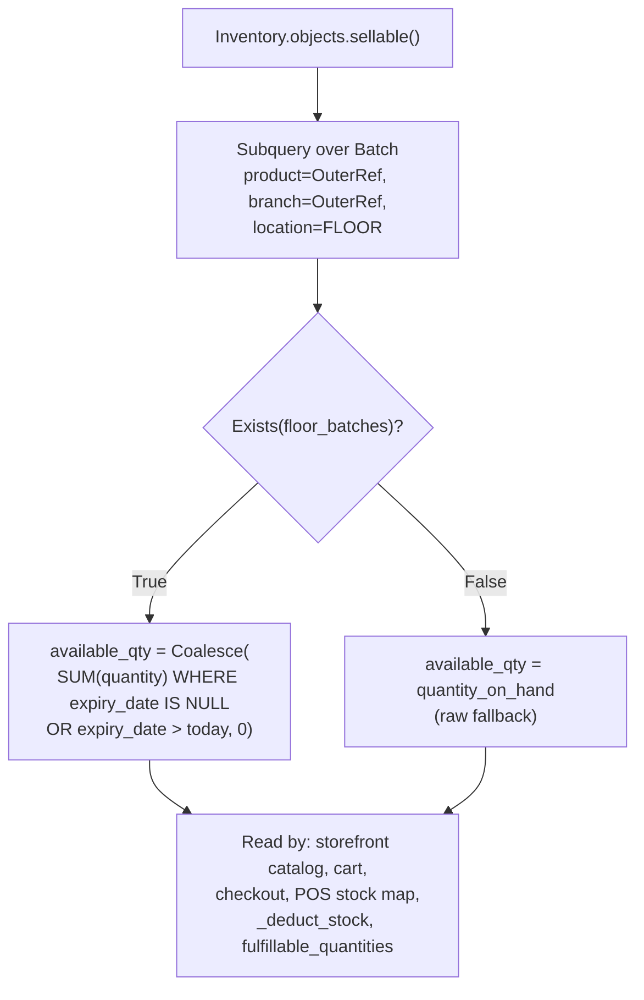
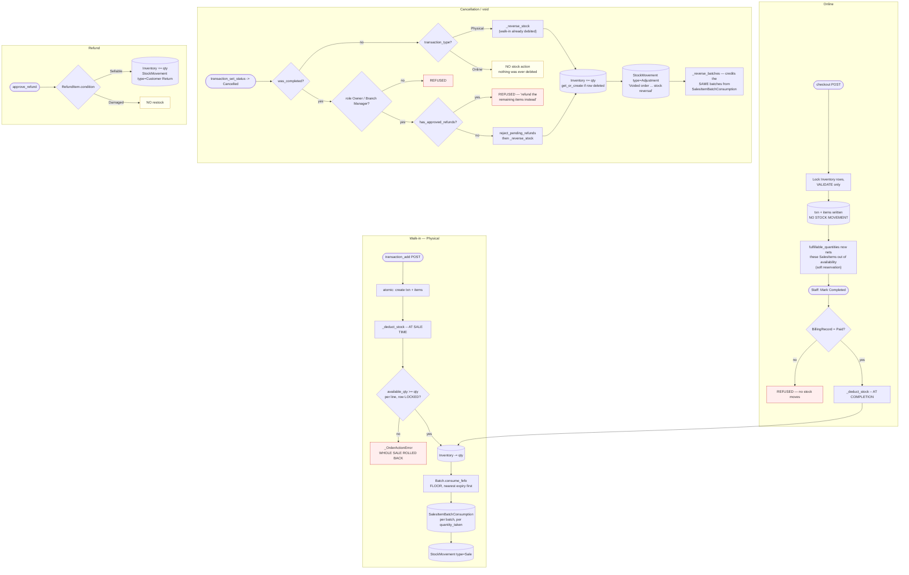
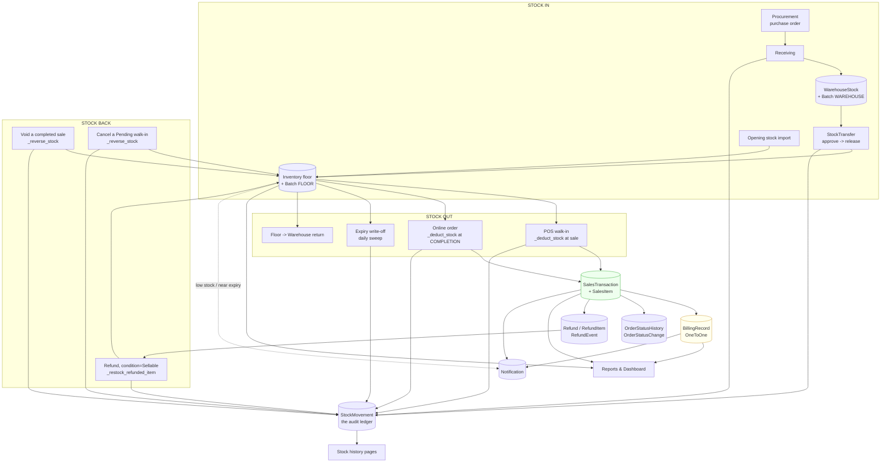
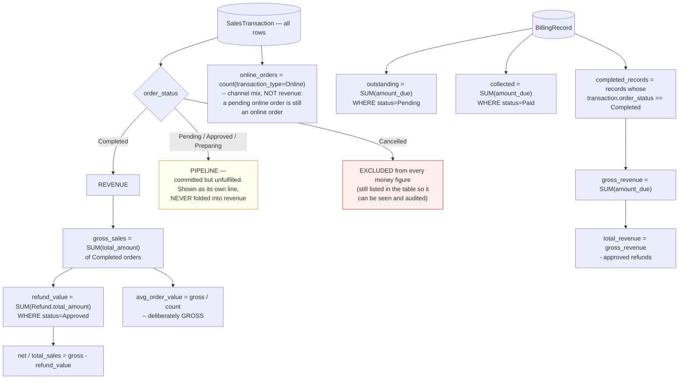

# 04 — Inventory & Cross-Module Flow

Verified against `inventory/models.py`, `inventory/services.py`,
`inventory/views.py`, `sales/views.py`, `sales/refunds.py`,
`procurement/services.py`, `reports/views.py`, `reports/services.py`.

---

## 1. Two stock locations, one ledger

| Location | Model | Credited by | Debited by |
|---|---|---|---|
| **Warehouse** | `WarehouseStock` (per `Warehouse`, which is per `Branch`) | Receiving a delivery; supplier replacement | Release of a `StockTransfer` to the floor; supplier return; expiry write-off |
| **Store floor** | `Inventory` (per `Product` × `Branch`) | `StockTransfer` release; opening-stock import; customer return (Sellable refund); void reversal | Sales; write-offs; floor→warehouse return; expiry write-off |

**`Inventory` is floor stock only.** Its docstring: *"Store floor stock only.
Stock enters here via a completed StockTransfer from the warehouse."* Nothing
sells off the warehouse.

Every change to either is recorded as a **`StockMovement`** row carrying
`movement_type`, `quantity_change`, `quantity_before`, `quantity_after`,
`reference_id`, optional `batch`, `notes` and `created_by`. That is the audit
trail, and it is the fastest-growing table in the schema (one row per sale line,
per receipt line, per transfer line, per adjustment) — which is why it carries an
explicit `['-created_at']` index.

### `movement_type` values relevant to Financials

| Value | Written by | Direction |
|---|---|---|
| `Sale` | `sales.views._deduct_stock` | − floor |
| `Adjustment` | `sales.views._reverse_stock` (void / walk-in cancel) | + floor |
| `Customer Return` | `sales.refunds._restock_refunded_item` | + floor |
| `Warehouse to Floor` | `inventory.views` transfer release — **two rows**, one per side | − warehouse, + floor |
| `Procurement Received` | `procurement.services` receiving | + warehouse |
| `Expiry Write-off` | `inventory.services.expire_due_batches` | − either |
| `Opening Balance` / `Opening Reversal` | opening-stock import / reverse | ± floor |
| `Supplier Return` | supplier return shipped | − warehouse |

---

## 2. `available_qty` — the only quantity the storefront and POS may trust

`Inventory.objects.sellable()` annotates `available_qty`: the portion of this
product/branch's **floor** stock whose expiry date has not arrived, summed
across its `Batch` rows.

Four properties to state precisely:

1. **Batch-aware, not a whole-row exclusion.** A product with one expired lot
   and one fresh lot still shows the *fresh* quantity as buyable, rather than
   disappearing entirely because *some* of its stock expired.
2. **A row with no batches at all falls back to raw `quantity_on_hand`**, not 0.
   Every real write path creates a matching batch now, so this only affects stock
   predating batch tracking — and in that case there *is* no expiry information,
   so the safe assumption is "available". This is different from a row whose
   batches are *all* expired, which correctly nets to 0.
3. **Deliberately not applied to internal Floor Stock management screens.** Those
   show the aggregate the daily sweep reconciles, and may surface a due lot
   during the short interval before the sweep runs.
4. **`quantity_on_hand` is the source of truth for the aggregate**; `available_qty`
   is a computed view of it. `_deduct_stock` checks `available_qty` but decrements
   `quantity_on_hand`.

---

## 3. Stock movement triggered by Sales & Orders

### Exactly-once stock: the four rules that make it hold

1. **One deduction per order, by channel.** `_deduct_stock` is called from
   `transaction_add` for `Physical` and from `transaction_set_status` **only
   when** `transaction_type == ONLINE`. A `Physical` order reaching `Completed`
   through `transaction_set_status` hits the `ONLINE` guard and does nothing.
2. **One reversal per order, by prior state.** `_reverse_stock` fires for
   `Cancelled` **either** when the order was not completed *and* is `Physical`,
   **or** when it *was* `Completed`. Those two conditions are mutually exclusive,
   so it cannot run twice in one call.
3. **Refund and void cannot both apply.** `Completed → Cancelled` is refused when
   `has_approved_refunds(txn)` — `_reverse_stock` credits the *full* quantity
   sold and would restock refunded units a second time, and the money side
   (`refunded_amount`, `Partially Refunded`) would have nothing coherent to
   reverse to.
4. **Every path is inside one `transaction.atomic()` with row locks.** A
   `_OrderActionError` raised mid-loop rolls back the whole block — *including
   any earlier line items already deducted in the same loop* — so a rejected
   action never partially applies.

### Batch-level integrity (finding O-1)

`_deduct_stock` records, on each `SalesItemBatchConsumption`, exactly which
batch(es) a line drew from and how much, straight from what `consume_fefo`
computed. `_reverse_batches` reads that back and credits **those same batches**,
so the aggregate `Inventory` row and the batch ledger agree again after a void
instead of drifting apart forever.

Two cases fall back to a fresh no-expiry batch, tagged as a void reversal *"so
the missing expiry data reads as honestly unknown rather than invented"*:

- a sale recorded before this tracking existed (no consumption rows at all), and
- a consumption row whose batch was itself deleted since (`SET_NULL` leaves
  `quantity_taken` behind with no batch to credit).

### Deleted products

`SalesItem.product` is `on_delete=SET_NULL` precisely so a hard-deleted catalog
product does not destroy sales history. Consequences:

- `_reverse_stock` **skips** a line whose `product_id is None` — there is no
  `Inventory` row to credit, and `product` is required on `Inventory`, so
  inserting one would raise `IntegrityError`. The skipped items are **returned to
  the caller**, and `transaction_set_status` warns the person voiding the order:
  *"N line item(s) (M unit(s) total) could not have their stock restored — the
  product has since been removed from the catalog."* The reversal is not silently
  short.
- `_deduct_stock` can never find stock for such a line either, so it always fails
  the normal availability check rather than crashing on it.

---

## 4. Stock coming in — receiving and transfers

```mermaid
flowchart LR
    A(["Supplier delivers against a PO"]) --> B["procurement.services receive<br/>DeliveryReceipt + DeliveryReceiptItem/Line"]
    B --> B1{"warehouse exists<br/>for this branch?"}
    B1 -- no --> BX["DeliveryError — cannot receive stock"]
    B1 -- yes --> B2{"qty <= remaining<br/>(unless is_unexpected)?"}
    B2 -- no --> BY["DeliveryError — exceeds remaining"]
    B2 -- yes --> C[("ProcurementItem.quantity_received += qty")]
    C --> D[("WarehouseStock locked,<br/>quantity_on_hand += qty")]
    D --> E[("Batch created:<br/>location=WAREHOUSE,<br/>expiry_date captured HERE")]
    E --> F[("StockMovement<br/>type=Procurement Received<br/>location=Warehouse")]
    F --> G[("Procurement.status -><br/>Received or Partially Received")]

    G --> H(["Staff raise a StockTransfer<br/>warehouse -> floor"])
    H --> I["Approve, then Release"]
    I --> I1{"warehouse stock and<br/>batch availability sufficient?"}
    I1 -- no --> IX["_InsufficientStockError"]
    I1 -- yes --> J[("WarehouseStock -= qty<br/>StockMovement<br/>type=Warehouse to Floor<br/>location=Warehouse")]
    J --> K[("Inventory get_or_create,<br/>quantity_on_hand += qty<br/>StockMovement<br/>type=Warehouse to Floor<br/>location=Floor")]
    K --> L["Batch.consume_fefo on the SOURCE<br/>warehouse lots, and create one<br/>matching FLOOR batch per lot —<br/>each keeping its own real expiry"]
    L --> M(["Now sellable:<br/>Inventory.sellable() counts it"])

    style BX fill:#fee,stroke:#c33
    style BY fill:#fee,stroke:#c33
    style IX fill:#fee,stroke:#c33
```

Three points:

- **Receiving credits the warehouse, never the floor.** Goods are not sellable
  the moment they arrive; a transfer has to move them.
- **A release writes two `StockMovement` rows**, one per side, both
  `Warehouse to Floor` — one with `warehouse_stock` set and
  `location_type='Warehouse'`, one with `inventory` set and
  `location_type='Floor'`.
- **Expiry dates are captured at receiving and carried through the transfer.** A
  release creates **one floor batch per source lot consumed**, so a restock with
  a different expiry cannot merge into whatever the floor already had. Two lots
  split across one release become two floor batches, each keeping its own real
  `expiry_date`.

### Scheduled jobs (management commands)

| Command | Effect |
|---|---|
| `inventory process_expired_stock` | `expire_due_batches` — zeroes due lots, writes `Expiry Write-off` movements, fires `EVENT_EXPIRY_WRITE_OFF` (deduplicated) |
| `inventory dispatch_notifications` | Pending notification dispatch |
| `inventory check_batch_reconciliation` | Reconciliation check between batch sums and `quantity_on_hand` |
| `procurement process_overdue_deliveries` | `EVENT_PO_OVERDUE`, then `EVENT_PO_OVERDUE_ESCALATED` |

These are cron-driven (`railway.cron.json`). **UNVERIFIED:** whether they are
actually scheduled in the group's demo environment. Do not claim expired stock is
swept automatically during the defense unless the command has been run.

---

## 5. The full cross-module picture

---

## 6. Sales, billing and reporting data flow

This section matters because *"do your reports reflect real transactions?"* is a
standard panel question, and the answer is **yes, with explicit definitions**.

### One definition of revenue, shared by web and API

`reports/services.py` owns `REVENUE_ORDER_STATUSES`, `PIPELINE_ORDER_STATUSES`,
`revenue_sales()`, `pipeline_sales()`, `gross_sales_total()`,
`refund_value_total()`. `reports/views.py` and `reports/api_views.py` both import
them — the views module used to carry its own copy, *"which is how the API and the
web report drifted."*

### Four definitions to quote verbatim if asked

1. **A sale is revenue only once `order_status == 'Completed'`.** A `Cancelled`
   order is a voided/returned sale, and a `Pending`/`Approved`/`Preparing` order
   has not moved stock or been paid for. Neither belongs in Total Sales, the
   daily trend, the Sales-by-Branch donut, or the average transaction value.

2. **A refund never changes `order_status`.** A refunded order is still
   `Completed` and still in `completed_records`, so every revenue figure
   subtracts approved refunds separately. The code comment is explicit: *"without
   this, a fully-refunded order kept counting its original `amount_due` as
   revenue forever."* Only `status=Approved` refunds count — `Pending`/`Rejected`
   requests moved no money.

3. **Only the money figures use `revenue_qs`; the transactions table shows every
   row.** The Sales tab lists `Cancelled` orders too, so they can be seen and
   audited. This closed a real inconsistency: *"a voided ₱300 sale still showed
   as ₱300 / 1 order / ₱300 ATV here while the Billing tab correctly showed ₱0 on
   the same data."*

4. **`avg_order_value` stays on the GROSS figure deliberately** — it describes
   the size of a typical completed order, not a figure blended with refunds that
   don't line up one-to-one with the window's own orders.

### Report access and scoping

| Control | Rule |
|---|---|
| Role | `@management_report_required` → `MANAGEMENT_REPORT_ROLES = (OWNER, BRANCH_MANAGER)`. Staff never see reports, whatever module grants their account carries |
| Anonymous | `redirect_to_login(request.get_full_path(), LOGIN_URL)` — returns here afterwards |
| Signed-in, wrong role | **Real 403**, rendered by `templates/403.html` — never a 200 "no access" page |
| Module layer | `user_can_perform_module_action` caps `REPORTS` to `REPORT_ROLES`; `ModulePermissionMiddleware` raises `PermissionDenied` for a Staff account rather than a flash redirect, *"that would imply the Owner could unlock it"* |
| Branch | `branch_ids_for_user`; `?branch=` honoured only when that returns `None` (Owner) |
| Date range | `core.timebounds.range_from_request` + `local_range_bounds` |

Three places keep this consistent and must agree:
`core.permissions.MANAGEMENT_REPORT_ROLES`,
`core.module_permissions.REPORT_ROLES`, and
`reports.api_views.check_report_access`.

### A timezone trap the code documents

`date_recorded` and `transaction_date` are `DateTimeField`s. Using
`date_recorded__date__gte` goes through `CONVERT_TZ` on MySQL and **silently
matched zero rows** — which once made both date inputs return an empty report for
every range. `local_range_bounds` turns local calendar days into aware bounds
(half-open, inclusive of the whole end day) instead. Worth a sentence if the
panel asks about timezone handling.

### CSV export

`export_csv(request, kind)` is `@management_report_required` and inherits the
same branch and range filters as the page it exports, so a download reflects the
rows on screen rather than the branch's whole history (finding
KATRINA-REPORT-002). `_csv_safe(value)` guards against formula injection in
spreadsheet software.

---

## 7. Alerts and reorder levels

`inventory.alerts.stock_status(available, reorder_level)` is the single tiering
function, read by the Floor Stock list, the Alerts Center, the POS stock map,
the storefront cart rows **and** the product page's per-branch panel (finding
S-4 — the templates used to hard-code `<= 10`, disagreeing with what
`Inventory.reorder_level` actually said was low).

`urgent_alert_count(branch_ids)` backs the sidebar badge and counts everything
the Alerts Center surfaces: floor low stock, warehouse low stock,
expired/expiring/approaching-expiry batches, **and** overdue deliveries. It
previously counted floor low stock only, so the badge could read 0 while the page
it linked to had expired batches sitting on it (finding KATRINA-ALERT-001). It is
branch-scoped and cached per user for 30 seconds.

---

## 8. Over-commitment reporting (finding S-11)

An open order is **over-committed** when, added to every other open order for the
same branch and product, it asks for more than that branch's current sellable
floor stock — i.e. the branch has promised more of an item than it can pull.

`sales.views._over_committed_order_ids(user)` computes this per request, scoped
through `scope_queryset`, and the Order Console flags those rows.

**It is reporting only.** Nothing reserves or holds stock, so a completed
transfer or a cancelled order elsewhere can clear the flag before `Preparing`
without any code path having to release a hold. This is the staff-side
counterpart to the storefront's `fulfillable_quantities` soft reservation — the
same arithmetic, surfaced as a warning instead of a refusal.

---

## 9. Step-by-step data trace — one unit, from supplier to customer and back

| Step | Actor | Action | Data created / updated | Stock effect |
|---|---|---|---|---|
| 1 | Owner | Approve a purchase order | `Procurement.status='Approved'`; `Notification` to requester + supplier | — |
| 2 | Supplier | Deliver | — | — |
| 3 | Staff | Receive, qty 10, expiry 2027-01-31 | `DeliveryReceipt`, `DeliveryReceiptItem`, `DeliveryReceiptLine`; `ProcurementItem.quantity_received=10`; **`WarehouseStock` +10**; **`Batch`** (`WAREHOUSE`, expiry); **`StockMovement`** `Procurement Received` | Warehouse +10 |
| 4 | Staff | Raise + approve + release a transfer of 10 | `StockTransfer`, `StockTransferItem`, `StockTransferEvent`; **`WarehouseStock` −10** + movement; **`Inventory` +10** + movement; **`Batch`** (`FLOOR`, same expiry) | Warehouse −10, Floor +10 |
| 5 | Customer | Order 3 online | `SalesTransaction` (`Online`,`Pending`), `SalesItem` (3), `BillingRecord` (`Pending`), `OrderStatusHistory` | **Floor unchanged.** `fulfillable_quantities` now reports 7 |
| 6 | Staff | Approve → Preparing | 2 audit rows each + `Notification` each | Floor unchanged |
| 7 | Staff B | Verify the payment | `BillingRecord.status='Paid'`, `confirmed_by`, `date_confirmed`; `Notification` | Floor unchanged |
| 8 | Staff | Mark Completed | `order_status='Completed'`, `completed_at`; 2 audit rows; **`Inventory` −3**; `Batch` drained FEFO; **`SalesItemBatchConsumption`**; **`StockMovement`** `Sale`; `Notification` | **Floor 10 → 7** |
| 9 | Customer | Returns 1, defective, within 7 days | `Refund` (`Pending`), `RefundItem` (qty 1, `Damaged`), `RefundEvent`; `Notification` to Owner/Manager | Floor unchanged |
| 10 | Owner | Approve the refund | `Refund.status='Approved'`, `refunded_by`, `refunded_at`, `RefundEvent`; **`SalesTransaction.refunded_amount` += amount** (`total_amount` untouched); `BillingRecord.status='Partially Refunded'`; `Notification` | **No restock — condition was `Damaged`** |
| 11 | *(alternative)* | Same but condition `Sellable` | as above | **`Inventory` +1**, `StockMovement` `Customer Return` |
| 12 | Reports | Sales tab | — | Order counts as revenue at `total_amount`, **minus** the approved refund |

---

## 10. Where a panel could reasonably push back

These are real, documented limits — better to own them than be caught by them.

| Limit | Reality |
|---|---|
| Soft reservation, not a hard hold | `fulfillable_quantities` nets out open online orders on *read*. Nothing writes a reservation row, so two shoppers *can* both be shown the same unit between two reads. The hard guard is the `select_for_update()` lock in `checkout` and `_deduct_stock` |
| Online stock is promised before it is debited | Deliberate: the goods have not been handed over. The cost is that an online order can be accepted and later fail at `Mark Completed` with "Not enough stock" if the floor was drained by walk-in sales meanwhile. That failure is safe — it rolls back — but it is a real operational case |
| Expired stock lingers until the sweep runs | `quantity_on_hand` still includes expired units until `process_expired_stock` writes them off. `available_qty` is what protects every sale path in the meantime |
| No delivery-fee model | The ₱500 "free delivery" meter is display only; no fee is stored on any order |
| Refunds are recorded, not paid out | Same limitation as payments — `Refund.refund_method` records how money was returned; no gateway moves it |
