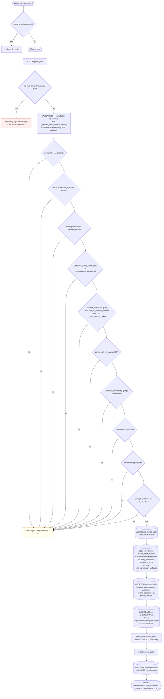
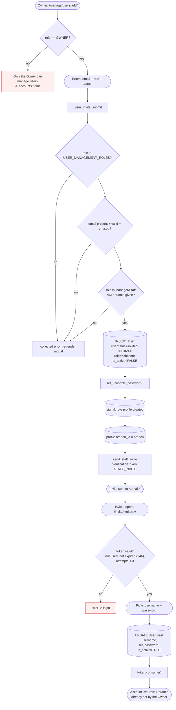
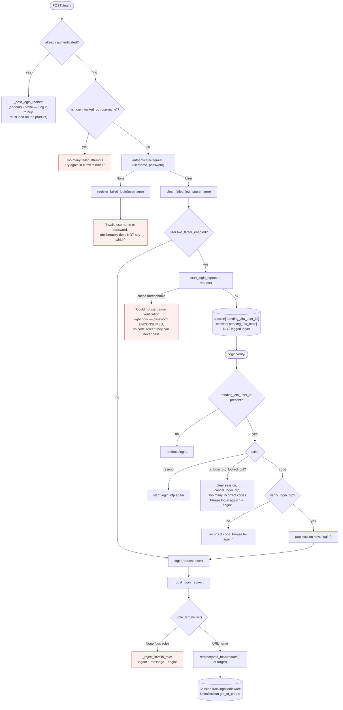
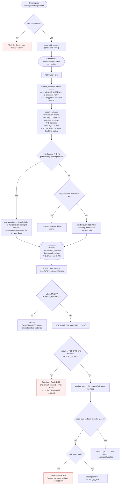
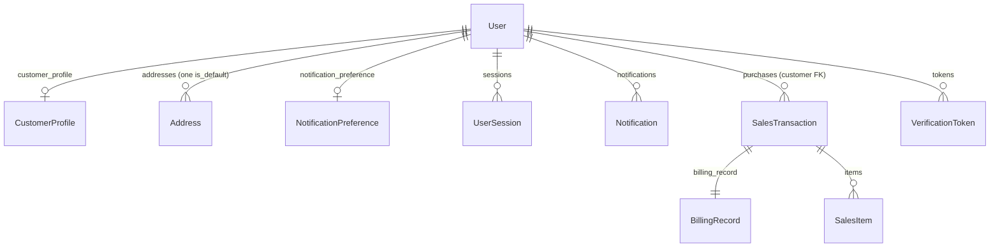

# 08 — User Accounts, Authentication & Sessions

Verified against `accounts/models.py`, `accounts/views.py`,
`accounts/api_views.py`, `accounts/signals.py`, `accounts/services.py`,
`accounts/middleware.py`, `accounts/validators.py`, `accounts/two_factor.py`,
`accounts/rate_limit.py`, `accounts/password_reset_views.py`,
`accounts/role_policy.py`, `core/permissions.py`, `core/module_permissions.py`.

---

## 1. Two completely different account-creation workflows

**Do not describe these as one flow.** They differ in who initiates, what is
collected, and what the account can do on day one.

| | **Customer self-registration** | **Internal staff provisioning** |
|---|---|---|
| Who starts it | The visitor | **The Owner only** |
| Entry point | `/register/` → `register_view` | `/manage/users/add/` → `user_form` → `_user_invite_submit` |
| Role produced | `CUSTOMER`, hardcoded | `OWNER`, `BRANCH_MANAGER`, `STAFF`, `SUPPLIER` (`USER_MANAGEMENT_ROLES`) |
| Credentials | Visitor sets username + password immediately | **Neither.** A placeholder username `invited-<uuid hex[:24]>` and `set_unusable_password()` |
| `is_active` at creation | `True` | **`False`** until the invite is completed |
| Branch | None (customers have no branch) | **Required** for `BRANCH_MANAGER` / `STAFF` |
| Completion | Logged in immediately | Emailed `STAFF_INVITE` token → `staff_invite_complete` where they pick their own username + password |
| Consent | `accept_terms == '1'` required; `terms_accepted_at` + `terms_version` recorded | Not applicable |
| Address | **Required** — one default `Address` row created | Not collected |
| Rate limited | ✅ `is_rate_limited('register', client_ip, ...)` | Owner-gated, so no |

### Customer registration



**Four details worth stating:**

1. **Why the address is mandatory.** *"This is the only place (with Settings →
   Addresses) an address is captured: checkout shows it read-only and ships to
   it, so an account needs one from the start."* Without it, a Delivery checkout
   would be refused.
2. **Why `accept_terms != '1'` is checked server-side.** The checkbox's HTML
   `required` is only a browser nicety — a POST built by hand skips it. It must
   be *exactly* `'1'`, not merely present, so a scripted `accept_terms=false`
   does not count.
3. **Why passwords are excluded from `_register_form_values`.** *"A password
   re-rendered into HTML is a password in the browser's view-source and in
   whatever proxy cached the response."* Every other field *is* echoed back,
   because the view rejects on several separate conditions and previously
   re-rendered blank, making the visitor retype everything to fix one field.
4. **Email verification is optional.** Login is not gated on it — only enabling
   Two-Factor Authentication is. So a send failure must not block account
   creation, and the user is told which of the two outcomes happened.

### Internal staff provisioning (invite flow)



**Why the placeholder username exists:** *"A real username doesn't exist yet —
the invited person picks their own on the completion page. This placeholder is
never shown anywhere and gets overwritten the moment they do; it only exists
because the column itself is required and unique."*

**The security property:** an invited account cannot log in before the invite is
completed, because `is_active=False` **and** the password is unusable. A role and
branch are chosen by the Owner, never by the invitee — so an invitee cannot
self-elevate.

---

## 4. Login, 2FA, and lockout



### Design decisions that are worth a sentence each

**Role is validated before `next`.** `_post_login_redirect` resolves
`_role_target(user)` *first*. Preferring `next` before that check would let an
account with an unplaceable role stay logged in and browse, which is exactly the
state `_reject_invalid_role` exists to prevent — the bad role has to be caught
however the user arrived.

**`_reject_invalid_role` logs the user out.** An unrecognized role must never
fall through to `accounts:login` while still authenticated — with `login_view`'s
own "already authenticated" redirect at the top, that is an infinite redirect
loop instead of a login page.

**`safe_next` is validated against the host.** `next` arrives from a query string
on the way in and a hidden field on the way back out, either of which an attacker
can set, and `redirect()` will happily send the browser to another origin.
`url_has_allowed_host_and_scheme(nxt, allowed_hosts={request.get_host()},
require_https=request.is_secure())`. The storefront has three sibling helpers for
the same reason: `_safe_next`, `_safe_get_next`, `_safe_referer`.

**`next` round-trips through a failed attempt** via a hidden field, "otherwise a
typo in the password quietly costs the shopper their place."

**With 2FA, `login()` does not happen until the code is verified.** Only a
session pointer is set. `next` survives in the session rather than a hidden field
on the code form, "since there is no reason to expose it there."

### Post-login destinations (`_role_target`)

| Role | Lands on |
|---|---|
| `OWNER` | `accounts:owner_dashboard` |
| `BRANCH_MANAGER` | `accounts:manager_dashboard` |
| `STAFF` | `accounts:staff_dashboard` |
| `SUPPLIER` | `accounts:supplier_dashboard` |
| `CUSTOMER` | `accounts:customer_dashboard` |

`home_view` ("/") also redirects `INTERNAL_ROLES` and `SUPPLIER` to their own
dashboards, because "/" is the PWA `start_url` and the storefront is not their
landing experience — a supplier landing there "can't use any of its links… they
could not even reach Logout from there." The one exception is `?preview=1` for an
internal user previewing the Owner's staged storefront hero.

---

## 5. Password recovery and password change — two separate mechanisms

| | **Forgot password** (not logged in) | **Change password** (logged in) |
|---|---|---|
| Entry | `/forgot-password/` → `forgot_password_view` | `/profile/change-password/` → `change_password` |
| Token | Django's `PasswordResetTokenGenerator` (`uidb64`/`token`) | `VerificationToken` `PURPOSE_PASSWORD_CHANGE` (UUID) |
| Confirm | `GerlynPasswordResetConfirmView` → `GerlynPasswordResetCompleteView` | `/password-change/confirm/<uuid:token>/` → `confirm_password_change` |
| Email step | Always | Only via `request_password_change_email` |
| Attempt limit | Django's token expiry | `VerificationToken.MAX_ATTEMPTS = 3`, then the token is consumed |

`VerificationToken` covers five purposes — `EMAIL_VERIFY`, `EMAIL_CHANGE`,
`PASSWORD_CHANGE`, `ACCOUNT_DEACTIVATE`, `STAFF_INVITE` — with
`EXPIRY_HOURS = 24`, `MAX_ATTEMPTS = 3`, single-use (`is_used`), and
`register_failed_attempt()` which consumes the token once the attempt limit is
hit.

---

## 6. Session management

### `UserSession` — why it exists

Django's own session store has **no user→sessions index**, so it cannot be
queried without scanning `django_session`. `accounts.UserSession` is one row per
active login, which is what makes Settings → Sessions listable and individually
revocable.

`SessionTrackingMiddleware` keeps it in sync, and checks **both** before and
after the view:

- **Pre-view**, so a view like Settings → Sessions sees its *own* session already
  recorded (an already-authenticated request has a `session_key` from the moment
  `SessionMiddleware` loads the cookie).
- **Post-view**, to catch the login request itself, where
  `request.session.session_key` only becomes real partway through the view once
  `login()` runs.

It only hits the database **once** for an ordinary already-authenticated request:
the post-view check is skipped when the session key hasn't changed since
pre-view. *"Without this, every single authenticated page view on the site paid
for two `get_or_create()` round trips against MySQL instead of one — a fixed tax
on every click."* `last_active` is only rewritten past
`TOUCH_INTERVAL = 1 minute`.

### Session surfaces

| Action | URL | Effect |
|---|---|---|
| List | `/profile/sessions/` → `sessions_view` | `get_active_sessions(user)` — pruned lazily against unexpired `django_session` rows; no cleanup job |
| Revoke one | `POST /profile/sessions/<pk>/revoke/` | Deletes the `django_session` row **and** the `UserSession`. Refuses the current one: *"That's your current session — use Logout for that instead."* |
| Revoke others | `POST /profile/sessions/logout-others/` | `revoke_other_sessions(user, keep_session_key=...)` |
| Logout | `/logout/` → `logout_view` | `logout(request)` then `redirect('/')` |

`get_object_or_404(UserSession, pk=pk, user=request.user)` — the ownership clause
is in the query, so you cannot revoke another user's session.

### Two protections against stale authenticated pages

- **`NoCacheForAuthenticatedMiddleware`** sets `Cache-Control: no-store,
  no-cache, must-revalidate, private` on every authenticated response. *"Without
  this, pressing Back after logout (or after an idle timeout) can redisplay a
  cached copy of a protected page straight from the browser's bfcache/disk cache
  — no request ever reaches Django, so `login_required` never gets a chance to
  reject it."*
- **Idle timeout** — `templates/_idle_timeout.html` plus the idle-timeout logout
  path, which also removes the `UserSession` row.

---

## 7. Profile, avatar, and personal data

| Surface | URL | Notes |
|---|---|---|
| Profile | `/profile/` → `profile_view` | Merged page; Saved Addresses is the `#addresses` card on it, not its own rail row |
| Update | `POST /profile/update/` | Contact number validated with `validate_ph_mobile_number` + duplicate check |
| Avatar | `POST /profile/update-avatar/` | `_validate_avatar` — **real** image check via Pillow (`img.verify()`), JPEG/PNG/WEBP only, max 2 MB |
| Addresses | `/profile/addresses/` + add/edit/delete/set-default | `Address.set_as_default()` unsets any other — one default per user, enforced in code, not at DB level |
| Address picker data | `/geo/regions|provinces|cities|barangays|search|reverse/` | Bundled PSGC dataset, **no external calls** |
| Notification prefs | Merged into `/notifications/` | `order_updates`, `promotions`, `delivery_reminders`, `newsletter`. The `NotificationPreference` row is created **lazily** by `get_or_create`, not by a signal. ⚠️ The toggles save but gate nothing — finding **A-3** |
| Language | `/profile/language/` → `language_view` | `en` / `fil`; saved on `User.language` **and** `session['language']` |
| Privacy & Data | `/profile/privacy/` → `privacy_view` | Account deactivation |
| Public policy | `/terms-privacy/` → `terms_privacy_view` | **Deliberately public** — the sign-up consent box links here and the reader has no account yet |

### `Address` structure

`text` is the **source of truth** for the human-readable address shown
everywhere. The structured fields store **PSGC codes**, not names — names are
looked up on demand via `accounts.geo`, "which keeps these in sync with the
bundled dataset instead of freezing a copy." `latitude`/`longitude` are nullable
so a typed address without a map pin remains valid; automatic fulfillment uses
the pair when present and falls back to `city`/`barangay`.

### Deactivation vs. personal-data erasure — two different things

| | **Deactivation** (self-service) | **Personal-data erasure** (Owner only) |
|---|---|---|
| Effect | `is_active = False` | Identity fields on the row blanked |
| Reversible | ✅ Fully | ❌ Never |
| Who | The account holder | `accounts.services.hard_delete_personal_data`, Owner-triggered |
| Path | 2FA off → `deactivate_account_confirm` (password on the page). 2FA on → `deactivate_account_request` → emailed `ACCOUNT_DEACTIVATE` token → `confirm_account_deactivation` | `/manage/users/<pk>/hard-delete/` |
| Audit | — | `deleted_at` + `deleted_by` (FK to the Owner) |

**The row itself is never deleted**, and no FK is ever cleared. *"Every table
that references this user by id — sales, stock movements, billing confirmations
— keeps working exactly as before; only the identity fields on THIS row go
blank. This pair is the accountability record itself: who erased it and when."*

Suppliers cannot self-deactivate — guarded on **both** POST endpoints, not just
the page they are posted from, "a Supplier POSTing this URL directly would
otherwise still trigger a real deactivation email."

`confirm_account_deactivation` is **not** login-gated: the token identifies the
account and the password re-entered proves ownership, with the same 3-attempt
lockout.

---

## 8. Roles, permissions, and branch access



### Default grants by role (`ROLE_DEFAULT_MODULES` / `ROLE_DEFAULT_ACTIONS`)

| Role | View modules | Notable write grants |
|---|---|---|
| `OWNER` | All 10 | Every action the registry supports |
| `BRANCH_MANAGER` | All 10 | `withdrawals` A/E, `sales_pos` A/E, `billing` E, `procurement` A/E/D, `deliveries` A/E, `floor_stock` A, `alerts` D |
| `STAFF` | **9** — everything except `reports` | `sales_pos` A/E, `billing` E, `deliveries` E, `withdrawals` A/E, `floor_stock` A, `alerts` D. **No `procurement` writes** |
| `SUPPLIER` | `procurement`, `deliveries` | none (own portal has its own checks) |
| `CUSTOMER` | `sales_pos`, `billing` | none |

> ⚠️ `CUSTOMER` carrying `sales_pos` and `billing` in `ROLE_DEFAULT_MODULES`
> looks alarming but is **inert**: `user_can_perform_module_action` returns
> `True` for every non-Staff/Manager role, so these entries are never read as a
> grant. Actual customer access is decided entirely by the role checks on the
> views — `billing_list` is `role_required(OWNER, BRANCH_MANAGER, STAFF)`, and
> `transaction_detail` refuses any non-internal role. The entries exist so
> "irrelevant internal modules [stay] unchecked" in the role-switch UI. Worth
> knowing in case a panel member reads the file. See finding **D-3**.

**`alerts` DELETE** is the expiry write-off (`inventory.views.expiry_write_off`),
not a destructive delete — it only ever zeroes a lot that is *already* expired.
The view always allowed Owner/Manager/Staff; the defaults previously didn't match
(finding KATRINA-RBAC-001).

### Branch assignment

Branch lives on the **role profile**, not on `User`:

| Role | Field |
|---|---|
| `BRANCH_MANAGER` | `BranchManagerProfile.branch` |
| `STAFF` | `StaffProfile.branch` |
| `SUPPLIER` | `SupplierProfile.branch` — blank means "available to every branch" |
| `OWNER` | none; `Branch.owner` points the other way |
| `CUSTOMER` | none |

All are `on_delete=SET_NULL`, so **deleting a branch nulls them out** — which is
exactly why `branch_ids_for_user` must return `[]` (not `None`) for an unassigned
Manager/Staff. `core/scoping.py` carries an explicit warning against the
fail-open idiom.

A Manager/Staff account with a null branch is a **real, reachable state**, and
the system handles it:

- `_pos_user_branch` returns the sentinel `POS_BRANCH_UNASSIGNED` — *deliberately
  not `None`*, because `None` means "unrestricted, the Owner picks a branch" and
  collapsing them handed an unassigned Staff account the Owner's every-branch
  selector and skipped the posted-branch access check. `transaction_add` refuses
  on both GET and POST: *"Your account is not assigned to a branch, so it cannot
  record sales."*
- Every list view shows nothing, via `scope_queryset` returning an empty filter.

### Account activation / deactivation by the Owner

`user_toggle_active` (`/manage/users/<pk>/toggle/`) — *"Deactivate/reactivate an
account without deleting its audit history."* An inactive account cannot log in
(Django's `ModelBackend`), and is excluded from notification fan-out:
`core.notifications._recipients` filters `is_active=True`, and `notify_customer`
/ `notify_supplier` both no-op for an inactive account.

Also available: `user_cancel_invite`, `user_resend_invite`, `customer_list`
(read-only roster of customers).

---

## 9. How a customer account connects to orders, billing, and notifications



| Link | Field | `on_delete` | Consequence |
|---|---|---|---|
| Customer → orders | `SalesTransaction.customer` | `SET_NULL` | Erasing a customer leaves the sale intact and anonymised |
| Order → billing | `BillingRecord.transaction` | `CASCADE` | Deleting an order deletes its bill — but no view deletes orders |
| Customer → notifications | `Notification.user` | `CASCADE` | — |
| Delivery address | **Not an FK.** `delivery_address` is a `TextField` **snapshot** copied from `Address.text` at checkout | — | **Editing the saved address later does not rewrite past orders.** This is correct: the order records where it was actually sent |

**That last row is a good answer to a likely panel question.** The order keeps a
frozen copy of the address, so changing your profile address does not retroactively
alter delivery history.

### Order ownership — enforced in three places

```
my_orders:           SalesTransaction.objects.filter(customer=request.user)
track_order:         get_object_or_404(..., id=transaction_id, customer=request.user)
order_confirmation:  get_object_or_404(..., id=transaction_id, customer=request.user)
```

All three put ownership **in the query**, so another customer's id produces a
**404**, never a 403 that would confirm the order exists. The same convention is
used by `user_can_access_billing_record` on the API side.

---

## 10. The second registration path — and how it differs

`/api/auth/register/` → `RegisterCustomerView` (`permission_classes = [AllowAny]`).

It shares the consent gate (`acceptTerms` must be `True`/`'true'`/`'1'`) and
password validation, and wraps account + profile updates in
`transaction.atomic()`. But it is **not equivalent** to `register_view`:

| Check | `register_view` | `RegisterCustomerView` |
|---|---|---|
| Rate limiting | ✅ `is_rate_limited('register', IP)` | ❌ |
| Username length / `username_validator` | ✅ | ❌ |
| `validate_email` format | ✅ | ❌ (only a uniqueness check) |
| `validate_ph_mobile_number` | ✅ | ❌ |
| `contact_number_taken` | ✅ | ❌ |
| Address **required** | ✅ | ❌ |
| **`Address` row created** | ✅ `is_default=True` | ❌ **none** |
| `terms_accepted_at` / `terms_version` | ✅ | ✅ |
| `acceptTerms` gate | ✅ | ✅ |
| Logs in immediately | ✅ | ✅ |

**The practical consequence:** an account created through the API has **no
default `Address`**, so `checkout` refuses any Delivery order from it with *"Add
a delivery address to your account — open Settings then Addresses."* The customer
can fix it in Settings, so this is a divergence rather than a dead end — but it
is a real inconsistency between two live signup paths. See finding **C-1**.

---

## 11. Exception paths — what is written and what is not

| Scenario | Records created / updated | Records unchanged |
|---|---|---|
| Registration, any validation failure | *none* | Form re-rendered filled in (minus passwords) |
| Registration, rate limited | *none* | — |
| Registration, consent unticked | *none* | — |
| Registration succeeds but email send fails | `User`, `CustomerProfile`, `Address`, `UserSession` | `is_email_verified` stays `False`; warning shown; retry from Settings |
| Login, wrong password | Failed-login counter (cache) | No session |
| Login, locked out | *none* | Counter untouched |
| 2FA, OTP backend unreachable | *none* | **Password unconsumed** — user can retry |
| 2FA, too many wrong codes | Session pointers cleared, OTP cancelled | Not logged in |
| Login with an unrecognised role | `logout()` | Sent to `/login/` with a message |
| Session expires mid-checkout | *none* | Cart lost with the session; `@customer_required` → login with `?next=` |
| Invite token expired / over-attempted | `VerificationToken.attempts` (and `is_used` at 3) | Account stays `is_active=False` |
| Owner deactivates an account | `User.is_active=False` | All history intact; excluded from notification fan-out |
| Owner erases personal data | Identity fields blanked, `deleted_at`, `deleted_by` | **Row and every FK kept** |
| Customer self-deactivates | `is_active=False`, `logout()` | Orders, billing and notifications all intact |
| Staff/Manager branch deleted | Profile `branch` → `NULL` | Account exists but **sees nothing**; POS refuses |

---

## 12. Security measures, in one list

| Measure | Where |
|---|---|
| Custom user model, no dependency on Django's default | `accounts.User(AbstractUser)` |
| Password strength | `django.contrib.auth.password_validation.validate_password` on register, invite completion, change, and the Owner's inline manager creation |
| Login brute-force lockout | `accounts.rate_limit.is_login_locked_out` / `register_failed_login` |
| Registration flood protection | `is_rate_limited('register', client_ip, ...)` — web path only |
| 2FA | Emailed 6-digit OTP, with its own lockout; `login()` deferred until verified |
| Single-use, expiring, attempt-limited tokens | `VerificationToken` — 24h, 3 attempts, 5 purposes |
| Open-redirect protection | `safe_next`, `_safe_next`, `_safe_get_next`, `_safe_referer` |
| No back-button leak after logout | `NoCacheForAuthenticatedMiddleware` |
| Session enumeration / revocation | `UserSession` + `SessionTrackingMiddleware` |
| Real image validation on uploads | `_validate_avatar`, `billing.views._validate_proof_of_payment` (both Pillow `verify()`) |
| Payment proofs behind authorization | `payment_proofs/` excluded from `/media/`; served only by checked views |
| CSRF | Django default; `templates/403_csrf.html` is a styled failure page |
| State-changing reads made POST | `mark_notification_read` is POST, *"a plain `<a href>` hands that change to anything that follows links — a prefetcher, a crawler, an accessibility tool"* |
| Django admin off by default on hosted deploys | `settings.ADMIN_ENABLED`, `settings.ADMIN_URL`, superuser-only gate in `core.admin_site` |
| Password never echoed into HTML | `_register_form_values` omits both password fields |
