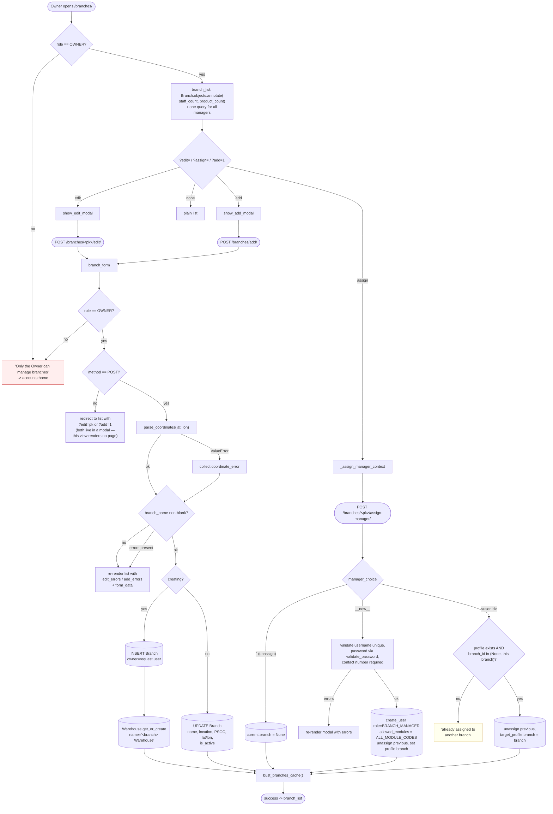
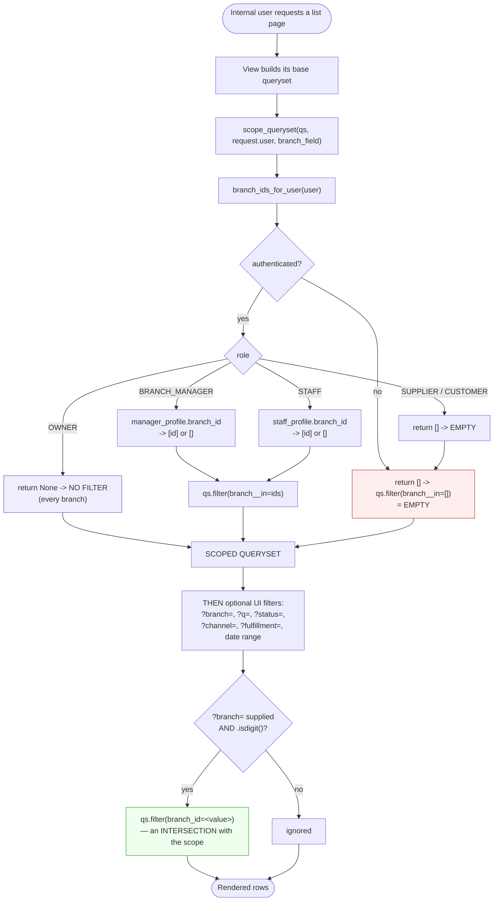
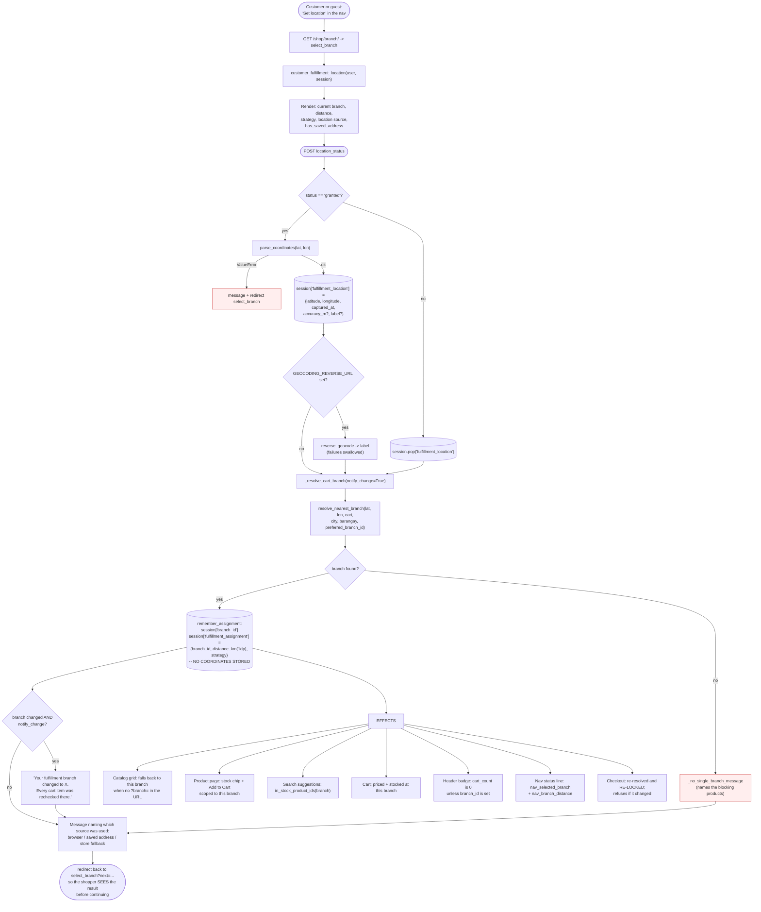
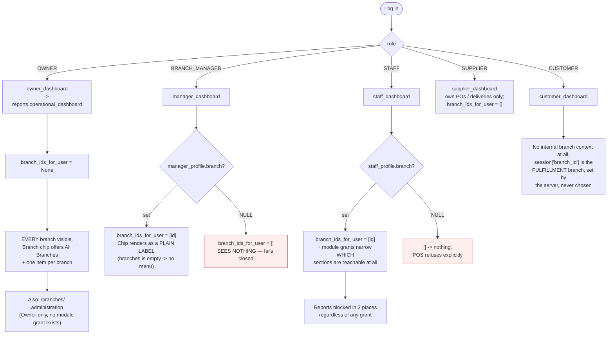

# 09 — Locations, Branches & Branch Navigation

Verified against `branches/models.py`, `branches/views.py`, `branches/services.py`,
`core/scoping.py`, `orders/services.py`, `orders/customer_views.py`,
`accounts/views.py`, `templates/partials/_branch_switch.html`,
`sales/views.py`, `billing/views.py`, `reports/views.py`.

---

## 1. There are TWO unrelated things called "branch" — separate them first

This is the single most important distinction in this document, and it is the
most likely place for a confused answer during the defense.

| | **Internal branch context** | **Storefront fulfillment branch** |
|---|---|---|
| Who it applies to | `OWNER`, `BRANCH_MANAGER`, `STAFF` | Customers and guests |
| What decides it | The account's **role profile** (`StaffProfile.branch` / `BranchManagerProfile.branch`) — Owner is unrestricted | The **server**, from a location hint + the cart's contents |
| Where it is stored | **Nowhere per-request.** Derived from the database on every request by `core.scoping` | `request.session['branch_id']` + `session['fulfillment_assignment']` |
| How it is "switched" | A `?branch=` **URL query parameter**, applied *after* scoping | It is **not** switchable. A posted `branch_id` is explicitly ignored |
| Is it a security boundary? | **No.** `?branch=` is a UI filter. `scope_queryset` is the boundary | No — it is a routing decision, re-resolved and re-locked at checkout |
| Fails closed? | **Yes** — `branch_ids_for_user` returns `[]` for an unassigned account | Returns `branch=None` and refuses checkout |

**One sentence for the panel:** *"Staff don't choose a branch — their account is
pinned to one and the server filters every query to it. Customers don't choose a
branch either — the server picks the one branch that can fulfil their whole
cart."*

---

## 2. The `Branch` model

| Field | Purpose |
|---|---|
| `owner` | FK → `User` with `limit_choices_to={'role':'OWNER'}`, `SET_NULL` |
| `branch_name` | Display name |
| `location` | Free-text address line (`TextField`) |
| `is_active` | **`db_index=True`.** *"Inactive branches are excluded from customer fulfillment."* |
| `region`, `province`, `city`, `barangay` | PSGC codes (same vocabulary as `accounts.Address`) |
| `street_detail` | Street line |
| `latitude`, `longitude` | `Decimal(9,6)`, nullable, with `MinValueValidator`/`MaxValueValidator` |

### Three database-level constraints

```
branch_coordinate_pair_complete  -- both null, or both set. Never one.
branch_latitude_in_range         -- null, or -90..90
branch_longitude_in_range        -- null, or -180..180
```

Plus `Branch.clean()` raising a paired `ValidationError` on both fields when only
one coordinate is supplied. So **a half-pinned branch cannot exist** — which is
what lets `resolve_nearest_branch` treat "has coordinates" as a single yes/no
test (`valid_coordinate_pair`) instead of defending against partial data.

### Reverse relations that matter

| From `Branch` | Relation |
|---|---|
| `transactions` | `SalesTransaction.branch` (`SET_NULL`) |
| `inventory` | `Inventory.branch` |
| `staff` | `StaffProfile.branch` (`SET_NULL`) |
| `managers` | `BranchManagerProfile.branch` (`SET_NULL`) |
| `suppliers` | `SupplierProfile.branch` (`SET_NULL`) — blank = all branches |
| `notifications` | `Notification.branch` (`SET_NULL`) |

Every one is `SET_NULL`, so **deleting a branch never cascades away sales
history** — but it *does* orphan staff accounts, which is exactly why scoping
must fail closed.

---

## 3. Branch administration — Owner only

All four views in `branches/views.py` open with the same gate:

```
if request.user.role != User.Role.OWNER:
    messages.error(request, 'Only the Owner can manage branches.')
    return redirect('accounts:home')
```

Note what is **absent**: branch management is **not** in
`MODULE_PERMISSION_REGISTRY`. `core/module_permissions.py` states the rule
directly — *"Branch Management and User Management… stay Owner-only, full
stop."* There is no module grant an Owner could give a Manager to unlock it.



### Branch creation always creates a warehouse

```
Warehouse.objects.get_or_create(branch=branch, defaults={'name': f'{name} Warehouse'})
```

*"Every branch needs a warehouse to receive/withdraw stock."* Without it,
`procurement.services` receiving raises `DeliveryError: No warehouse is
configured for <branch> — cannot receive stock.`

### One manager per branch, one branch per manager

`_assign_manager_context` offers only `BranchManagerProfile.objects.filter(
branch__isnull=True)`, and the direct-assign path refuses a profile whose
`branch_id` is neither `None` nor this branch. Assigning a new manager
**unassigns the previous one first** (`current.branch = None`).

A manager created inline gets `allowed_modules = ALL_MODULE_CODES` — *"the Owner
is setting this account up from scratch, so it starts with every module rather
than an empty grant that would lock them out."*

### Branch deletion is guarded by a service, not the view

`branches/services.py` → `delete_branch_if_safe(branch.pk)`, raising
`BranchDeletionBlocked` with a human-readable reason. The view surfaces that
reason as a flash message. A direct `GET` to the delete URL just redirects to the
list — the confirm step is a modal driven by `confirm-dialog.js` off the row's
Delete button, matching the project-wide delete pattern.

### `bust_branches_cache()`

`core.refdata` caches the branch list (it is read by nearly every page's filter
toolbar). Every create, edit, and manager assignment busts it, so a new branch
appears in the dropdowns immediately.

---

## 4. Internal branch context — how it actually works

**There is no "active branch" stored anywhere for an internal user.** There is no
session key, no profile field holding a *current* selection, and no middleware
setting one. Every request re-derives the permitted set from the database.



### The ordering is the whole security argument

`scope_queryset` runs **first**; `?branch=` is applied **on top**. So if a Branch
Manager at branch 1 hand-edits the URL to `?branch=2`:

```
qs.filter(branch__in=[1]).filter(branch_id=2)   ->   zero rows
```

They see an empty list, not another branch's data. **The filter cannot widen the
scope, only narrow it.** This is why `?branch=` being user-controllable is
harmless.

Confirmed in: `sales.views._transaction_list_context`, `billing.views.billing_list`,
`inventory.views` (Floor Stock, Warehouse Stock, Product Master List, Stock
Adjustments), `procurement.views`, `reports.views`, `core.views.notification_center_view`.

### Three different ways views handle `?branch=`

| Pattern | Used by | Behaviour |
|---|---|---|
| Accept from anyone, intersect with scope | `sales.transaction_list` | Harmless by construction (see above) |
| Only read it for the Owner | `billing_list`, `notification_center_view`, `billing_report` | `branch_filter = request.GET.get('branch','') if request.user.role == OWNER else ''` — *"Manager/Staff are already pinned, so a selector would do nothing for them"* |
| Only offer the switcher to the Owner | `transaction_list`, Floor Stock, etc. | `show_branch_filter = branch_ids_for_user(request.user) is None`; `branches = Branch.objects.all() if show_branch_filter else []` |

All three are safe. The second and third are also *honest* — they don't draw a
control that would do nothing.

### Non-list record access uses the point check

For a single record, `user_can_access_branch(user, branch_id)` is the equivalent:

```
ids = branch_ids_for_user(user)
return ids is None or branch_id in ids
```

Call sites: `transaction_detail`, `transaction_set_status`, `transaction_add`
(on the resolved branch, for **every** role), `billing_detail`, `billing_create`,
`billing_confirm`, `billing_proof`, `payment_proof_download`,
`BillingConfirmAPIView`, `BillingRecordDetailAPIView`, `BillingPaymentAPIView`.

> ⚠️ One trap the code calls out explicitly: for an Owner,
> `branch_ids_for_user` returns `None`, so `user_can_access_branch` alone says
> **yes to any id, real or not** — *"'no restriction' was being read as 'no need
> to check it exists'."* `transaction_add` therefore pairs it with an existence
> check, because otherwise a branch deleted while the Owner still had the page
> open would hit the FK constraint and 500.

---

## 5. The topbar branch switcher

`templates/partials/_branch_switch.html`. A pure-link `<details>` dropdown —
**no JavaScript, no POST, no session write.** Each item is
`?branch=<id>&<carried filters>`.

Context contract:

| Variable | Meaning |
|---|---|
| `branches` | The choices. **Empty hides the menu** and renders a plain chip |
| `branch_filter` | Current `?branch=` as a string, `''` for none |
| `filter_branch` | The matching `Branch` object — names the pill |
| `user_branch` | `branch_for_user(user)` — shown as plain text when `branches` is empty |
| `branch_switch_carry` | `[(name, value)]` of the page's **other** filters, so switching branch never drops the search/status/range |
| `readonly` | Renders the plain chip even with choices — for a page that already has its own branch tabs below |

`branch_switch_carry` is the mirror image of `_daterange.html`'s
`daterange_carry`: the range must survive a branch change, and the branch must
survive a range change. In `reports/views.py` it is built by
`_range_carry(active_range, range_start, range_end)`.

**`branch_for_user` must never be used to filter a queryset**, and its docstring
is an unusually direct warning:

> *"`None` is returned for TWO different situations that must not be treated
> alike: the Owner → sees ALL branches; a Manager/Staff whose profile branch is
> NULL → must see NOTHING. The idiom `if user_branch: qs = qs.filter(...)`
> silently hands that account every branch's data."*

It is for cases that genuinely want the `Branch` object and treat `None` as "ask
which branch": a form default, a filename label, a "should I show the Owner's
branch picker" check.

---

## 6. What changes when the branch filter changes

| Surface | Scoped on | Effect |
|---|---|---|
| Order Console | `SalesTransaction.branch` | Rows, **and the status tab counts** |
| Billing list | `transaction__branch` | Rows, status counts, **and the Outstanding total** |
| Floor Stock / Warehouse Stock | `Inventory.branch` / `warehouse__branch` | Rows and stock figures |
| Product Master List | — | Availability columns |
| Stock Transfers | `source_branch` / `destination_branch` via `transfers_visible_to` | Rows |
| Deliveries / Procurement | `Procurement.branch` | Rows |
| Reports Dashboard | `scoped_report_querysets(user, override_branch_id)` | Every KPI, trend, donut, branch breakdown |
| Billing report | `transaction__branch` | Outstanding, collected, revenue, payment breakdown |
| CSV export | same as its page | **Download matches the page**, not the whole history |
| Notification Center | `Notification.branch` | Rows and the per-category counts |
| POS | `_pos_user_branch` / `_pos_owner_branch` | Product dropdown, stock map, category tabs, "replaces" list |

Note the POS case: for an Owner, **the Items card is gated until a branch is
chosen**. Previously it fell back to every product in the system, embedding the
whole catalogue — unit price, tiers, eligibility flags, one `<option>` apiece —
in every item row, on a store whose catalog can run past a thousand SKUs.

---

## 7. Storefront location selection — the full picture

Already covered in [`03-storefront-online-ordering.md`](03-storefront-online-ordering.md) §3.
The diagram here is the **effects** view.



### Why it redirects back to `select_branch` instead of straight on

*"Return to this page so the shopper can see which location was used and which
branch it selected before continuing."* The destination is carried as
`?next=<validated url>` and defaults to the cart.

### Behaviour when the location is missing, invalid, changed, or unavailable

| Situation | What happens |
|---|---|
| Never shared, no saved address | `source='fallback'` → `_fallback_rank` with no city/barangay → `strategy='default'`, ordered by previous assignment, then `DEFAULT_FULFILLMENT_BRANCH_ID`, then pk |
| Coordinates malformed | `parse_coordinates` raises `ValueError` → message, nothing stored |
| Coordinates out of range | `_coordinate` returns `None` → treated as absent (also enforced by DB constraints on `Branch`) |
| Accuracy absurd | Accepted only if finite and `0 <= accuracy <= 100000`; otherwise dropped. **Never affects ranking** |
| Browser location older than 30 min | Popped from the session; falls through to the saved address |
| Shopper declines | `fulfillment_location` popped; told *"Location was not shared. Using your saved address (…)"* or *"the configured store fallback"* |
| Branch has no coordinates | Ranked **after** every located branch, by barangay → city → previous assignment → default → pk |
| Chosen branch goes inactive | `resolve_nearest_branch` only ever considers `is_active=True`; `nav_selected_branch` and `view_cart` both re-filter on `is_active=True`, so a stale `session['branch_id']` resolves to `None` and the next `_resolve_cart_branch` reassigns |
| Branch changes mid-session | `notify_change=True` → *"Your fulfillment branch changed to X. Every cart item was rechecked there."* |
| Branch changes during checkout | `checkout` compares against `displayed_branch_id` **twice** — once before the lock, once inside it — and **refuses both times**, sending the shopper back to review |
| No branch can cover the cart | `branch=None`; checkout refused with the blocking products named |
| No active branches at all | `strategy='no_active_branches'`, `branch=None` |

### Does the storefront location represent a branch, an address, or a preference?

**All three feed it, but it *is* none of them.** Precisely:

- The **input** is a location hint — browser coordinates (temporary), else the
  saved default `Address`, else a configured fallback.
- The **output** is a *fulfillment branch assignment*: which physical branch will
  supply this cart.
- It is **not** a delivery address. The delivery address is read separately at
  checkout from the account's default `Address` row, and only for `Delivery`.
- It is **not** a saved preference. It is recomputed on essentially every cart
  operation (`add_to_cart`, `update_cart`, `remove_from_cart`, `view_cart`,
  `select_branch`, `checkout`), with the previous assignment used only as a
  **tie-breaker** (`preferred_branch_id` in `_fallback_rank`).

---

## 8. Delivery vs. pickup — what the branch means for each

| | `Delivery` | `Pickup` |
|---|---|---|
| Who supplies it | The resolved fulfillment branch | The resolved fulfillment branch |
| `delivery_address` | A **snapshot** of `Address.text` for the account's default address | Always `''` |
| Where the customer goes | Nowhere | The branch — `track_order` shows `branch.branch_name` and `branch.location` |
| PWD/Senior discount | **Never** — no in-person verification exists | Allowed; requestable at checkout, approved at collection |
| `Pay at Store` | **Refused** server-side | Allowed |
| Completion notification | `notify_order_delivered` (`EVENT_ORDER_DELIVERED`) | Generic status notice via `notify_customer` |

**UNVERIFIED:** nothing in the code assigns a courier, computes a delivery radius,
or charges a delivery fee. The ₱500 "free delivery" meter on the cart is display
only. Do not claim the system manages delivery logistics.

---

## 9. Cross-branch leakage assessment

### Verified closed

| Vector | Guard |
|---|---|
| `?branch=<other>` on any list | `scope_queryset` applied first → intersection → empty |
| Non-numeric `?branch=` | `if branch_filter and not branch_filter.isdigit(): branch_filter = ''` — would otherwise raise `ValueError` inside the ORM |
| Guessing a `transaction_detail` pk | `user_can_access_branch(txn.branch_id)` → "That order belongs to another branch" |
| Guessing a `billing_detail` / `billing_create` / `billing_confirm` pk | `user_can_access_branch(record.transaction.branch_id)` |
| Guessing a billing pk via **API** | `user_can_access_billing_record` → **404**, which does not confirm existence (finding F-02) |
| Guessing a payment-proof pk | Both proof endpoints call `user_can_access_billing_record` |
| Posting another branch on the POS form | `user_can_access_branch` on the **resolved** branch, for *every* role — not just when it came from the Owner's dropdown |
| Unassigned Manager/Staff | `branch_ids_for_user` → `[]`; POS refuses via `POS_BRANCH_UNASSIGNED` |
| Staff reaching Reports | Capped in **three** places: `management_report_required`, `user_can_perform_module_action`, `ModulePermissionMiddleware` (which raises a real 403) |
| Customer reaching the Order Console | `transaction_detail` refuses non-internal roles outright |
| Customer reaching Billing pages | `role_required(OWNER, BRANCH_MANAGER, STAFF)` (finding X-1) |
| Reading another customer's order | Ownership in the **query** → 404 |
| Inactive branch stock leaking into the storefront | `Inventory.objects.sellable().filter(branch__is_active=True)`; covered by `inventory/tests_product_api_isolation.py` |

### Incorrect attribution — also closed

| Risk | Guard |
|---|---|
| Sale attributed to the wrong branch | `branch_id` comes from the pinned profile, or is access-checked for the Owner. Never trusted from the form unchecked |
| Online order attributed to a branch that can't fill it | `resolve_nearest_branch` requires full coverage; re-resolved **and re-locked** inside the checkout transaction |
| Stock deducted from the wrong branch | `_deduct_stock` filters `branch=txn.branch` |
| Stock restored to the wrong branch | `_reverse_stock` uses `get_or_create(product=..., branch=txn.branch)` |
| Owner/Manager sale recording no operator | `recorded_by` added precisely for this (finding X-3) — `staff` stays `STAFF`-only because of its `limit_choices_to` |

### Residual notes (not leaks)

- `_pos_owner_branch` reads `?branch=`/POST and resolves it with no access check
  — but it is **only called for the Owner**, who is unrestricted, and
  `transaction_add` re-checks the branch on submit regardless.
- `payment_proof_download` is only `@login_required`, not `role_required`, so a
  **customer can download their own order's proof** via `user_can_access_billing_record`'s
  `CUSTOMER` branch — while the sibling `billing_proof` is internal-only and its
  docstring claims proofs are never shown back to customers. Not a leak (it is
  the customer's own upload), but the two endpoints disagree. See finding **D-2**.

---

## 10. Branch navigation flow, by role



---

## 11. Step-by-step data trace — Owner switching branch on the Order Console

| Step | Actor | Action | Data read | Data written | Result |
|---|---|---|---|---|---|
| 1 | Owner | `GET /sales/` | `SalesTransaction` + joins; `Branch.objects.all()` | *none* | `branch_ids_for_user` → `None` → unfiltered. Chip shows "All Branches" |
| 2 | Owner | Clicks "Makinabang" in the chip | — | *none* | Browser follows `?branch=2&q=&status=&channel=&fulfillment=` |
| 3 | Server | `_transaction_list_context` | same | *none* | `scope_queryset` no-ops (Owner), then `.filter(branch_id=2)` |
| 4 | Server | Recount tabs | same, post-date-range | *none* | Counts reflect branch 2 only |
| 5 | Owner | Narrows the date range | — | **`session`** (range fallback in `core.timebounds`) | `daterange_carry` keeps `?branch=2` |
| 6 | Owner | Opens an order | that `SalesTransaction` | *none* | `user_can_access_branch` → `None` → allowed |

**Nothing about the branch choice is persisted.** It lives entirely in the URL.
Only the *date range* has a session fallback.

### Step-by-step — Branch Manager attempting cross-branch access

| Step | Action | Result | Records |
|---|---|---|---|
| 1 | `GET /sales/` | `scope_queryset` → `filter(branch__in=[1])`. `show_branch_filter` is `False`, so **no switcher is drawn** | none |
| 2 | Hand-edits `?branch=2` | `filter(branch__in=[1]).filter(branch_id=2)` → **0 rows** | none |
| 3 | Hand-edits `/sales/42/` (branch 2) | `user_can_access_branch(user, 2)` → `False` → *"That order belongs to another branch"* → `transaction_list` | none |
| 4 | `PATCH /api/billing/99/confirm/` (branch 2) | `user_can_access_billing_record` → `False` → **404** | none |
| 5 | `GET /reports/` | `management_report_required` passes (Manager), then `scoped_report_querysets` limits to branch 1 | none |
| 6 | Branch 1 is deleted | `BranchManagerProfile.branch` → `NULL` (`SET_NULL`) | — |
| 7 | `GET /sales/` again | `branch_ids_for_user` → **`[]`** → `filter(branch__in=[])` → **0 rows**. Fails closed | none |
| 8 | `GET /sales/add/` | `_pos_user_branch` → `POS_BRANCH_UNASSIGNED` → *"Your account is not assigned to a branch, so it cannot record sales. Ask the Owner or an administrator to set your branch."* | none |
