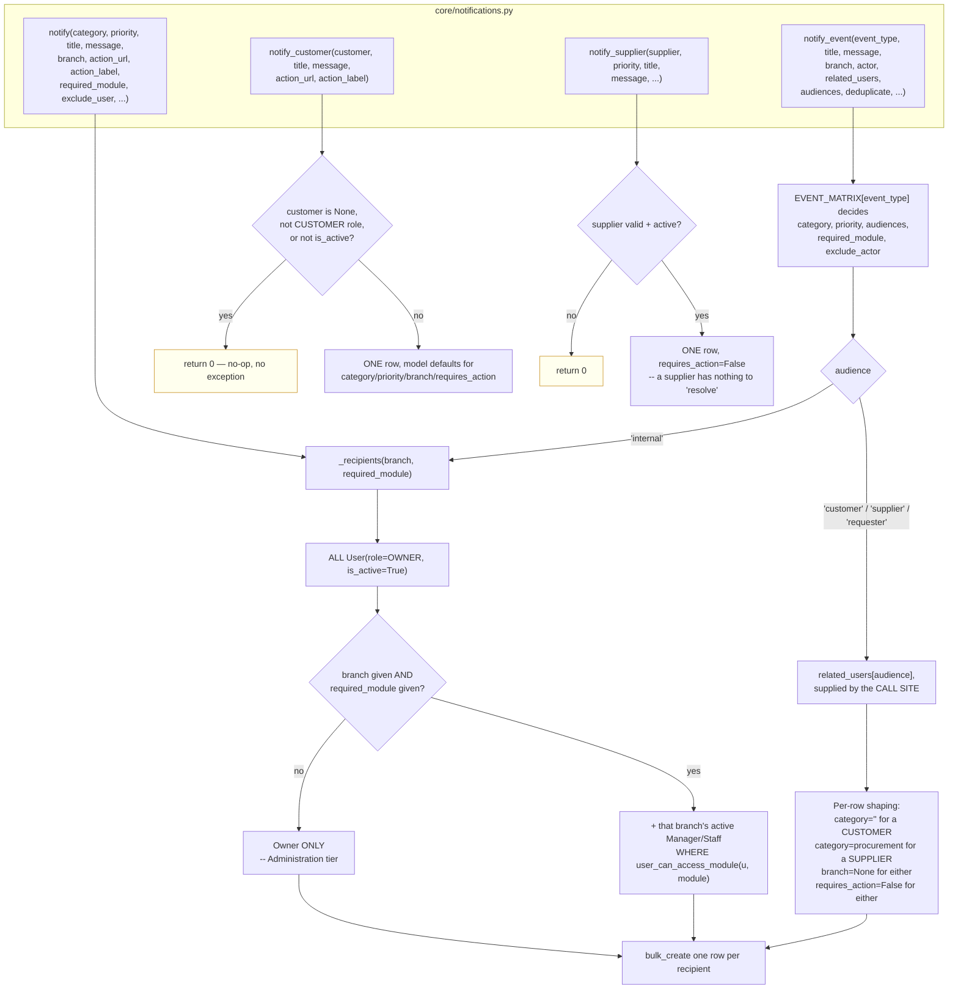
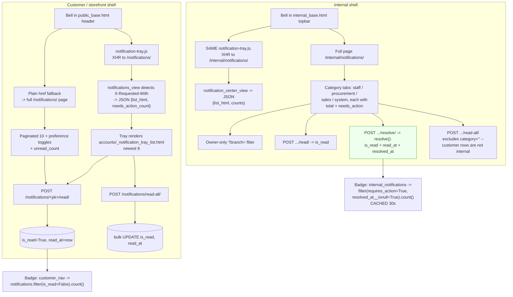
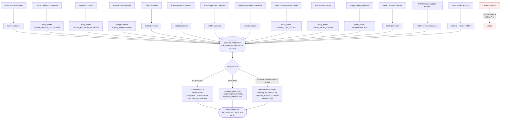

# 10 — Notifications & the Customer Dashboard

Verified against `core/notifications.py`, `accounts/models.py` (`Notification`),
`accounts/views.py`, `core/views.py`, `core/context_processors.py`,
`sales/notifications.py`, `sales/signals.py`, `sales/pwd_requests.py`,
`billing/notifications.py`, `inventory/models.py`, `inventory/alerts.py`,
`inventory/services.py`, `procurement/notifications.py`,
`templates/accounts/_account_sidebar.html`, `templates/public_base.html`.

---

## 1. Three different things are called "notification" — separate them

| Kind | Mechanism | Persisted? | Who sees it |
|---|---|---|---|
| **1. Database notification** | `accounts.Notification` row, via `core.notifications` | ✅ Yes, with `is_read`/`read_at`/`resolved_at` | The one `user` on the row |
| **2. Flash message** | `django.contrib.messages` | ❌ No — one render, then gone | Whoever made the request |
| **3. Transactional email** | `accounts.services.send_*` + `accounts/emails/` templates | Only the `VerificationToken` | The addressee |

> ⚠️ **There is no email, SMS or push notification for any order, payment or
> stock event.** Email is used *only* for account lifecycle: verification,
> email change, password change/reset, account deactivation, and staff invites.
> Every order and payment notice is an in-app `Notification` row, read on the
> site. **Do not claim the system emails customers about their orders.**

---

## 2. The `Notification` model — one table, two audiences

`accounts.models.Notification`. Its docstring sets the rule:

> *"One notification, one row, one recipient — a customer's order update and an
> Owner's 'PO delayed' alert are the same model. Fan-out to several recipients
> means several rows, not a many-to-many: each reads/resolves independently."*

| Field | Purpose |
|---|---|
| `user` | The single recipient (`CASCADE`) |
| `title`, `message` | Human-readable content |
| `is_read`, `read_at` | Read state |
| `event_type` | `EventType` code — **stable** business event, `db_index=True` |
| `recipient_role` | **Snapshot** of the role at send time |
| `reference_type`, `reference_id` | Which business record it was about |
| `category` | `staff` / `procurement` / `sales` / `system`. **Blank for a customer notice** |
| `priority` | `critical` / `high` / `medium` / `low` |
| `branch` | `SET_NULL`. **Always `None` for a customer or supplier row** |
| `action_url`, `action_label` | The deep link |
| `requires_action` | Derived from priority, not passed in |
| `resolved_at` | Set only by the explicit Resolve action |

Two deliberate design choices worth quoting:

- **`recipient_role` is a snapshot** — *"a later role change must not rewrite who
  received the notice at the time it was sent."*
- **`event_type` outlives wording** — *"the human title/message can change
  without losing which event produced the row."* `EventType.GENERAL = ''` keeps
  customer notices and pre-matrix historical rows valid.

`is_read` vs. `is_resolved`:

```
is_resolved = not requires_action or resolved_at is not None
```

**Reading is not resolving.** Opening a card marks it read; only its action
button resolves it. That is why the internal badge counts *unresolved
High/Critical*, not raw unread — so the badge does not empty the moment the Owner
glances at the list.

---

## 3. The four ways a notification is created



### `_recipients` — the fan-out rule, stated exactly

```
users = list(User.objects.filter(role=OWNER, is_active=True))
if branch is None or not required_module:
    return users                      # Owner only
users += [u for u in branch_users if user_can_access_module(u, required_module)]
```

**The Owner always gets every internal trigger, for every branch** — matching
`branch_ids_for_user` returning `None` for them.

**A Manager or Staff member gets it only when the call site passes
`required_module`, and only if they actually have that module enabled.** The
reasoning: triggers with no `required_module` (role changes, login lockouts, new
staff accounts) are *Administration-tier* and reach the Owner **only — not even
the branch's own Manager**, matching `module_permissions.py`'s "Branch Management
and User Management… stay Owner-only, full stop."

In practice an unrestricted Manager still sees everything module-tied about their
branch (their default grant is every module); this only bites once the Owner has
narrowed a specific account.

### `EVENT_MATRIX` — the executable policy table

`notify_event` reads a declarative rule per event rather than each call site
re-deciding recipients. The matrix keeps `when` and `recipients` as prose
alongside the routing data *"so the policy is reviewable without reconstructing
it from a collection of views and signals."*

Safety properties:

- An unknown `event_type` raises `ValueError`.
- An `audiences=` override that is not a subset of the rule's own raises
  `ValueError`.
- A `required_module` override not in the rule's `allowed_modules` raises
  `ValueError`.
- **One row per person even if they appear in two audiences** — `seen_user_ids`
  (e.g. an Owner who both raised *and* approved their own PO).
- `exclude_actor` drops the person who caused the event.
- `deduplicate=True` (used by the expiry sweep) skips a recipient who already has
  a row for the same `event_type` + `reference_type` + `reference_id`.
- Inactive users are skipped.

---

## 4. Complete notification trigger inventory

### Customer-facing (the only notifications a customer ever receives)

| Trigger | Recipient | Content / data | Database operation | Destination |
|---|---|---|---|---|
| Any `order_status` transition **except** Completed+Online+Delivery — `sales.views.transaction_set_status` | The order's `customer` | `"Order {order_number}: {new_status}"` + `orders.customer_views.STATUS_BLURB[status]` | `notify_customer` → 1 row, `category=''`, `priority=low` | `orders:track_order`, "Track Order" |
| Online **Delivery** order → `Completed` — `sales.notifications.notify_order_delivered` | The `customer` | `"Order delivered: {order_number}"` | `notify_event(EVENT_ORDER_DELIVERED)`, audiences `('customer',)` | `orders:track_order`, "View Order" |
| Payment → `Paid` — `billing.notifications.notify_payment_decision` | The `customer` | `"Payment verified: {order_number}"` + `₱{amount_due}` | `notify_event(EVENT_PAYMENT_VERIFIED)`, audiences `('customer',)` | `orders:track_order`, "View Order" |
| Payment → `Rejected` — same function | The `customer` **and** internal | Customer override: `"Payment needs attention: {order_number}"` + `reject_reason` | `notify_event(EVENT_PAYMENT_REJECTED)`, audiences `('customer','internal')` | Customer → `orders:track_order`; internal → `billing_detail` |
| PWD request **approved** — `sales.pwd_requests.approve_pwd_request` | The `customer` | `"PWD discount approved — {order_number}"` + amount off + new total. **Only when the discount actually moved the total** | `notify_customer` → 1 row | `orders:track_order`, "Track Order" |
| PWD request **rejected** — `reject_pwd_request` | The `customer` | `"PWD discount not approved — {order_number}"` + reason + "Your order stays at the full price." | `notify_customer` → 1 row | `orders:track_order`, "Track Order" |

**Note the deliberate non-duplication.** `transaction_set_status` skips its
generic customer notice for exactly the Completed+Online+Delivery combination,
because `notify_order_delivered` already sends a more specific, delivery-framed
notice for that same event. The code warns against "fixing" it:

> *"Do NOT remove this guard to 'restore' coverage here — doing so would
> double-notify the customer for one transition instead of closing a gap."*

Similarly, `billing_confirm` calls `notify()` for the internal audience itself,
then calls `notify_payment_decision(..., include_internal=False)` so the matrix
event adds only the customer. One rejection, no duplicate internal rows.

### Internal — Sales & Financial (`category='sales'`)

| Trigger | Recipient | Priority | Module | Destination |
|---|---|---|---|---|
| Order cancelled — `transaction_set_status` | Owner + branch Manager/Staff with `sales_pos` | `medium` | `SALES_POS` | `transaction_detail` |
| Payment rejected — `billing_confirm` | Owner + branch Manager/Staff with `billing`, **actor excluded** | `high` → `requires_action=True` | `BILLING` | `billing_detail` |
| PWD discount requested — `notify_pwd_request_submitted` | Owner + branch Manager/Staff with `sales_pos` | `medium` | `SALES_POS` | `transaction_detail`, "Review Request" |
| Refund requested — `notify_refund_requested` | Owner + branch Manager/Staff with `sales_pos` | `high` | `SALES_POS` | `transaction_detail`, "View Order" |
| Refund approved / rejected — `notify_refund_decided` | same | `medium` | `SALES_POS` | `transaction_detail` |
| **Large order placed** — `sales.signals.notify_large_order` | Owner + branch Manager/Staff with `sales_pos` | `high` | `SALES_POS` | `transaction_detail` |

> ⚠️ **The large-order trigger never fires.** Its guard is
> `if not (update_fields and 'order_number' in update_fields): return`, which
> describes a two-save creation pattern that no longer exists —
> `SalesTransaction.save()` now writes `order_number` on the INSERT itself, in a
> single save with `update_fields=None`. **Confirmed defect A-1** in
> [`07-audit-findings.md`](07-audit-findings.md).

### Internal — Procurement & Inventory (`category='procurement'`)

| Trigger | Recipients | Priority | Module |
|---|---|---|---|
| `EVENT_LOW_STOCK` (floor) — `Inventory._notify_stock_crossing` | internal | `medium`, or **`critical` at zero** | `FLOOR_STOCK` |
| `EVENT_LOW_STOCK` (warehouse) — `WarehouseStock._notify_stock_crossing` | internal | same | `WAREHOUSE_STOCK` |
| `EVENT_NEAR_EXPIRY` — `inventory.alerts` | internal | `high` | `ALERTS` |
| `EVENT_EXPIRY_WRITE_OFF` — `inventory.services.expire_due_batches` | internal, `deduplicate=True` | `high` | `FLOOR_STOCK` / `WAREHOUSE_STOCK` |
| Stock request needs approval — `_notify_new_stock_request` | internal, **requester excluded** | `medium` | `WITHDRAWALS` |
| Write-off needs approval — `_notify_new_write_off_request` | internal, **requester excluded** | `medium` | `WITHDRAWALS` |
| `EVENT_PO_APPROVED` | requester + supplier, actor excluded | `medium` | — |
| `EVENT_INCOMING_DELIVERY` | internal | `medium` | `DELIVERIES` |
| `EVENT_PO_TERMS_FOR_BUYER` | internal | `medium` | `PROCUREMENT` |
| `EVENT_PO_TERMS_FOR_SUPPLIER` | supplier | `medium` | — |
| `EVENT_SUPPLIER_OFFER_FOR_REVIEW` | Owner only (no branch) | `medium` | — |
| `EVENT_SUPPLIER_OFFER_DECISION` | supplier | `medium` | — |
| `EVENT_PO_OVERDUE` | internal + supplier | `high` | `DELIVERIES` |
| `EVENT_PO_OVERDUE_ESCALATED` | **Owner only** | `critical` | — |
| `EVENT_SUPPLIER_RETURN_FOR_SUPPLIER` | supplier | `medium` | — |
| `EVENT_SUPPLIER_RETURN_RESPONSE` | internal | `medium`, `high` on rejection | `PROCUREMENT` |

### Internal — Staff & System

| Trigger | Recipient | Priority | Module |
|---|---|---|---|
| New `STAFF` account — `accounts.signals.create_user_profile` | **Owner only** — no `required_module`, Administration tier | `low` | — |

### Low-stock crossing is edge-triggered, not level-triggered

`_notify_stock_crossing` fires when stock crosses **from above to at/below** the
reorder level — not on every save while it sits low. Otherwise every sale of a
low-stock item would raise a fresh alert. The sweep-based `EVENT_EXPIRY_WRITE_OFF`
uses `deduplicate=True` for the same reason.

---

## 5. Customer dashboard & storefront navigation — item-by-item audit

The reference screenshot is the **My Orders** page: storefront header, left
account rail, five status tabs, empty state with **Start shopping**.

### Storefront header (`templates/public_base.html`)

| Item | Route | Auth | Handler | Reads / writes | Status |
|---|---|---|---|---|---|
| Logo / **Home** | `/` | ❌ | `accounts.views.home_view` | `Product` (in-stock), active `Branch`, `ProductCategory`, `best_sellers`, `HomeHeroSlide` | ✅ **Functional** |
| **Shop** | `/shop/` | ❌ | `orders.customer_views.product_catalog` | `Inventory.sellable()`, categories, `units_sold`; writes nothing | ✅ **Functional** |
| **About Us** | `/about/` | ❌ | `core.views.about_view` | `StoreSetting` (Owner-editable About copy) | ✅ **Functional** |
| Category dropdown / chips | `/shop/?category=<id>` | ❌ | `product_catalog` + `nav_categories` | `storefront_categories(limit=8)` | ✅ **Functional.** Hidden below 2 categories; empty categories dropped |
| Search box | `/shop/?q=` | ❌ | `product_catalog` | `product__product_name__icontains` | ✅ **Functional** |
| Search suggestions | `/shop/search/suggest/` | ❌ | `search_suggestions` (JSON) | name/SKU match ∩ `in_stock_product_ids`; min 2 chars, max 8 | ✅ **Functional** |
| Notification bell + badge | `/notifications/` | ✅ | `accounts.views.notifications_view`; XHR tray via `notification-tray.js` | `user.notifications`; badge from `customer_nav` context processor | ✅ **Functional** |
| Mark all read (tray) | `POST /notifications/read-all/` | ✅ | `mark_all_notifications_read` | `UPDATE is_read, read_at` | ✅ **Functional** |
| Cart + badge | `/shop/cart/` | ✅ customer | `view_cart` | `session['cart']`; badge from `customer_nav` | ✅ **Functional** |
| Account icon | `/shop/orders/` | ✅ customer | `my_orders` | own `SalesTransaction` | ✅ **Functional** |
| **Log In** (guests) | `/login/?next=…` | ❌ | `login_view` | — | ✅ **Functional** |
| **"Set location"** / "Update location" | `/shop/branch/` | ❌ | `select_branch` | Reads default `Address`; writes `session['fulfillment_location']`, `['branch_id']`, `['fulfillment_assignment']` | ✅ **Functional** — see §3 and §7 of `09-…` |
| Nav status line | — | ❌ | `nav_selected_branch` context processor | Active `Branch` + rounded distance | ✅ **Functional** |
| Footer "Visit Us" | — | ❌ | `nav_branches` context processor | `Branch.objects.filter(is_active=True)` | ✅ **Functional** |

> **A deliberate honesty decision worth mentioning:** the design reference put a
> standing promise ("orders processed within 24 hours") in the nav status slot.
> `nav_selected_branch`'s docstring: *"This store has no such SLA recorded
> anywhere, and a delivery promise invented in a template is a claim the business
> never made."* The slot carries the one fact the session actually knows — which
> branch is fulfilling.

### Left account rail (`templates/accounts/_account_sidebar.html`)

| Item | Route | Auth | Handler | Reads / writes | Status |
|---|---|---|---|---|---|
| **My Orders** | `/shop/orders/` | ✅ customer | `my_orders` | `SalesTransaction.filter(customer=user)` + `billing_record` | ✅ **Functional** |
| **Notifications** (+ count) | `/notifications/` | ✅ | `notifications_view` | `user.notifications` paginated 10; `NotificationPreference.get_or_create` | ✅ **Functional** (but see the preference note below) |
| **My Profile** | `/profile/` | ✅ | `profile_view` | Role profile, avatar, `Address` list at `#addresses` | ✅ **Functional** |
| **Sessions** | `/profile/sessions/` | ✅ | `sessions_view` | `get_active_sessions(user)`; revoke deletes `django_session` + `UserSession` | ✅ **Functional** |
| **Privacy & Data** | `/profile/privacy/` | ✅ | `privacy_view` | Deactivation controls | ✅ **Functional** |
| **Language** | `/profile/language/` | ✅ | `language_view` | Writes `User.language` + `session['language']`; `LanguageMiddleware` sets `request.LANGUAGE` for `` | ⚠️ **Partial** — see below |
| **Help Center** | `/help-center/` | ✅ | `help_center_view` | Static FAQ (Supplier gets its own template) | ✅ **Functional** (static content) |
| **About** | `/about/` | ❌ *(see note)* | **`core.views.about_view`** — *not* `accounts.views.about_view` | Active `Branch` list, `StoreSetting` | ⚠️ **Lands on the public page, not the account one — defect A-2** |
| **Logout** | `/logout/` | ✅ | `logout_view` | `logout()`; signal deletes the `UserSession` row | ✅ **Functional** |
| ~~Payment Methods~~ | — | — | — | — | 🚫 **Not built — correctly hidden.** It is inside `` with the note *"page not yet built, placeholder link"*. It does **not** render |
| ~~Addresses~~ (as its own row) | — | — | — | — | ↪️ **Merged** into My Profile `#addresses` |
| ~~Notification Preferences~~ (as its own row) | `/profile/notification-preferences/` | ✅ | `notification_preferences_view` | **301 permanent redirect** to `/notifications/#preferences` | ↪️ **Merged.** The route is kept on purpose: *"it has been the preferences URL for the life of the settings section… a 404 there teaches nothing"* |

#### Three caveats on this rail

**0. The "About" row does not reach the view it was written for.** The root
URLconf registers `path('about/', core.views.about_view, name='about')` **before**
`path('', include('accounts.urls', namespace='accounts'))`, and `accounts/urls.py`
registers its own `path('about/', views.about_view, name='about')`. Both names
reverse to the same path, and the first pattern wins resolution:

```
accounts:about  ->  /about/  ->  core.views.about_view
about           ->  /about/  ->  core.views.about_view
```

So `accounts.views.about_view` is **unreachable**, and `templates/accounts/about.html`
plus `templates/procurement/supplier_about.html` are **orphaned**. Clicking
**About** in the account rail leaves the account shell and lands on the public
storefront About Us page — losing the sidebar, and with `active_page` never
matching. It also means that row is not login-gated, unlike every other row
beside it. `core.views.about_view`'s own docstring describes the account version
as *"reached from there"*, which is no longer true. **Confirmed defect A-2.**


**1. `Language` is partially implemented.** The toggle saves, and the custom
`` tag (`accounts/templatetags/i18n_extra.py` + `accounts/translations.py`)
renders Filipino for strings present in the dictionary. But this is a hand-rolled
dictionary, not Django's `gettext`/`.po` machinery, so **coverage is partial** —
any string not in the table stays English. The views' own section comment calls
Language a placeholder needing *"an actual i18n setup."* Describe it as "partial
Filipino support", not "bilingual".

**2. The four notification preference toggles save but gate nothing.**
`order_updates`, `promotions`, `delivery_reminders`, `newsletter` are written to
`NotificationPreference` and confirmed to the user. The gate function
`accounts.services.should_notify(user, kind)` exists — **and is never called from
anywhere.** `notify_customer` does not consult it. **Confirmed defect A-3.**

### My Orders status filters

| Tab | `?status=` | `order_status` matched |
|---|---|---|
| All | *(none)* | everything, `Cancelled` included |
| In progress | `active` | `Pending`, `Approved` |
| To receive | `to_receive` | `Preparing` |
| Completed | `completed` | `Completed` |
| Cancelled | `cancelled` | `Cancelled` |

Unknown values fall back to **All**. Tabs are plain text with **no counts** — a
previous five-`.count()` `counts` dict was removed because nothing read it.

### Empty state

```
  "No orders yet"
  status_filter set  -> "Nothing in this tab — try 'All'."
  otherwise          -> "When you place an order it'll show up here..."
  [Start shopping] ->   ->  /shop/
```

✅ **Fully functional** — a plain link, no JavaScript.

---

## 6. Notification reading surfaces



### The two badges count different things — on purpose

| Badge | Context processor | Counts | Cached |
|---|---|---|---|
| Storefront bell | `customer_nav` | `notifications.filter(is_read=False).count()` — raw unread | ❌ |
| Internal topbar | `internal_notifications` | `filter(requires_action=True, resolved_at__isnull=True).count()` — **unresolved High/Critical only** | ✅ 30 s |

*"Opening a card marks it read, only its action button resolves it, so the badge
stays a count of what's still waiting on the Owner/Manager rather than emptying
the moment they glance at the list."*

Both are fail-safe: wrapped in `try/except` returning `{}`, because *"a badge must
never break a page render."*

### Role routing on the shared `/notifications/` route

```
XHR         -> JSON fragment (both audiences use it)
SUPPLIER    -> redirect('supplier_notifications')   # has its own inbox
otherwise   -> full customer-shelled page with customer-only toggles
```

Internal roles reaching `/notifications/` get the customer-shelled page; their
real surface is `/internal/notifications/`, which is `@role_required(*INTERNAL_ROLES)`.
`notification_mark_all_read` there excludes `category=''` — customer rows are not
internal notifications and must not be swept by an Owner's "mark all read".

### Ownership on every notification action

```
get_object_or_404(Notification, pk=pk, user=request.user)   # accounts
get_object_or_404(request.user.notifications, pk=pk)        # core
```

Scoped to the requesting user in the lookup itself → **404** for someone else's
notification.

**`mark_notification_read` is POST, not GET.** *"Marking something read changes
stored state, and a plain `<a href>` hands that change to anything that follows
links on the page — a prefetcher, a crawler, an accessibility tool walking the
DOM — which is how an inbox empties itself without anyone having clicked."*

---

## 7. Notification generation & delivery — one diagram



---

## 8. Notification failure modes

| Failure | Behaviour | Severity |
|---|---|---|
| Customer deleted / deactivated | `notify_customer` returns `0`, no exception — `SalesTransaction.customer` is nullable (`SET_NULL`), so this must not raise | ✅ Handled |
| Supplier deleted / deactivated | `notify_supplier` returns `0` | ✅ Handled |
| No recipients at all | `notify` returns `0` before `bulk_create` | ✅ Handled |
| Walk-in sale status change | `locked_txn.customer` is `None` → `notify_customer` no-ops | ✅ Handled |
| Manager/Staff lacking the module | Excluded by `user_can_access_module`; **Owner still receives it** | ✅ By design |
| Unknown `event_type` | `ValueError` | ✅ Fails loudly |
| Invalid audience / module override | `ValueError` | ✅ Fails loudly |
| Duplicate from one person in two audiences | `seen_user_ids` de-dupes | ✅ Handled |
| Repeat expiry alerts | `deduplicate=True` | ✅ Handled |
| Badge query fails | `try/except` → `{}` | ✅ Fail-safe |
| **Notification write itself fails** | It is inside the view's `transaction.atomic()`, so the whole business action rolls back with it | ⚠️ **See note** |
| **Preference toggles** | Saved, confirmed, **never consulted** | ❌ **Defect A-3** |
| **Large-order alert** | Never created | ❌ **Defect A-1** |

> ⚠️ **On the atomic coupling.** For `transaction_set_status`, both `notify()`
> calls sit *inside* the `transaction.atomic()` block, so a notification failure
> would roll back the status change itself. That is arguably the safe direction
> (no silent divergence between the order and what anyone was told), but it does
> mean notification delivery is on the critical path of a financial transition.
> There is no retry queue and no outbox. Flagged as **B-4** (needs testing)
> rather than a defect, since `bulk_create` against the same connection is
> unlikely to fail independently.

---

## 9. Step-by-step data trace — notifications across one order's life

| Step | Event | Function | Rows created | Where each lands |
|---|---|---|---|---|
| 1 | Customer checks out, requests PWD | `notify_pwd_request_submitted` | 1 per Owner + branch Manager/Staff with `sales_pos` | `/internal/notifications/` → Sales tab, `medium`, "Review Request" |
| 2 | Staff → `Approved` | `notify_customer` | **1** (the customer) | Storefront bell → "Order ORD-…: Approved" + blurb |
| 3 | Staff → `Preparing` | `notify_customer` | **1** | Bell → "Order ORD-…: Preparing" |
| 4 | Staff approve the PWD request | `_notify_customer_of_decision` | **1** (only if the discount moved the total) | Bell → "PWD discount approved — ORD-…" |
| 5 | Staff B verifies the payment | `notify_payment_decision` (`EVENT_PAYMENT_VERIFIED`) | **1** (customer only, per the matrix) | Bell → "Payment verified: ORD-…" |
| 6 | Staff → `Completed`, Online+**Delivery** | `notify_order_delivered` | **1** (customer) | Bell → "Order delivered: ORD-…" |
| 6′ | Staff → `Completed`, any other combination | `notify_customer` | **1** | Bell → "Order ORD-…: Completed" |
| 7 | *(alternative)* Payment rejected | `notify()` + `notify_payment_decision` | 1 per internal recipient (actor excluded) **+ 1 customer** | Internal: Sales tab, `high`, `requires_action=True`. Customer: "Payment needs attention" |
| 8 | *(alternative)* Order cancelled | `notify()` + `notify_customer` | 1 per internal recipient **+ 1 customer** | Internal: `medium`. Customer: "Order ORD-…: Cancelled" |
| 9 | Refund requested | `notify_refund_requested` | 1 per internal recipient | Sales tab, `high`, "View Order" |
| 10 | Refund decided | `notify_refund_decided` | 1 per internal recipient | Sales tab, `medium` |
| 11 | That sale drops stock to the reorder level | `notify_event(EVENT_LOW_STOCK)` | 1 per Owner + branch staff with `floor_stock` | Procurement tab, `medium` (or `critical` at zero), → Alerts Center |

**A customer typically receives 3–6 notifications per order.** Everything else is
internal.

---

## 10. What a customer can and cannot see — the summary table

| Can see | Cannot see |
|---|---|
| Their own orders (`my_orders`, ownership in the query) | Any other customer's order — **404** |
| Their own order's items, totals, status, timeline steps | The staff Order Console (`transaction_detail` refuses non-internal roles) |
| Their own order's payment **status** pill, method, and `reject_reason` via the notification | The Billing section (`role_required` internal only, finding X-1) |
| Their own billing record through `GET /api/billing/` (scoped to `transaction__customer=self`) | Other branches' stock figures, other customers, staff names beyond the branch contact |
| Their own uploaded payment proof via `payment_proof_download` | Internal notifications, the Notification Center, Reports |
| Branch name, location and contact for their order | Internal cost prices, supplier data, purchase orders |
| In-stock products only, per the resolved branch | Out-of-stock products — *except on `/dashboard/customer/`*, finding **C-2** |
| A **Refunded / Partially Refunded** payment pill | The refunded **amount** — every customer surface prints `total_amount`, never `net_amount`. Finding **C-5** |
