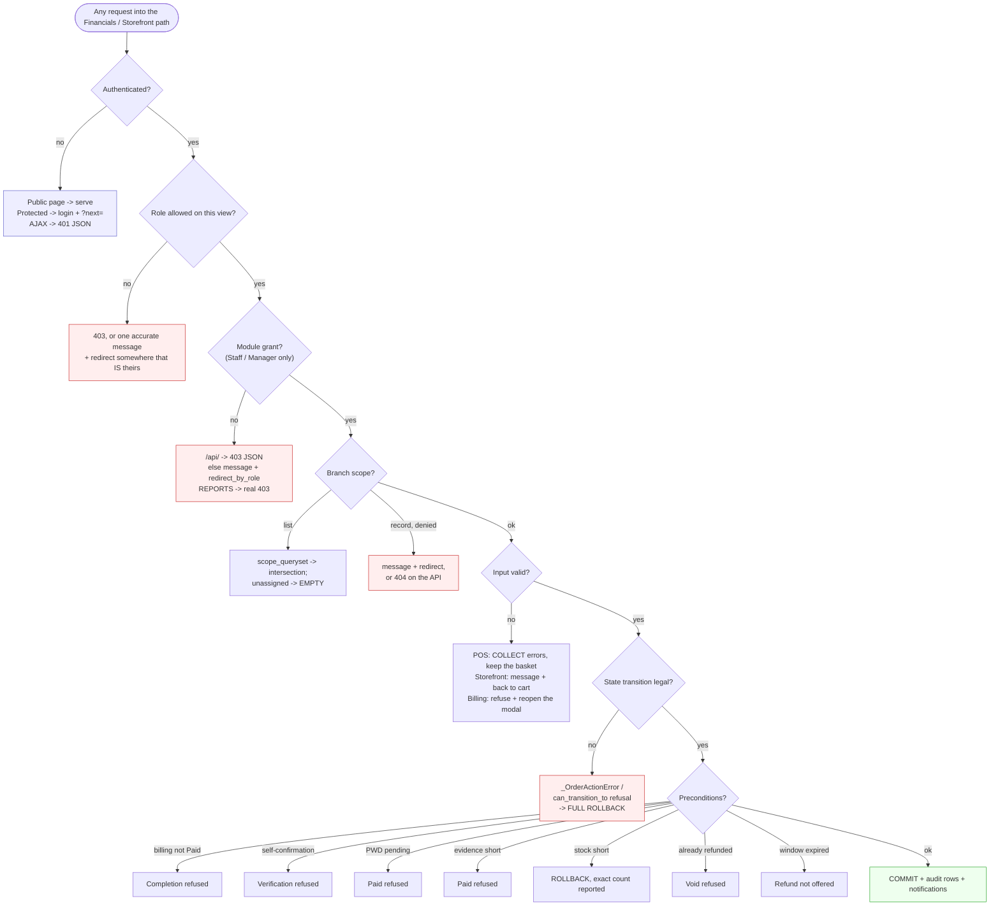

# 11 — Integrated System Data Flow

One end-to-end picture, plus every exception path. This file is the one to have
open when a panel asks *"show me how it all connects."*

---

## 1. The hypothesis, corrected against the code

The brief proposed this sequence:

> Customer Account → Location Selection → Storefront → Cart → Checkout → Order →
> Sales & Orders → Billing → Payment Verification → Inventory → Notifications →
> Customer Order Tracking

**Four corrections the code requires:**

| Hypothesis | Reality |
|---|---|
| "Customer Account → Location Selection" is a prerequisite chain | **Location needs no account.** A guest browses and sets a location. An account is required only at *Add to cart*. And location resolution happens automatically on the first add — the explicit "Set location" screen is optional |
| "Order → Sales & Orders" is a handoff | **There is no handoff.** Checkout writes `sales.SalesTransaction` directly. "Sales & Orders" is a *view over the same rows*, not a destination they are copied into |
| "Billing" comes after the order | **Billing is created *with* the order**, by `post_save` signal, inside the same atomic block. Not a later step |
| "Payment Verification → Inventory" | **Verification does not move stock.** It *unlocks* `Mark Completed`, and completion is what moves stock. Two separate human actions |

### The corrected sequence

```
Guest browsing  ──(optional)──►  Set location
      │                               │
      └──────────┬────────────────────┘
                 ▼
         Account required HERE  ──►  Add to cart
                 ▼
   Branch auto-resolved per cart (every mutation)
                 ▼
  Checkout  ──atomic──►  SalesTransaction + SalesItem + BillingRecord + OrderStatusHistory
                 │                            (ALL AT ONCE — no stock movement)
                 ▼
    ┌────────────┴────────────┐
    ▼                         ▼
Staff: Approve → Preparing    Staff B: verify payment  (independent, order-insensitive)
    └────────────┬────────────┘
                 ▼
   Mark Completed  ──requires BillingRecord = Paid──►  stock deducted + notification
                 ▼
          Customer tracking
```

**The two middle branches run in parallel.** Approving and preparing an order and
verifying its payment are independent; only `Mark Completed` requires both to
have happened.

---

## 2. The integrated happy path

```mermaid
flowchart TD
    subgraph P1["1. ACCOUNT — optional until Add to cart"]
      A1(["Guest"]) --> A2{"Add to cart pressed?"}
      A2 -- no --> A3["Browse freely:<br/>catalog, product, search,<br/>set location"]
      A2 -- yes --> A4["@customer_required<br/>-> /login/?next=..."]
      A4 --> A5["register_view OR login_view"]
      A5 --> A6[("User role=CUSTOMER<br/>CustomerProfile<br/>Address is_default=True<br/>UserSession")]
    end

    subgraph P2["2. LOCATION -> BRANCH (server-decided)"]
      A6 --> B1["customer_fulfillment_location:<br/>browser coords (30 min TTL)<br/>-> default Address<br/>-> settings fallback"]
      B1 --> B2["resolve_nearest_branch(loc, cart)"]
      B2 --> B3["fulfillable_quantities =<br/>sellable floor stock<br/>MINUS open online commitments"]
      B3 --> B4{"one branch covers<br/>the WHOLE cart?"}
      B4 -- no --> B5["REFUSE, naming the<br/>blocking products"]
      B4 -- yes --> B6[("session['branch_id']<br/>session['fulfillment_assignment']<br/>-- no coordinates stored")]
    end

    subgraph P3["3. CART (session only)"]
      B6 --> C1[("session['cart'] = {pid: qty}")]
      C1 --> C2["_cart_items: re-prices at<br/>Product.price_at(qty),<br/>prunes unpriceable lines,<br/>flags short lines"]
      C2 --> C3["Branch RE-RESOLVED on every<br/>add / increase / decrease / remove"]
    end

    subgraph P4["4. CHECKOUT (one atomic block)"]
      C3 --> D1["cache.add double-submit token<br/>+ rotate"]
      D1 --> D2["Validate: payment method,<br/>GCash reference + proof,<br/>fulfillment_type, Pay-at-Store rule,<br/>default Address for Delivery,<br/>PWD request eligibility"]
      D2 --> D3["LOCK every active-branch Inventory<br/>row for the cart, ordered"]
      D3 --> D4["Re-resolve branch; refuse if changed"]
      D4 --> D5["Per line: select_for_update().sellable()<br/>VALIDATE ONLY"]
      D5 --> D6["price_cart(discount_type=None)"]
      D6 --> D7[("SalesTransaction<br/>Online / Pending")]
      D7 --> D8[("signal -> BillingRecord Pending")]
      D7 --> D9[("signal -> OrderStatusHistory")]
      D7 --> D10[("SalesItem x N")]
      D10 --> D11[("BillingRecord payment details")]
      D11 --> D12["COMMIT · session cart cleared<br/>· NO STOCK MOVED"]
    end

    subgraph P5["5. SALES & ORDERS — same rows, staff view"]
      D12 --> E1["transaction_list:<br/>scope_queryset FIRST,<br/>then ?branch= / ?status= / etc"]
      E1 --> E2["transaction_detail:<br/>user_can_access_branch"]
      E2 --> E3["Approve -> Preparing<br/>each: lock, _next_actions check,<br/>2 audit rows, customer Notification"]
    end

    subgraph P6["6. BILLING — parallel to step 5"]
      D8 --> F1["billing_list / billing_detail<br/>scoped on transaction__branch"]
      F1 --> F2["Record Payment (if needed):<br/>record_payment_details under lock"]
      F2 --> F3["Verify: 5 gates<br/>role · branch · human-confirmable ·<br/>maker/checker · transition ·<br/>PWD block · evidence"]
      F3 --> F4[("BillingRecord status=Paid<br/>confirmed_by · date_confirmed")]
      F4 --> F5["Notification -> customer<br/>'Payment verified'"]
    end

    subgraph P7["7. COMPLETION -> INVENTORY"]
      E3 --> G1(["Mark Completed"])
      F4 --> G1
      G1 --> G2["LOCK BillingRecord, re-read"]
      G2 --> G3{"status == Paid?"}
      G3 -- no --> G4["REFUSED — no stock moves"]
      G3 -- yes --> G5[("order_status=Completed<br/>completed_at=now<br/>2 audit rows")]
      G5 --> G6["_deduct_stock (ONLINE guard)"]
      G6 --> G7[("Inventory -= qty<br/>Batch.consume_fefo<br/>SalesItemBatchConsumption<br/>StockMovement type=Sale")]
      G7 --> G8{"low stock crossed?"}
      G8 -- yes --> G9["EVENT_LOW_STOCK -> internal"]
    end

    subgraph P8["8. NOTIFICATIONS"]
      G5 --> H1{"Online + Delivery?"}
      H1 -- yes --> H2["notify_order_delivered"]
      H1 -- no --> H3["notify_customer<br/>+ STATUS_BLURB"]
      H2 --> H4[("Notification row<br/>category='' · branch=None")]
      H3 --> H4
      F5 --> H4
      G9 --> H5[("Notification rows<br/>category='procurement'<br/>requires_action per priority")]
    end

    subgraph P9["9. TRACKING"]
      H4 --> I1["Storefront bell badge<br/>customer_nav: unread count"]
      I1 --> I2["/notifications/ -> tray or full page"]
      I2 --> I3["/shop/orders/ my_orders<br/>filter(customer=request.user)"]
      I3 --> I4["Tabs -> tab_statuses mapping"]
      I4 --> I5["/shop/orders/&lt;id&gt;/ track_order<br/>get_object_or_404(customer=user)"]
      I5 --> I6["4-step bar · blurb · items ·<br/>billing pill · branch contact"]
    end

    style B5 fill:#fee,stroke:#c33
    style G4 fill:#fee,stroke:#c33
    style D12 fill:#efe,stroke:#3a3
    style G7 fill:#eef,stroke:#66c
```



---

## 3. Parallel, conditional and scheduled operations

### Genuinely parallel

| A | B | Why independent |
|---|---|---|
| `Pending → Approved → Preparing` | Recording and verifying the payment | Nothing in `_FLOW` consults billing until `Completed` |
| Payment verification | Stock | Verification writes only `BillingRecord`; stock moves at completion |
| Internal notification fan-out | Customer notification | Separate recipient sets; in the rejection case, two explicit calls |

### Conditional

| Condition | Branch taken |
|---|---|
| `transaction_type` | `Physical` → deduct at sale; `Online` → deduct at completion |
| `mode_of_payment == 'Cash'` at the POS | Created `Completed` + `Paid`; otherwise `Pending` |
| `fulfillment_type` | `Delivery` → address required, `Pay at Store` refused, PWD impossible; `Pickup` → no address, PWD available |
| Method in `REFERENCE_REQUIRED_METHODS` / `PROOF_REQUIRED_METHODS` | Which evidence is mandatory |
| `pwd_request_status == 'Pending'` | Billing refuses `Paid` |
| `is_self_confirmation(user)` | `Paid`/`Rejected` refused for that user |
| `was_completed` on cancel | `_reverse_stock` vs. nothing |
| `RefundItem.condition` | `Sellable` → restock; `Damaged` → no restock |
| `has_approved_refunds` | Void refused |
| Owner vs. Manager/Staff | Void permission, refund decisions, reports, branch/user admin |
| `required_module` passed to `notify` | Whether branch Manager/Staff are included |

### Scheduled (cron, `railway.cron.json`)

| Command | Writes |
|---|---|
| `process_expired_stock` | Zeroes due batches, `Expiry Write-off` movements, `EVENT_EXPIRY_WRITE_OFF` (deduplicated) |
| `process_overdue_deliveries` | `EVENT_PO_OVERDUE`, then `EVENT_PO_OVERDUE_ESCALATED` |
| `dispatch_notifications` | Pending notification dispatch |
| `check_batch_reconciliation` | Reconciliation check |

### Genuinely asynchronous: **none**

There is **no** Celery, RQ, task queue, websocket or background worker in
`requirements.txt`. Every notification, stock movement and status change happens
synchronously inside the request that caused it. The storefront's "live" search
and notification tray are plain XHR to the same Django views.

> Say this plainly if asked — it is a simpler and more defensible architecture
> for this scale, not a gap.

---

## 4. Exception paths — what is created, updated, left unchanged

### Authentication & accounts

| Path | Created | Updated | Unchanged |
|---|---|---|---|
| Registration — any validation failure | *none* | *none* | Form re-rendered filled in (minus passwords) |
| Registration — rate limited (`is_rate_limited`) | *none* | *none* | Even the per-field checks never run |
| Registration — consent not exactly `'1'` | *none* | *none* | — |
| Registration — email send fails | `User`, `CustomerProfile`, `Address`, `UserSession` | — | `is_email_verified=False`; warning; retry from Settings |
| Login — bad password | *none* | Failed-login counter (cache) | No session, no `UserSession` |
| Login — locked out | *none* | *none* | Counter untouched; `authenticate` never called |
| 2FA — OTP backend unreachable | *none* | *none* | **Password unconsumed**; no dead-end code screen |
| 2FA — too many wrong codes | *none* | Session pointers cleared, OTP cancelled | Not logged in |
| Login — unrecognised role | *none* | `logout()` | Prevents an infinite redirect loop |
| Invite token expired / 3 failed attempts | *none* | `VerificationToken.attempts`, `is_used` | Account stays `is_active=False` |
| Session expires mid-shop | *none* | Session row gone | Cart lost with it; `?next=` preserves the destination |

### Branch & authorization

| Path | Created | Unchanged |
|---|---|---|
| Manager edits `?branch=<other>` | *none* | `scope_queryset` ∩ filter → 0 rows |
| Non-numeric `?branch=` | *none* | Silently ignored (`.isdigit()` guard) |
| Manager opens another branch's order | *none* | "That order belongs to another branch" → list |
| Manager `PATCH`es another branch's billing via API | *none* | **404** — existence not confirmed |
| Staff opens `/reports/` | *none* | **403** via `templates/403.html`, in three independent places |
| Staff lacks a module grant | *none* | `/api/` → JSON 403; else message + `redirect_by_role` |
| Customer opens the Order Console | *none* | One accurate message → `accounts:home` |
| Customer opens Billing | *none* | `role_required` → 403 |
| Branch deleted under a Manager | Profile `branch` → `NULL` | Account sees **nothing**; POS refuses explicitly |
| Owner posts a deleted branch id at the POS | *none* | "That branch no longer exists" — collected, basket survives |

### Storefront & checkout

| Path | Created | Unchanged |
|---|---|---|
| No active branches exist | *none* | `strategy='no_active_branches'`, refused |
| No single branch covers the cart | *none* | Blocking products named |
| Location coordinates malformed | *none* | Message; nothing stored |
| Browser location >30 min old | *none* | Popped; falls back to the saved address |
| Chosen branch goes inactive | *none* | Re-filtered on `is_active`; next resolution reassigns |
| Insufficient stock on add | *none* | "Only N of X left for fulfillment" |
| Cart line's product deleted | `session['cart']` entry popped | No DB write; shopper told |
| Double submit | *none* on the 2nd | → My Orders, "may already be on its way" |
| GCash reference malformed / proof missing or not an image | *none* | → cart. **No order is created** |
| `fulfillment_type` missing | *none* | Refuses — no safe default |
| Delivery + `Pay at Store` | *none* | Refused server-side too, not just in JS |
| Delivery with no default `Address` | *none* | "open Settings then Addresses" |
| Branch changes during checkout | *none* — `set_rollback(True)` | → cart to review |
| Stock short inside the lock | *none* — `set_rollback(True)` | → cart, exact remaining count |
| PWD request with no eligible product | *none* — `set_rollback(True)` | → cart |
| Customer opens another's order | *none* | **404** |

### Financials

| Path | Created / updated | Unchanged |
|---|---|---|
| POS — any validation error | *none* | **Basket survives** — errors collected, form re-rendered with `pos_restore_rows` |
| POS — oversell on any line | *none* — whole atomic block rolls back | No partial sale, no partial deduction |
| POS — duplicate receipt reference | *none* | Caught twice: pre-check, and re-check under `Branch.select_for_update()` |
| POS — total > `MAX_AMOUNT` | *none* | "Split it into two sales" |
| POS — cash tendered < total | *none* | Exact shortfall reported |
| Status change — `expected_status` mismatch | *none* | "changed while you were reviewing it" |
| Status change — transition not in `_next_actions` | *none* | "Cannot move X from A to B" |
| `Completed` while billing not `Paid` | *none* | "can only be completed once its payment is verified as Paid" |
| Cancel with no reason | *none* | Required for `Cancelled` only |
| Staff tries to void a completed sale | *none* | "Only the Owner or a Branch Manager can void a completed sale" |
| Void an already-refunded order | *none* | "refund the remaining items instead" |
| Void where a product was deleted | Reversal for every *other* line | Caller **warned** which lines could not be restored |
| Payment — method invalid for the channel | *none* | Re-opens the modal over the message |
| Payment — proof not a real image | *none* | Pillow `verify()` catches a renamed file |
| Payment — evidence incomplete | *none* | Names exactly what is missing |
| Payment — record no longer `Pending` | *none* | Locked re-read raises `ValidationError` |
| Verify — self-confirmation (maker/checker) | *none* | "ask another staff member, a manager, or the owner" |
| Verify — illegal transition | *none* | "a {status} payment cannot be changed to {new}" |
| Verify `Paid` — PWD request pending | *none* | "approve or reject it on the order first" |
| Verify `Paid` — evidence short | *none* | Re-checked even for records saved before the rule existed |
| Reject with no reason | *none* | Required |
| Refund outside the 7-day window | *none* | `refund_window_expired()`; deadline shown regardless |
| Refund — Staff requests it | `Refund` `Pending`, `RefundItem`, `RefundEvent`, internal `Notification` | **No money, no stock** until decided |
| Refund rejected | `Refund.status='Rejected'`, `RefundEvent`, `decision_note`, `Notification` | **No money, no stock** |

### Notifications

| Path | Result |
|---|---|
| Recipient deleted / deactivated | `notify_customer` / `notify_supplier` return `0`, no exception |
| Walk-in status change (`customer is None`) | `notify_customer` no-ops |
| Manager/Staff lacks the module | Excluded; **Owner still receives it** |
| Unknown `event_type` / bad audience / bad module | `ValueError` — fails loudly |
| Same person in two audiences | One row (`seen_user_ids`) |
| Repeat expiry alert | Suppressed (`deduplicate=True`) |
| Badge query fails | `try/except` → `{}`; page still renders |
| **Preference toggle set to off** | **Ignored — nothing reads it.** Defect A-3 |

---

## 5. Record lifecycle — which tables a single order touches

```mermaid
flowchart LR
    subgraph AT["At creation (one atomic block)"]
      T1[("SalesTransaction")]
      T2[("SalesItem x N")]
      T3[("BillingRecord")]
      T4[("OrderStatusHistory<br/>'' -> initial")]
      T5[("OrderNumberSequence<br/>last_value += 1")]
    end

    subgraph WALK["Walk-in ONLY, same block"]
      T6[("Inventory -= qty")]
      T7[("Batch drained FEFO")]
      T8[("SalesItemBatchConsumption")]
      T9[("StockMovement type=Sale")]
    end

    subgraph PER["Per status change"]
      S1[("OrderStatusHistory +1")]
      S2[("OrderStatusChange +1")]
      S3[("Notification — customer")]
      S4[("Notification x N — internal,<br/>on Cancelled only")]
    end

    subgraph ONC["On Completed, ONLINE only"]
      C1[("Inventory -= qty")]
      C2[("Batch FEFO +<br/>SalesItemBatchConsumption")]
      C3[("StockMovement type=Sale")]
      C4[("SalesTransaction.completed_at")]
    end

    subgraph PAY["On payment actions"]
      P1[("BillingRecord: payment_method,<br/>reference_number, proof_of_payment")]
      P2[("SalesTransaction.mode_of_payment<br/>-- sync_payment_method_to_sale")]
      P3[("BillingRecord: status,<br/>confirmed_by, date_confirmed,<br/>reject_reason")]
      P4[("Notification — customer<br/>+ internal on rejection")]
    end

    subgraph CAN["On Cancelled"]
      X1[("SalesTransaction.cancel_reason")]
      X2[("BillingRecord: status=Cancelled,<br/>voided_by, date_voided")]
      X3[("Inventory += qty + StockMovement<br/>ONLY if stock had left")]
    end

    subgraph REFD["On refund"]
      R1[("Refund / RefundItem / RefundEvent")]
      R2[("SalesTransaction.refunded_amount<br/>-- total_amount NEVER reduced")]
      R3[("BillingRecord -> Partially Refunded<br/>or Refunded")]
      R4[("Inventory += qty + StockMovement<br/>type=Customer Return,<br/>Sellable condition only")]
    end

    AT --> WALK
    AT --> PER
    PER --> ONC
    AT --> PAY
    PER --> CAN
    ONC --> REFD
```



### Count of tables a single online order can touch: **13**

`SalesTransaction`, `SalesItem`, `BillingRecord`, `OrderStatusHistory`,
`OrderStatusChange`, `OrderNumberSequence`, `Inventory`, `Batch`,
`SalesItemBatchConsumption`, `StockMovement`, `Notification`, and — if refunded —
`Refund`, `RefundItem`, `RefundEvent`.

---

## 6. "Do these records stay synchronized?" — verified, one by one

This is the question the brief asked not to assume. Each pair below was checked.

| Pair | Synchronized? | Mechanism | Verified |
|---|---|---|---|
| `SalesTransaction` ↔ `BillingRecord` *existence* | ✅ **Guaranteed** | `post_save` signal, same atomic block; `OneToOneField` forbids duplicates | `billing/signals.py` |
| `total_amount` ↔ `amount_due` *at creation* | ✅ | Total computed before the INSERT and passed to it; signal reads `instance.total_amount` | `transaction_add`, `checkout`, `billing/signals.py` |
| `total_amount` ↔ `amount_due` *after a discount* | ✅ | `_reprice_locked` writes **both** under one lock | `sales/pwd_requests.py` |
| `mode_of_payment` ↔ `payment_method` | ✅ *with one documented exception* | `sync_payment_method_to_sale()`, called by both write paths. **`Bank Transfer` has no sale-side equivalent**, so the sale keeps its method — deliberate | `billing/models.py` (X-2) |
| `order_status` ↔ `BillingRecord.status` on **cancel** | ✅ | Billing row locked and routed through `can_transition_to` in the same block | `transaction_set_status` (B-1, D-1) |
| `order_status == Completed` ⇒ billing `Paid` | ✅ **Enforced one-way** | Locked re-read before the transition | `transaction_set_status` |
| billing `Paid` ⇒ `order_status == Completed` | ❌ **Not enforced — correct** | Verification unlocks completion; a human still presses the button | by design |
| `Inventory.quantity_on_hand` ↔ `Batch` sums | ✅ *reconciled* | Both written together; `_reverse_batches` credits the same lots; `check_batch_reconciliation` audits | `_deduct_stock`, `_reverse_stock`, O-1 |
| `refunded_amount` ↔ `Refund` rows | ✅ | `_apply_approval` increments under the same lock that flips the `Refund` to `Approved` | `sales/refunds.py` (P14) |
| `BillingRecord.status` ↔ refund completeness | ✅ | `Refunded` vs. `Partially Refunded` decided from `_refundable_items` | `sales/refunds.py` |
| `Notification` ↔ the event | ✅ *coupled* | Created inside the same atomic block — see the note in `10-…` §8 |
| Order `delivery_address` ↔ `Address.text` | ❌ **Deliberately a snapshot** | Copied at checkout. Editing the saved address later does **not** rewrite past orders — the order records where it was actually sent | `checkout` |
| Reports ↔ actual transactions | ✅ | One shared definition in `reports/services.py`, imported by both the web views and the API | `reports/views.py`, `reports/api_views.py` |
| `OrderStatusHistory` ↔ `OrderStatusChange` | ✅ *complementary, not duplicated* | Both written by `transaction_set_status`; `_status_timeline` merges them and keeps orphans | `sales/views.py` |

---

## 7. Concurrency control — every lock in the Financials path

| Where | Lock | Prevents |
|---|---|---|
| `SalesTransaction.save` | `OrderNumberSequence.select_for_update()` | Two orders sharing an `order_number` |
| `transaction_add` | `Branch.select_for_update()` | Receipt-reference race against the POS import |
| `_deduct_stock` | `Inventory.select_for_update()` per line | Overselling |
| `checkout` | All cart `Inventory` rows locked **in `(branch_id, product_id)` order** | Overselling **and deadlock** between two concurrent checkouts |
| `transaction_set_status` | `SalesTransaction.select_for_update()` | Double-advance from a double-click |
| `transaction_set_status` | `BillingRecord.select_for_update()` | A payment confirmed in the gap being overwritten, in either direction |
| `billing_confirm` | `BillingRecord.select_for_update()` | Two confirmations passing the same stale check |
| `record_payment_details` | `BillingRecord.select_for_update()` | Rolling a verified record back to `Pending` |
| `_lock_for_discount` | `SalesTransaction` + `BillingRecord` | Two staff compounding one discount |
| `approve_refund` | `_lock_for_decision` | Double-approving one refund |
| Transfer release | `WarehouseStock` + `Inventory.select_for_update()` | Releasing stock twice |
| Receiving | `WarehouseStock.select_for_update()` | Double-crediting a delivery |
| `checkout` | `cache.add()` + rotated session token | Duplicate orders from a double-tap |
| `checkout` | `expected_status` echo *(status changes)* | Acting on a stale view of the record |

Two extra safeguards worth naming:

- **`_OrderActionError`** exists specifically so an invalid transition or an
  oversell raised *inside* the atomic block rolls the whole block back —
  *"including any earlier line items already deducted in the same loop"*.
- **Lock ordering** in `checkout` (`.order_by('branch_id','product_id')`) is what
  makes two concurrent checkouts for overlapping carts queue rather than
  deadlock.

---

## 8. Integrated exception matrix — the compact version



**Every refusal in this diagram leaves the database exactly as it was**, and
**every one of them says something** — the project treats a silent
`return redirect()` as a defect in its own right.

---

## 9. Full step-by-step trace — guest to tracked, refunded order

| # | Actor | Action | Data read | Data created / updated | Next |
|---|---|---|---|---|---|
| 1 | Guest | `/` | in-stock `Product`, active `Branch`, `best_sellers`, `HomeHeroSlide` | — | Browse |
| 2 | Guest | `/shop/`, filters, search | `Inventory.sellable()` ∩ active branches, category counts | `session['recently_viewed']` on a PDP | — |
| 3 | Guest | Add to cart | — | — | `@customer_required` → `/login/?next=` |
| 4 | Guest | Register | uniqueness checks, PSGC data | `User(CUSTOMER)`, `CustomerProfile` (+`terms_accepted_at`, `terms_version`), `Address(is_default)`, `UserSession` | → `customer_dashboard` |
| 5 | Customer | *(optional)* Set location | default `Address`; optional reverse-geocode | `session['fulfillment_location']` (30 min TTL) | — |
| 6 | Customer | Add to cart | `Product`; `fulfillable_quantities`; location | `session['cart']`, `['branch_id']`, `['fulfillment_assignment']`, `['last_added']` | Branch auto-resolved |
| 7 | Customer | `/shop/cart/` | `_cart_items` → `Inventory.sellable()`, `price_tiers`; default `Address` | `session['checkout_token']` | Tier prices shown |
| 8 | Customer | Place Order — Pickup + GCash + ref + screenshot | token + cache; `clean_reference_number`; `missing_payment_evidence`; `_validate_proof_of_payment`; locked `Inventory` | **`SalesTransaction`**, **`SalesItem`**×N, **`BillingRecord`**, **`OrderStatusHistory`**, `OrderNumberSequence`; session cart cleared | **No stock moved** |
| 9 | Server | — | — | *(no `Notification` at creation — the large-order trigger is dead, **A-1**)* | — |
| 10 | Staff | `/sales/` → open the order | `scope_queryset`; `user_can_access_branch` | — | Console |
| 11 | Staff | Approve | locked txn; `_next_actions` | `order_status`, `OrderStatusHistory`, `OrderStatusChange`, **`Notification`** → customer | Customer sees "Approved" |
| 12 | Staff | Preparing | same | same ×3 | "To receive" tab |
| 13 | Staff B | Verify payment | locked `BillingRecord`; `is_self_confirmation` (False — `txn.staff` is None); `pwd_review_block_message`; `missing_payment_evidence` | `status='Paid'`, `confirmed_by`, `date_confirmed`; **`Notification`** → customer | Completion unlocked |
| 14 | Staff | Mark Completed | locked `BillingRecord` = `Paid` ✅ | `order_status='Completed'`, `completed_at`; ×2 audit; **`Inventory` −qty**, `Batch` FEFO, `SalesItemBatchConsumption`, **`StockMovement`** `Sale`; **`Notification`** | **Stock leaves here** |
| 15 | Server | Low-stock check | `reorder_level` | **`Notification`**×N `EVENT_LOW_STOCK` if crossed | Alerts Center |
| 16 | Customer | `/shop/orders/` → Track Order | own orders ∩ `billing_record` | — | 4-step bar complete |
| 17 | Customer | Reports a defect | — | — | Contacts the branch |
| 18 | Staff | Request a refund, 1 unit, `Damaged` | `can_request_refund`; `refund_window_expired()` | **`Refund`** `Pending`, **`RefundItem`**, **`RefundEvent`**, **`Notification`** internal | Awaits decision |
| 19 | Owner | Approve | `_lock_for_decision` | `Refund.status='Approved'`, `refunded_by`, `refunded_at`, `RefundEvent`; **`refunded_amount` +=**; `BillingRecord='Partially Refunded'`; **`Notification`** | **No restock — `Damaged`** |
| 20 | Customer | My Orders | — | — | Pill reads **"Partially Refunded"**; the row still prints `total_amount` (**C-5**) |
| 21 | Manager | Reports → Sales | `revenue_sales`, `gross_sales_total`, `refund_value_total` | — | Order counts as revenue **minus** the refund |

---

## 10. One-paragraph summary to memorise

> *A customer browses without an account; the server lists only what is actually
> in stock. Signing in is required to use the cart. The customer never picks a
> branch — the server picks the one branch that can fulfil the whole cart, from a
> location hint, and re-checks it on every cart change. Checkout validates
> everything first, then writes the order, its line items and its billing record
> in one database transaction, and deliberately does **not** touch stock. Staff
> move the order forward, and a **different** person verifies the payment. The
> order can only be completed once the payment is verified `Paid`, and completion
> is what finally takes the stock off the shelf and notifies the customer.
> Cancelling only restores stock if stock had actually left. Refunds are a
> separate approved workflow that restocks only goods marked sellable, and they
> reduce the order's net value without ever rewriting what the customer was
> originally charged.*
